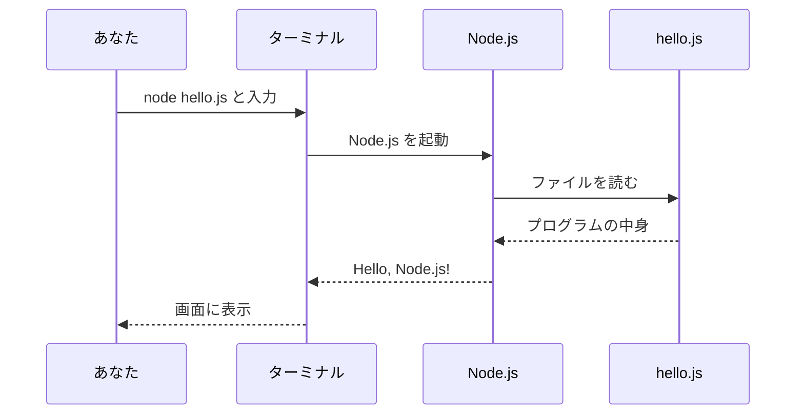

# 第1回　基本文法①　変数・型・条件分岐・繰り返し

## 1. 今日のゴール

- `node ファイル名` でJavaScriptのプログラムを実行できる
- 変数（`let` / `const`）とテンプレートリテラルを使って、値を表示できる
- `if` と `for` を使って、FizzBuzzを自分で書ける

## 2. 教科書の該当節

| 節 | 見出し | 読み方 |
|---|---|---|
| 1.1 | Node.jsの言語としての特徴 | 導入として読む |
| 1.2 | フロントエンド／バックエンドの両方に必要となったNode.js | 導入として読む |
| 2.1 | 開発環境の導入 | 今日の「準備」に当たる |
| 2.2 | JavaScript基礎 | 今日の中心。第4回まで少しずつ進める |

教科書の目次の中で、今日の場所はここ（★が今日）。

| 章・節 | 見出し | この授業では |
|---|---|---|
| **1章** | **はじめてのNode.js** | |
| 1.1 | Node.jsの言語としての特徴 | ★ 今日（導入） |
| 1.2 | フロントエンド／バックエンドの両方に必要となったNode.js | ★ 今日（導入） |
| **2章** | **JavaScript/Node.jsの文法** | |
| 2.1 | 開発環境の導入 | ★ 今日 |
| 2.2 | JavaScript基礎 | ★ 今日〜第4回 |
| 2.3 | JavaScriptと継承 | 扱わない |
| 2.4 | JavaScriptとthis | 第4回（紹介のみ） |
| 2.5 | ES2015以降の重要文法 | 第4・5回 |

今日の教材の各部分と教科書の対応：

| 教材 | 内容 | 教科書 |
|---|---|---|
| 4.1、4.2 | 準備、はじめてのプログラム | 2.1 |
| 4.3 | シーケンス図 | 教科書にない（補足） |
| 4.4〜4.10 | 変数、型、テンプレートリテラル、条件分岐、繰り返し | 2.2 |

## 3. これまでのふりかえり

以前の授業で習ったJavaScriptを思い出そう。まずは動かさずに、頭の中で答えを考える。

**Q1.** 次のプログラムを実行すると、何が表示されるか。

```js
let x = 3;
x = x + 2;
console.log(x);
```

**Q2.** 次のプログラムを実行すると、何が表示されるか。

```js
const age = 20;
if (age >= 18) {
  console.log("大人");
} else {
  console.log("子ども");
}
```

答えは授業の中で確認する。迷った人は、今日の内容でもう一度ていねいに学び直すので心配しなくてよい。

---

## 4. 解説と例題

### 4.1 準備：Node.jsを確認する

VS Codeを開き、メニューの「ターミナル」→「新しいターミナル」でターミナルを出す。次のコマンドを入力して Enter を押す。

```powershell
node --version
```

`v24.15.0` のように、`v24` で始まるバージョンの番号が表示されればよい（後ろの数字は違っていてよい）。

次に、この授業用のフォルダを作り、VS Codeの「ファイル」→「フォルダーを開く」で開く。今日のファイルは、その中に `lesson01` フォルダを作り、そこに自分で入力して作っていく。

例題の完成したコードは、この教材と同じ場所の `examples` フォルダに入っている。うまく動かないときに、自分のコードと見比べるために使う。

> **図を見るための準備**
> この教材には図が入っている。VS Codeで図を表示するには、拡張機能「Markdown Preview Mermaid Support」を入れる。
> 左端の拡張機能アイコンを押し、名前で検索して「インストール」を押す。
> 教材のファイルを開いて `Ctrl + Shift + V` を押すと、図の入ったプレビューが表示される。

### 4.2 はじめてのプログラム

`hello.js` というファイルを作り、次のように書いて保存する。

```js
console.log("Hello, Node.js!");
console.log(1 + 2);
```

ターミナルで実行する。

```powershell
node hello.js
```

実行結果：

```
Hello, Node.js!
3
```

- `console.log( )` は、かっこの中の値を画面に表示する命令
- 文字は `"` で囲む。数値は囲まない
- 文の終わりには `;` を付ける

**動かしてみよう**：`"Hello, Node.js!"` を自分の名前に変えて、もう一度実行する。

> **うまくいかないとき**
> `Cannot find module` と出たら、ファイルのある場所とターミナルの場所がずれている。ターミナルの左側に表示されているフォルダ名を確認しよう。
> 何も変わらないときは、ファイルを保存し忘れていることが多い（`Ctrl + S`）。

### 4.3 プログラムが動くまでの流れ（シーケンス図）

`node hello.js` と入力してから画面に文字が出るまでを、図にするとこうなる。



この形の図を**シーケンス図**という。これから毎回のように出てくるので、読み方を覚えよう。

| 図の部品 | 意味 |
|---|---|
| 上に並んだ四角 | 登場人物（人、プログラム、ファイルなど） |
| 四角から下にのびる縦線 | 時間の流れ。**上から下へ**進む |
| 実線の矢印 | 「これをして」というお願い |
| 点線の矢印 | お願いに対する返事 |
| 矢印の上の文字 | 何をお願いしたか、何を返したか |

読むときは、矢印を上から順に1本ずつ追っていく。

### 4.4 変数：`const` と `let`

変数は、値に名前を付けてしまっておく箱のようなもの。

`variables.js`

```js
const name = "佐藤";
let score = 70;

console.log(name);
console.log(score);

score = 85; // let で作った変数は、あとから入れ直せる
console.log(score);

// name = "鈴木"; // const で作った変数は入れ直せない（先頭の // を消して試してみよう）
```

実行結果：

```
佐藤
70
85
```

| 書き方 | 入れ直し | 使いどころ |
|---|---|---|
| `const` | できない | ふだんはこちらを使う |
| `let` | できる | 合計や回数など、途中で値が変わるもの |

`//` から行の終わりまでは**コメント**で、プログラムとしては無視される。

**動かしてみよう**：最後の行の先頭にある `//` を消して実行する。どんなエラーが出るか見てみよう。

> エラーメッセージは敵ではなく、ヒント。`Assignment to constant variable.` は「constの変数に入れ直そうとした」という意味。

### 4.5 値の種類（型）

値には種類がある。今日は3つ覚える。

| 型 | 例 | 説明 |
|---|---|---|
| 数値（number） | `120`、`3.14` | 計算に使う |
| 文字列（string） | `"りんご"`、`"10"` | `"` で囲んだ文字 |
| 真偽値（boolean） | `true`、`false` | 「はい」か「いいえ」 |

`types.js`

```js
const price = 120; // 数値
const item = "りんご"; // 文字列
const inStock = true; // 真偽値（true か false）

console.log(typeof price);
console.log(typeof item);
console.log(typeof inStock);

// 数値どうしの + は足し算
console.log(10 + 5);

// 文字列が混ざると、+ は「つなげる」になる
console.log("10" + 5);

// 文字列を数値に直してから足す
console.log(Number("10") + 5);
```

**予想してみよう**：実行する前に、6行の表示を予想する。特に `"10" + 5` は何になるだろうか。

<details>
<summary>実行結果を見る</summary>

```
number
string
boolean
15
105
15
```

`"10"` は文字列なので、`"10" + 5` は足し算ではなく「つなげる」になり、`105` と表示される。

</details>

計算に使う記号：

| 記号 | 意味 | 例 | 結果 |
|---|---|---|---|
| `+` | 足す | `7 + 2` | `9` |
| `-` | 引く | `7 - 2` | `5` |
| `*` | 掛ける | `7 * 2` | `14` |
| `/` | 割る | `7 / 2` | `3.5` |
| `%` | 割った余り | `7 % 2` | `1` |

`%`（余り）は今日のFizzBuzzで使う。

### 4.6 テンプレートリテラル

文字と変数を組み合わせて表示したいときに使う。

`template.js`

```js
const name = "佐藤";
const score = 85;

// + でつなげる書き方
console.log(name + "さんの点数は" + score + "点です");

// テンプレートリテラル（` で囲み、${ } の中に変数を書く）
console.log(`${name}さんの点数は${score}点です`);

// ${ } の中には計算も書ける
console.log(`あと${100 - score}点で満点です`);
```

実行結果：

```
佐藤さんの点数は85点です
佐藤さんの点数は85点です
あと15点で満点です
```

- 囲む記号は `"` ではなく `` ` ``（バッククォート）。キーボードでは `Shift + @`
- 変数を入れたい場所に `${変数名}` と書く

この授業では、文字と変数を組み合わせるときはテンプレートリテラルを使う。

### 4.7 条件分岐：`if` / `else`

条件によって、することを変える。

`if.js`

```js
const score = 72;

if (score >= 80) {
  console.log("よくできました");
} else if (score >= 60) {
  console.log("合格です");
} else {
  console.log("もう少しがんばろう");
}
```

実行結果：

```
合格です
```

- 条件は**上から順に**調べられ、最初に当てはまったところだけが実行される
- どれにも当てはまらないときは `else` が実行される

比べるときの記号：

| 記号 | 意味 |
|---|---|
| `>` / `<` | より大きい／より小さい |
| `>=` / `<=` | 以上／以下 |
| `===` | 等しい |
| `!==` | 等しくない |

**動かしてみよう**：`score` を 95 や 40 に変えて、表示が変わることを確かめる。

### 4.8 「等しい」は `===` を使う

`equals.js`

```js
const a = 10; // 数値
const b = "10"; // 文字列

console.log(a === b); // 型も値も同じか
console.log(a == b); // 型をそろえてから比べる（思わぬ結果になりやすい）

console.log(a === 10);
console.log(a !== 10); // !== は「等しくない」
```

実行結果：

```
false
true
true
false
```

`==` は数値の `10` と文字列の `"10"` を「等しい」と判断してしまう。まちがいの元になるので、この授業では**いつも `===` を使う**。

`=` が1つだけのときは「比べる」ではなく「入れる」の意味になる。`if (score = 80)` と書くまちがいに注意しよう。

### 4.9 繰り返し：`for`

同じことを何回も繰り返す。

`for.js`

```js
for (let i = 1; i <= 5; i++) {
  console.log(`${i}回目`);
}

// 1から10までの合計を求める
let total = 0;
for (let i = 1; i <= 10; i++) {
  total = total + i;
}
console.log(`合計は${total}`);
```

実行結果：

```
1回目
2回目
3回目
4回目
5回目
合計は55
```

`for` のかっこの中は、`;` で3つに分かれている。

| 部分 | 書いてあること | 意味 |
|---|---|---|
| `let i = 1` | はじめに | `i` を 1 から始める |
| `i <= 5` | 続ける条件 | `i` が 5 以下の間は繰り返す |
| `i++` | 1回終わるごとに | `i` を 1 増やす |

後半は、繰り返しながら合計を求めている。`total` は途中で値が変わるので、`const` ではなく `let` で作る。

### 4.10 繰り返し：`while`

回数が決まっていないときは `while` を使う。条件が成り立っている間、繰り返す。

`while.js`

```js
// 100を2で割り続けて、1より小さくなるまでの回数を数える
let value = 100;
let count = 0;

while (value >= 1) {
  value = value / 2;
  count++;
}

console.log(`${count}回割りました`);
```

実行結果：

```
7回割りました
```

> **注意**：条件がずっと成り立ったままだと、プログラムが終わらなくなる（無限ループ）。止まらなくなったら、ターミナルで `Ctrl + C` を押して止める。

---

## 5. 図を読む問題

4.3 のシーケンス図を見て答えよう。

1. 登場人物は全部でいくつあるか。
2. Node.js が `hello.js` にお願いしていることは何か。
3. `Hello, Node.js!` という文字は、どこからどこへ渡されているか。矢印を順にたどって答えよう。
4. 実線の矢印と点線の矢印は、それぞれ何本あるか。

---

## 6. 演習（基本）

ファイルは問題ごとに新しく作る。できたら実行して、表示を確かめること。

### 問1　自己紹介（`q1-intro.js`）

自分の名前・年齢・趣味を変数に入れ、テンプレートリテラルを使って次の形で表示する。3行目の「来年の年齢」は、計算で求めること。

```
私の名前は佐藤です。
年齢は19歳で、趣味はゲームです。
来年は20歳になります。
```

### 問2　点数から評価を求める（`q2-grade.js`）

変数 `score` に点数を入れ、次の表のとおりに評価を表示する。

| 点数 | 評価 |
|---|---|
| 80点以上 | A |
| 70点以上80点未満 | B |
| 60点以上70点未満 | C |
| 60点未満 | D |

```
75点の評価はBです
```

`score` を 80、79、60、59 に変えて、4つの評価がすべて正しく出ることを確かめる。

### 問3　九九の7の段（`q3-kuku7.js`）

`for` を使って、7の段を表示する。

```
7 × 1 = 7
7 × 2 = 14
（中略）
7 × 9 = 63
```

### 問4　FizzBuzz（`q4-fizzbuzz.js`）

1 から 30 までの数を順に表示する。ただし、

- 3 で割り切れる数のときは、数の代わりに `Fizz`
- 5 で割り切れる数のときは、数の代わりに `Buzz`
- 3 でも 5 でも割り切れる数のときは、数の代わりに `FizzBuzz`

を表示する。

```
1
2
Fizz
4
Buzz
（中略）
14
FizzBuzz
16
```

ヒント：

- 「3 で割り切れる」は「3 で割った余りが 0」と同じ。`i % 3 === 0` と書ける
- `if` は上から順に調べられる。どの条件を最初に書くかがポイント

---

## 7. 演習（発展）

基本が終わった人は挑戦しよう。

### 発展1　九九の表（`x1-kuku-table.js`）

1の段から9の段までを、次のような表の形で表示する。

```
  1  2  3  4  5  6  7  8  9
  2  4  6  8 10 12 14 16 18
（中略）
  9 18 27 36 45 54 63 72 81
```

ヒント：

- `for` の中に `for` を書く（外側が段、内側が掛ける数）
- 1行分の文字を変数にためてから、`console.log` で表示する
- `String(数値).padStart(3)` と書くと、数値を3文字分の幅にそろえた文字列になる

### 発展2　貯金のシミュレーション（`x2-savings.js`）

毎月 8,000 円ずつ貯金する。さらに、6か月ごと（6か月目、12か月目…）にボーナスとして 20,000 円を追加で貯金する。貯金が 100,000 円以上になるのは何か月目か。`while` を使って求め、次の形で表示する。

```
○か月目に○○円になりました
```

---

## 8. まとめ

今日のキーワード：

| キーワード | ひとこと |
|---|---|
| `node ファイル名` | プログラムを実行する |
| `console.log( )` | 値を表示する |
| `const` / `let` | 変数を作る。ふだんは `const`、値が変わるものは `let` |
| 型 | 数値・文字列・真偽値 |
| `` `${ }` `` | テンプレートリテラル。文字に変数を入れる |
| `if` / `else if` / `else` | 条件で分ける。上から順に調べる |
| `===` | 等しいかを比べる（`==` は使わない） |
| `for` / `while` | 繰り返す |
| シーケンス図 | 上から下へ、矢印を1本ずつ読む |

**次回**：関数の定義と呼び出し。今日書いた「評価を求める処理」を、何度でも使える部品にする。
