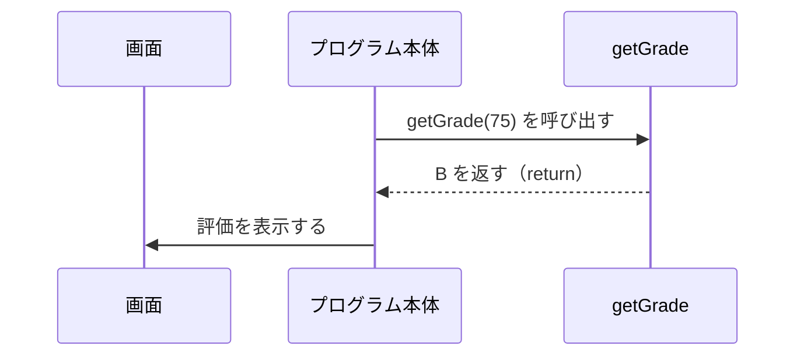

# 第2回　基本文法②　関数の定義と呼び出し

## 1. 今日のゴール

- `function` で関数を作り、呼び出せる
- 引数で値を渡し、`return` で値を受け取れる
- 「表示する関数」と「値を返す関数」を見分けられる

## 2. 教科書の該当節

| 節 | 見出し | 読み方 |
|---|---|---|
| 2.2 | JavaScript基礎 | 前回の続き。今日は関数の部分 |

教科書の目次の中で、今日の場所はここ（★が今日）。

| 章・節 | 見出し | この授業では |
|---|---|---|
| **2章** | **JavaScript/Node.jsの文法** | |
| 2.1 | 開発環境の導入 | 第1回 |
| 2.2 | JavaScript基礎 | ★ 今日（第1〜4回で進める） |
| 2.3 | JavaScriptと継承 | 扱わない |
| 2.4 | JavaScriptとthis | 第4回（紹介のみ） |
| 2.5 | ES2015以降の重要文法 | 第4・5回 |

今日の教材の各部分と教科書の対応：

| 教材 | 内容 | 教科書 |
|---|---|---|
| 4.1〜4.7 | 関数の定義、呼び出し、引数、戻り値、スコープ | 2.2 |
| 4.5 のシーケンス図 | 関数の呼び出しと戻り値の流れ | 教科書にない（補足） |

今日は `function` を使った書き方だけを扱う。教科書に出てくる `=>`（アロー関数）は第4回で学ぶ。

## 3. 前回のふりかえり

動かさずに、頭の中で答えを考えよう。

**Q1.** 次のプログラムを実行すると、何が表示されるか。

```js
const name = "田中";
const age = 18;
console.log(`${name}さんは来年${age + 1}歳`);
```

**Q2.** 次のプログラムを実行すると、何が表示されるか。

```js
for (let i = 1; i <= 3; i++) {
  console.log(i * 2);
}
```

---

## 4. 解説と例題

今日のファイルは、授業用フォルダの中に `lesson02` フォルダを作り、そこに自分で入力して作っていく。例題の完成したコードは `examples` フォルダに入っている。

### 4.1 関数とは：処理に名前を付けてまとめる

前回、点数から評価を求めるプログラムを書いた。3人分の評価を求めたいとき、同じ `if` を3回書くのは大変で、まちがいも起きやすい。

**関数**は、ひとまとまりの処理に名前を付けたもの。一度作っておけば、名前を書くだけで何度でも使える。

実は、これまで使ってきた `console.log( )` も関数である。今日は関数を自分で作る。

### 4.2 関数を作る・呼び出す

`greet.js`

```js
function greet() {
  console.log("こんにちは");
  console.log("今日もがんばろう");
}

greet();
greet();
```

実行結果：

```
こんにちは
今日もがんばろう
こんにちは
今日もがんばろう
```

| 部分 | 意味 |
|---|---|
| `function greet() { ... }` | 関数を**作る**（定義する）。`greet` が関数の名前 |
| `{ }` の中 | 関数がする処理 |
| `greet();` | 関数を**呼び出す**。ここで初めて中の処理が動く |

大事な点が2つある。

- 関数は、作っただけでは動かない。呼び出して初めて動く
- 一度作れば、何度でも呼び出せる

**動かしてみよう**：最後の2行（`greet();`）を消して実行する。何も表示されないことを確かめよう。

### 4.3 引数：関数に値を渡す

呼び出すときに値を渡すと、関数の中でその値を使える。渡す値を**引数**（ひきすう）という。

`args.js`

```js
function greet(name) {
  console.log(`こんにちは、${name}さん`);
}

greet("佐藤");
greet("鈴木");

function showTotal(price, count) {
  console.log(`合計は${price * count}円です`);
}

showTotal(120, 3);
```

実行結果：

```
こんにちは、佐藤さん
こんにちは、鈴木さん
合計は360円です
```

- `greet("佐藤")` と呼び出すと、関数の中の `name` に `"佐藤"` が入る
- 引数は `,` で区切って2つ以上渡せる。`showTotal(120, 3)` では `price` に 120、`count` に 3 が、**書いた順番どおりに**入る

**動かしてみよう**：`showTotal(3, 120)` と順番を逆にするとどうなるか。`showTotal(120)` と1つだけ渡すとどうなるか。

> 1つだけ渡すと `合計はNaN円です` と表示される。`NaN` は「数として計算できなかった」という印。渡されなかった `count` に値が入っていないために起きる。引数の数は、関数を作ったときの数に合わせよう。

### 4.4 戻り値：関数から値を受け取る

関数は、計算した結果を呼び出した側に返すことができる。返す値を**戻り値**（もどりち）といい、`return` で返す。

`return.js`

```js
function add(a, b) {
  return a + b;
}

const result = add(3, 5);
console.log(result);

console.log(add(10, 20));
```

実行結果：

```
8
30
```

- `return a + b;` は「`a + b` の結果を、呼び出した側に返す」という意味
- `add(3, 5)` と書いた場所が、戻り値の `8` に置き換わると考えるとよい。つまり `const result = add(3, 5);` は `const result = 8;` と同じになる
- 戻り値は、変数に入れても、そのまま `console.log( )` に渡してもよい

### 4.5 評価を求める関数を作る

前回の「点数から評価を求める処理」を関数にする。

`grade.js`

```js
function getGrade(score) {
  if (score >= 80) {
    return "A";
  } else if (score >= 70) {
    return "B";
  } else if (score >= 60) {
    return "C";
  } else {
    return "D";
  }
}

const grade = getGrade(75);
console.log(`75点の評価は${grade}です`);

console.log(`90点の評価は${getGrade(90)}です`);
console.log(`55点の評価は${getGrade(55)}です`);
```

実行結果：

```
75点の評価はBです
90点の評価はAです
55点の評価はDです
```

`if` を書いたのは1回だけなのに、3人分の評価を求められた。これが関数の便利なところである。

次の2行で起きていることを、シーケンス図で見てみよう。

```js
const grade = getGrade(75);
console.log(`75点の評価は${grade}です`);
```

1行目が上の2本の矢印、2行目がいちばん下の矢印に当たる。



- プログラム本体が `getGrade` に 75 を渡して、仕事をお願いしている（実線の矢印）
- `getGrade` は評価を求め、`"B"` を返事として返している（点線の矢印）
- 画面に表示しているのは `getGrade` ではなく、プログラム本体である

### 4.6 「表示する」と「返す」は違う

`console.log( )` は画面に**表示する**だけ。`return` は呼び出した側に値を**返す**。この2つはまったく別のものである。

`difference.js`

```js
// 表示するだけの関数（戻り値がない）
function showDouble(n) {
  console.log(n * 2);
}

// 値を返す関数（戻り値がある）
function getDouble(n) {
  return n * 2;
}

const a = showDouble(5);
const b = getDouble(5);

console.log(a);
console.log(b);
console.log(b + 1);
```

**予想してみよう**：実行する前に、表示される4行を予想する。

<details>
<summary>実行結果を見る</summary>

```
10
undefined
10
11
```

- 1行目の `10` は、`showDouble(5)` の中の `console.log` が表示したもの
- `showDouble` には `return` がないので、何も返ってこない。そのため `a` の中身は `undefined`（値がない、という意味）になる
- `getDouble` は `10` を返すので、`b` には `10` が入り、続けて計算にも使える

</details>

| | 表示する関数 | 値を返す関数 |
|---|---|---|
| 中で使うもの | `console.log( )` | `return` |
| 結果を変数に入れられるか | 入れられない（`undefined` になる） | 入れられる |
| 結果を次の計算に使えるか | 使えない | 使える |

迷ったら「値を返す関数」にしておくと、あとで使い回しやすい。

### 4.7 スコープ：変数が使える範囲

関数の中で作った変数は、その関数の中でしか使えない。変数が使える範囲を**スコープ**という。

`scope.js`

```js
const taxRate = 10; // 関数の外で作った変数（消費税率 %）

function getPrice(price) {
  const total = price + (price * taxRate) / 100; // 関数の中で作った変数
  return total;
}

console.log(getPrice(1000));
console.log(taxRate);

// console.log(total); // 関数の中の変数は外から使えない（先頭の // を消して試してみよう）
```

実行結果：

```
1100
10
```

| 変数 | 作った場所 | 使える場所 |
|---|---|---|
| `taxRate` | 関数の外 | 関数の中でも外でも使える |
| `total`、`price` | 関数の中（引数も同じ） | その関数の中だけ |

**動かしてみよう**：最後の行の先頭にある `//` を消して実行する。`total is not defined`（total という変数は見つからない）というエラーが出ることを確かめよう。

関数の中の値を外で使いたいときは、`return` で返して受け取る。

---

## 5. 図を読む問題

4.5 のシーケンス図を見て答えよう。

1. プログラム本体が `getGrade` に渡している値は何か。
2. `getGrade` からプログラム本体に戻ってくる値は何か。
3. 画面に文字を表示するようお願いしているのは、プログラム本体と `getGrade` のどちらか。
4. `getGrade(90)` を呼び出したときの図にするには、どの矢印の文字をどう変えればよいか。

---

## 6. 演習（基本）

ファイルは問題ごとに新しく作る。

### 問1　あいさつの関数（`q1-morning.js`）

名前を受け取って、次のように表示する関数 `morning` を作る。作った関数を、名前を変えて3回呼び出すこと。

```
佐藤さん、おはようございます
鈴木さん、おはようございます
高橋さん、おはようございます
```

### 問2　面積を返す関数（`q2-area.js`）

縦と横の長さを受け取り、長方形の面積を**返す**関数 `getArea` を作る。戻り値を変数に受け取ってから、次のように表示する。

```
縦3、横5の面積は15です
```

関数の中に `console.log` を書かないこと。

### 問3　評価を求める処理を関数にする（`q3-grade.js`）

`exercises/q3-grade-starter.js` は、前回の問2（点数から評価を求める）のプログラムである。これを自分のフォルダにコピーし、点数を受け取って評価を返す関数 `getGrade` に作り直す。

作った関数を4回呼び出して、次のように表示する。

```
80点の評価はAです
79点の評価はBです
60点の評価はCです
59点の評価はDです
```

### 問4　表示する関数と返す関数（`q4-which.js`）

`exercises/q4-which.js` を開き、**実行する前に**3行の表示を予想してノートに書く。そのあと実行して、予想と比べる。

予想と違ったところがあれば、なぜそうなるのかを 4.6 に戻って確かめよう。

---

## 7. 演習（発展）

### 発展1　FizzBuzzを関数にする（`x1-fizzbuzz.js`）

数を1つ受け取り、次の値を**返す**関数 `fizzBuzz` を作る。

- 3 でも 5 でも割り切れるときは `"FizzBuzz"`
- 3 で割り切れるときは `"Fizz"`
- 5 で割り切れるときは `"Buzz"`
- それ以外は、受け取った数そのもの

`for` で 1 から 15 までこの関数を呼び出し、戻り値を表示する。

### 発展2　関数から関数を呼ぶ（`x2-receipt.js`）

次の3つの関数を作る。

| 関数 | 受け取るもの | 返すもの |
|---|---|---|
| `getSubtotal(price, count)` | 値段と個数 | 小計（値段 × 個数） |
| `addTax(amount)` | 金額 | 10% の消費税を足した金額 |
| `getTotal(price, count)` | 値段と個数 | 税込みの合計。**中で上の2つの関数を呼び出して**求める |

`getTotal(120, 3)` を呼び出して、次のように表示する。

```
税込みの合計は396円です
```

---

## 8. まとめ

| キーワード | ひとこと |
|---|---|
| `function 名前( ) { }` | 関数を作る（定義する） |
| `名前( )` | 関数を呼び出す。呼び出して初めて動く |
| 引数 | 関数に渡す値。書いた順番どおりに入る |
| `return` | 呼び出した側に値を返す |
| 戻り値 | 関数から返ってきた値 |
| `undefined` | 値がない。`return` のない関数の結果を受け取るとこうなる |
| スコープ | 変数が使える範囲。関数の中の変数は外から使えない |

**次回**：配列（リスト）・オブジェクト・JSON。たくさんのデータをまとめて扱う。今日作った関数も引き続き使う。
