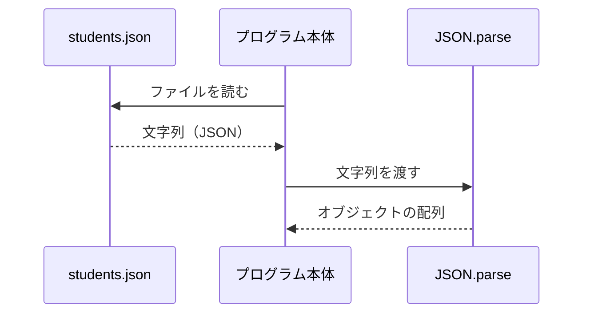

# 第3回　配列（リスト）・オブジェクト・JSON

## 1. 今日のゴール

- 配列を作り、`for` で1つずつ取り出して処理できる
- オブジェクトを作り、`.` で項目を取り出せる
- JSONファイルを読み込んで、名簿の一覧や合計を表示できる

## 2. 教科書の該当節

| 節 | 見出し | 読み方 |
|---|---|---|
| 2.2 | JavaScript基礎 | 配列とオブジェクトの部分。Column「ObjectとJSON」もあわせて読む |

教科書の目次の中で、今日の場所はここ（★が今日）。

| 章・節 | 見出し | この授業では |
|---|---|---|
| **2章** | **JavaScript/Node.jsの文法** | |
| 2.1 | 開発環境の導入 | 第1回 |
| 2.2 | JavaScript基礎 | ★ 今日（第1〜4回で進める） |
| 2.3 | JavaScriptと継承 | 扱わない |
| 2.4 | JavaScriptとthis | 第4回（紹介のみ） |
| 2.5 | ES2015以降の重要文法 | 第4・5回 |

今日の教材の各部分と教科書の対応：

| 教材 | 内容 | 教科書 |
|---|---|---|
| 4.1〜4.5 | 配列、オブジェクト、オブジェクトの配列 | 2.2 |
| 4.6 | JSON | 2.2 の Column「ObjectとJSON」 |
| 4.7 | JSONファイルの読み込み、シーケンス図 | 教科書にない（補足） |

今日は配列を `for` で処理する。教科書に出てくる `forEach` や `map` は、アロー関数と一緒に第4回で学ぶ。

## 3. 前回のふりかえり

動かさずに、頭の中で答えを考えよう。

**Q1.** 次のプログラムを実行すると、何が表示されるか。

```js
function double(n) {
  return n * 2;
}

console.log(double(4) + 1);
```

**Q2.** 次のプログラムを実行すると、何が表示されるか（2行）。

```js
function hello(name) {
  console.log(`${name}さん、こんにちは`);
}

const result = hello("佐藤");
console.log(result);
```

---

## 4. 解説と例題

今日のファイルは、授業用フォルダの中に `lesson03` フォルダを作り、そこに自分で入力して作っていく。例題の完成したコードは `examples` フォルダに入っている。

### 4.1 配列：値を並べてまとめる

3人分の点数を扱うのに、`score1`、`score2`、`score3` と変数を増やしていくのは大変である。**配列**を使うと、たくさんの値を1つの変数にまとめられる。Javaの配列や `ArrayList` に当たるものである。

`array.js`

```js
const fruits = ["りんご", "みかん", "ぶどう"];

console.log(fruits);
console.log(fruits[0]);
console.log(fruits[2]);
console.log(fruits.length);
```

実行結果：

```
[ 'りんご', 'みかん', 'ぶどう' ]
りんご
ぶどう
3
```

- 配列は `[ ]` の中に、値を `,` で区切って並べる
- 取り出すときは `fruits[番号]` と書く。**番号は 0 から始まる**
- `fruits.length` で、入っている個数が分かる

| 番号 | 0 | 1 | 2 |
|---|---|---|---|
| 中身 | りんご | みかん | ぶどう |

**動かしてみよう**：`fruits[3]` を表示するとどうなるか。前回出てきた言葉が表示されるはずである。

### 4.2 配列に追加する・入れ替える

`array-change.js`

```js
const fruits = ["りんご", "みかん", "ぶどう"];

fruits.push("もも"); // 最後に追加する
console.log(fruits);

fruits[1] = "バナナ"; // 1番の中身を入れ替える
console.log(fruits);

fruits.pop(); // 最後の1つを取り除く
console.log(fruits);
console.log(fruits.length);
```

実行結果：

```
[ 'りんご', 'みかん', 'ぶどう', 'もも' ]
[ 'りんご', 'バナナ', 'ぶどう', 'もも' ]
[ 'りんご', 'バナナ', 'ぶどう' ]
3
```

| 書き方 | すること |
|---|---|
| `fruits.push(値)` | 最後に追加する |
| `fruits[番号] = 値` | その番号の中身を入れ替える |
| `fruits.pop()` | 最後の1つを取り除く |

`const` で作った配列でも、中身の追加や入れ替えはできる。`const` が禁止しているのは、`fruits = [...]` のように配列そのものを別のものに入れ直すことだけである。

### 4.3 配列を順番に処理する

配列は `for` と組み合わせて使うことが多い。

`loop.js`

```js
const scores = [70, 85, 60];

// for で番号を使って取り出す
for (let i = 0; i < scores.length; i++) {
  console.log(`${i}番は${scores[i]}点`);
}

// for...of で1つずつ取り出す
let total = 0;
for (const score of scores) {
  total = total + score;
}
console.log(`合計は${total}点`);
```

実行結果：

```
0番は70点
1番は85点
2番は60点
合計は215点
```

書き方は2つある。

| 書き方 | 特徴 |
|---|---|
| `for (let i = 0; i < scores.length; i++)` | 番号 `i` を使える。`i` は 0 から始め、条件は `<`（`<=` ではない） |
| `for (const score of scores)` | 中身を先頭から1つずつ `score` に入れてくれる。番号がいらないときはこちらが楽 |

**動かしてみよう**：1つ目の `for` の条件を `i <= scores.length` に変えて実行する。何が起きるか確かめよう。

### 4.4 オブジェクト：項目に名前を付けてまとめる

1人の学生には、名前や点数など、いくつかの情報がある。**オブジェクト**を使うと、関係のある値を、名前を付けて1つにまとめられる。Javaでいえば、フィールドだけを持つクラスのインスタンスや `Map` に近い。

`object.js`

```js
const student = {
  name: "佐藤",
  score: 70,
};

console.log(student);
console.log(student.name);
console.log(student.score);

student.score = 85; // 値を変える
student.club = "テニス"; // 新しい項目を足す
console.log(student);
```

実行結果：

```
{ name: '佐藤', score: 70 }
佐藤
70
{ name: '佐藤', score: 85, club: 'テニス' }
```

- オブジェクトは `{ }` の中に、`名前: 値` を `,` で区切って並べる
- 取り出すときは `student.name` のように `.` でつなぐ
- 値を変えることも、あとから項目を足すこともできる

配列とオブジェクトの違い：

| | 配列 | オブジェクト |
|---|---|---|
| 囲む記号 | `[ ]` | `{ }` |
| 取り出し方 | 番号で：`fruits[0]` | 名前で：`student.name` |
| 向いているもの | 同じ種類のものを並べる | 1つのものの、いろいろな情報 |

### 4.5 オブジェクトの配列：名簿を作る

配列の中にオブジェクトを並べると、名簿のようなデータを表せる。これからExpressやデータベースで扱うデータは、ほとんどがこの形である。

`students.js`

```js
const students = [
  { name: "佐藤", score: 70 },
  { name: "鈴木", score: 85 },
  { name: "高橋", score: 55 },
];

console.log(students.length);
console.log(students[1].name);

// 一覧表示
for (const student of students) {
  console.log(`${student.name}さん：${student.score}点`);
}

// 合計と平均
let total = 0;
for (const student of students) {
  total = total + student.score;
}
console.log(`合計は${total}点、平均は${total / students.length}点`);
```

実行結果：

```
3
鈴木
佐藤さん：70点
鈴木さん：85点
高橋さん：55点
合計は210点、平均は70点
```

- `students[1]` は2人目のオブジェクト。その名前は `students[1].name`
- `for (const student of students)` と書くと、`student` に1人分のオブジェクトが順番に入る

変数の名前を、配列は複数形（`students`）、1つ分は単数形（`student`）にしておくと読みやすい。

### 4.6 JSON：データを文字列で表す決まり

**JSON**（ジェイソン）は、データを文字列で書き表すための決まりである。見た目はJavaScriptのオブジェクトや配列とほとんど同じで、ファイルに保存したり、ネットワークで送ったりするときに使う。

`json.js`

```js
const student = { name: "佐藤", score: 70 };

// オブジェクト → JSON（文字列）
const text = JSON.stringify(student);
console.log(text);
console.log(typeof text);

// JSON（文字列） → オブジェクト
const data = JSON.parse(text);
console.log(data.name);
console.log(typeof data);
```

実行結果：

```
{"name":"佐藤","score":70}
string
佐藤
object
```

| 関数 | 変換の向き |
|---|---|
| `JSON.stringify(オブジェクト)` | オブジェクト → JSONの文字列 |
| `JSON.parse(文字列)` | JSONの文字列 → オブジェクト |

大事なのは、**JSONはただの文字列**だということ。文字列のままでは `text.name` のように項目を取り出せない。`JSON.parse` でオブジェクトに直して、初めて取り出せるようになる。

JSONの書き方は、JavaScriptのオブジェクトより少しきびしい。

- 項目の名前を `"` で囲む（`"name": "佐藤"`）
- 文字列は `"` で囲む（`'` は使えない）
- 最後の項目の後ろに `,` を付けない

### 4.7 JSONファイルを読み込む

名簿をJSONファイルにしておき、プログラムから読み込む。

`students.json`

```json
[
  { "name": "佐藤", "score": 70 },
  { "name": "鈴木", "score": 85 },
  { "name": "高橋", "score": 55 },
  { "name": "田中", "score": 90 }
]
```

`read-json.js`

```js
const fs = require("fs"); // ファイルを扱うための決まり文句（くわしくは第9回）

const text = fs.readFileSync("students.json", "utf8"); // ファイルの中身を文字列として読む
const students = JSON.parse(text); // 文字列をオブジェクトの配列に直す

console.log(`${students.length}人のデータを読み込みました`);
for (const student of students) {
  console.log(`${student.name}さん：${student.score}点`);
}
```

実行結果：

```
4人のデータを読み込みました
佐藤さん：70点
鈴木さん：85点
高橋さん：55点
田中さん：90点
```

`students.json` と `read-json.js` は同じフォルダに置き、そのフォルダで実行すること。

1行目の `require("fs")` は、今は「ファイルを読むための決まり文句」と思っておけばよい。仕組みは第9回で学ぶ。

読み込みの2行で起きていることを、シーケンス図で見てみよう。

```js
const text = fs.readFileSync("students.json", "utf8");
const students = JSON.parse(text);
```



- 1行目が上の2本の矢印。ファイルから返ってくるのは**文字列**である
- 2行目が下の2本の矢印。`JSON.parse` が文字列を**オブジェクトの配列**に直して返す

この「文字列で受け取り、オブジェクトに直して使う」流れは、第7回でネットワークからデータを取ってくるときにも、そのまま出てくる。

---

## 5. 図を読む問題

4.7 のシーケンス図を見て答えよう。

1. プログラム本体が `students.json` から受け取るものは何か。
2. プログラム本体が `JSON.parse` に渡すものは何か。
3. `JSON.parse` から返ってくるものは何か。
4. `student.name` のように項目を取り出せるようになるのは、何本目の矢印の後か。

---

## 6. 演習（基本）

ファイルは問題ごとに新しく作る。

### 問1　好きな食べ物の配列（`q1-array.js`）

好きな食べ物を3つ入れた配列を作り、次の順に処理する。

1. 先頭の食べ物を表示する
2. 個数を表示する
3. `push` で食べ物を1つ追加する
4. `for` を使って、全部を次の形で表示する

```
カレー
3
1番目：カレー
2番目：ラーメン
3番目：すし
4番目：ピザ
```

ヒント：番号は 0 から始まるので、「○番目」と表示するには `i + 1` を使う。

### 問2　プロフィールのオブジェクト（`q2-object.js`）

名前（`name`）、年齢（`age`）、趣味（`hobby`）を持つオブジェクトを作り、1行目を表示する。そのあと `age` を1増やして、2行目を表示する。

```
佐藤さん（19歳）の趣味はゲームです
来年は20歳になります
```

### 問3　学生名簿（`q3-roster.js`）

次の5人の名簿を、オブジェクトの配列として作る。

| 名前 | 点数 |
|---|---|
| 佐藤 | 70 |
| 鈴木 | 85 |
| 高橋 | 55 |
| 田中 | 90 |
| 伊藤 | 80 |

`for...of` を使って、(1) 一覧、(2) 合計と平均、(3) 80点以上の人の名前、を表示する。

```
佐藤さん：70点
鈴木さん：85点
高橋さん：55点
田中さん：90点
伊藤さん：80点
合計は380点、平均は76点
80点以上の人
鈴木
田中
伊藤
```

### 問4　JSONファイルから読み込む（`q4-json.js`）

`exercises/members.json` を自分のフォルダにコピーする。このファイルを読み込み、問3と同じ3つの処理をする。

問3のプログラムをコピーして、名簿を作っている部分だけを「ファイルから読み込む」形に書き換えればよい。

```
山本さん：65点
中村さん：95点
小林さん：80点
加藤さん：45点
吉田さん：75点
合計は360点、平均は72点
80点以上の人
中村
小林
```

データが変わっても、`for` の部分は1文字も変えなくてよいことを確かめよう。

---

## 7. 演習（発展）

### 発展1　名前で検索する関数（`x1-search.js`）

問3の名簿を使う。名簿と名前を受け取り、その名前の学生のオブジェクトを**返す**関数 `findStudent(list, name)` を作る。見つからなかったときは `null` を返す。

`"鈴木"` と `"山田"` で呼び出して、次のように表示する。

```
鈴木さんは85点です
山田さんは見つかりません
```

ヒント：

- `null` は「何もない」ことを表す値。`return null;` と書ける
- `for...of` の中で名前を比べ、同じだったらその場で `return` する
- 受け取った結果が `null` かどうかは `=== null` で調べる

### 発展2　評価を足してJSONで表示する（`x2-grades.js`）

3人分の名簿を作り、前回の `getGrade` 関数を使って、1人ずつに評価（`grade`）の項目を足す。最後に名簿全体をJSONの文字列にして表示する。

```
[
  {
    "name": "佐藤",
    "score": 70,
    "grade": "B"
  },
  （以下略）
]
```

ヒント：`JSON.stringify(students, null, 2)` と書くと、改行と字下げの入った読みやすいJSONになる。

---

## 8. まとめ

| キーワード | ひとこと |
|---|---|
| 配列 `[ ]` | 値を並べてまとめる。番号は 0 から |
| `.length` | 配列の個数 |
| `push` / `pop` | 最後に追加する／最後を取り除く |
| `for...of` | 配列の中身を1つずつ取り出す |
| オブジェクト `{ }` | 項目に名前を付けてまとめる。`.` で取り出す |
| オブジェクトの配列 | 名簿の形。これからのデータはほとんどこの形 |
| JSON | データを表す文字列の決まり |
| `JSON.stringify` / `JSON.parse` | オブジェクト → 文字列／文字列 → オブジェクト |

**次回**：アロー関数と「関数を渡す」。今日 `for` で書いた処理を、`forEach` / `map` / `filter` という配列の機能で書き直す。
