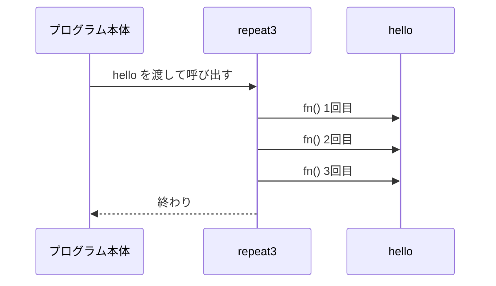

# 第4回　アロー関数と「関数を渡す」

## 1. 今日のゴール

- `function` で書いた関数を、アロー関数に書き換えられる
- 省略して書かれたアロー関数を読める
- 関数を「呼び出す」ことと「渡す」ことの違いを説明できる
- `forEach` / `map` / `filter` で配列を処理できる

## 2. 教科書の該当節

| 節 | 見出し | 読み方 |
|---|---|---|
| 2.2 | JavaScript基礎 | 関数の部分の続き |
| 2.5 | ES2015以降の重要文法 | アロー関数の部分 |
| 2.4 | JavaScriptとthis | 今日は紹介のみ。読まなくてよい |

教科書の目次の中で、今日の場所はここ（★が今日）。

| 章・節 | 見出し | この授業では |
|---|---|---|
| **2章** | **JavaScript/Node.jsの文法** | |
| 2.1 | 開発環境の導入 | 第1回 |
| 2.2 | JavaScript基礎 | ★ 今日（第1〜4回で進める） |
| 2.3 | JavaScriptと継承 | 扱わない |
| 2.4 | JavaScriptとthis | 今日（紹介のみ） |
| 2.5 | ES2015以降の重要文法 | ★ 今日と次回 |

今日の教材の各部分と教科書の対応：

| 教材 | 内容 | 教科書 |
|---|---|---|
| 4.1 | 関数を変数に入れる | 2.2 |
| 4.2、4.3 | アロー関数 | 2.5 |
| 4.4 | 関数を渡す、シーケンス図 | 2.2（図は補足） |
| 4.5、4.6 | forEach / map / filter / find | 2.2 |

## 3. 前回のふりかえり

動かさずに、頭の中で答えを考えよう。

**Q1.** 次のプログラムを実行すると、何が表示されるか（2行）。

```js
const colors = ["赤", "青", "黄"];
colors.push("緑");
console.log(colors[1]);
console.log(colors.length);
```

**Q2.** 次のプログラムを実行すると、何が表示されるか。

```js
const items = [
  { name: "ペン", price: 100 },
  { name: "ノート", price: 200 },
];

let total = 0;
for (const item of items) {
  total = total + item.price;
}
console.log(total);
```

---

## 4. 解説と例題

今日のファイルは `lesson04` フォルダに作る。例題の完成したコードは `examples` フォルダに入っている。

今日学ぶ `=>` を使った書き方を**アロー関数**という。これから学ぶExpressのコードは、ほとんどがアロー関数で書かれている。書けることと同じくらい、**読めること**が大切である。

### 4.1 関数を変数に入れる

JavaScriptでは、関数も数値や文字列と同じ「値」である。だから、変数に入れることができる。

`expr.js`

```js
// 関数宣言（第2回の書き方）
function double(n) {
  return n * 2;
}

// 関数式：関数を作って、変数に入れる
const triple = function (n) {
  return n * 3;
};

console.log(double(5));
console.log(triple(5));
```

実行結果：

```
10
15
```

- 2つ目は、名前のない関数を作り、それを変数 `triple` に入れている
- 呼び出し方は、どちらも同じで `名前( )`
- 関数式は `const triple = ...;` という文なので、最後に `;` が付く

### 4.2 function からアロー関数へ、1段階ずつ

関数式を、4つの段階でだんだん短くしていく。4つとも、まったく同じ働きをする関数である。

`arrow-steps.js`

```js
// (1) 関数式
const double1 = function (n) {
  return n * 2;
};

// (2) function を消して、( ) の後ろに => を付ける
const double2 = (n) => {
  return n * 2;
};

// (3) 中身が return だけなら、{ } と return を省ける
const double3 = (n) => n * 2;

// (4) 引数が1つなら、( ) も省ける
const double4 = n => n * 2;

console.log(double1(5));
console.log(double2(5));
console.log(double3(5));
console.log(double4(5));
```

実行結果：

```
10
10
10
10
```

| 段階 | 書き方 | したこと |
|---|---|---|
| (1) | `function (n) { return n * 2; }` | 出発点（関数式） |
| (2) | `(n) => { return n * 2; }` | `function` を消し、`=>` を付けた |
| (3) | `(n) => n * 2` | `{ }` と `return` を省いた |
| (4) | `n => n * 2` | 引数の `( )` を省いた |

`(n) => n * 2` は「`n` を受け取って、`n * 2` を返す」と読む。`=>` を「を受け取って」と読み替えると分かりやすい。

この授業では、自分で書くときは (2) か (3) の形を使う。(4) は、ほかの人のコードを読むために覚えておく。

> **`this` について**
> `function` とアロー関数には、`this` という言葉の扱いに違いがある（教科書2.4）。この授業の範囲では `this` を使わないので、今は「違いがあるらしい」と知っておくだけでよい。

### 4.3 省略できる場合・できない場合

`arrow-rules.js`

```js
// 引数が0個：( ) は省けない
const hello = () => "こんにちは";

// 引数が2個以上：( ) は省けない
const add = (a, b) => a + b;

// 処理が2行以上：{ } と return が必要
const getResult = (score) => {
  if (score >= 60) {
    return "合格";
  }
  return "不合格";
};

// オブジェクトを返す：全体を ( ) で囲む
const makeStudent = (name, score) => ({ name: name, score: score });

console.log(hello());
console.log(add(3, 5));
console.log(getResult(75));
console.log(makeStudent("佐藤", 70));
```

実行結果：

```
こんにちは
8
合格
{ name: '佐藤', score: 70 }
```

| 場合 | 書き方 | 注意 |
|---|---|---|
| 引数が0個 | `() => ...` | `( )` は省けない |
| 引数が1個 | `(n) => ...` または `n => ...` | `( )` を省いてもよい |
| 引数が2個以上 | `(a, b) => ...` | `( )` は省けない |
| 処理が1つの式 | `=> a + b` | `{ }` と `return` を省ける |
| 処理が2行以上 | `=> { ...; return 値; }` | `{ }` と `return` が必要 |
| オブジェクトを返す | `=> ({ ... })` | `( )` で囲まないと、`{ }` が処理のかっこだと思われてしまう |

いちばん多いまちがいは、`{ }` を書いたのに `return` を忘れることである。`(n) => { n * 2 }` は何も返さず、結果は `undefined` になる。

### 4.4 関数を渡す：「呼び出す」と「渡す」の違い

関数は値なので、**ほかの関数の引数として渡す**ことができる。

`callback.js`

```js
function hello() {
  console.log("こんにちは");
}

// 受け取った関数を3回呼び出す関数
function repeat3(fn) {
  fn();
  fn();
  fn();
}

repeat3(hello); // 関数そのものを渡す（( ) を付けない）

repeat3(() => console.log("やあ")); // その場で作ったアロー関数を渡す
```

実行結果：

```
こんにちは
こんにちは
こんにちは
やあ
やあ
やあ
```

`repeat3(hello)` で起きていることを、シーケンス図で見てみよう。



- プログラム本体は `hello` を**呼び出していない**。`repeat3` に渡しただけである
- `hello` を実際に呼び出しているのは `repeat3` である

このように、ほかの関数に渡して、あとで呼び出してもらう関数を**コールバック関数**という。

`( )` を付けるか付けないかで、意味がまったく変わる。

`pass-or-call.js`

```js
const hello = () => "こんにちは";

console.log(hello()); // 呼び出す：結果の値になる
console.log(hello); // 呼び出さない：関数そのもの
console.log(typeof hello);
```

実行結果：

```
こんにちは
[Function: hello]
function
```

| 書き方 | 意味 |
|---|---|
| `hello()` | 今すぐ呼び出す。その場所は**戻り値**に置き換わる |
| `hello` | 関数**そのもの**。渡す・しまっておくときに使う |

**動かしてみよう**：`callback.js` の `repeat3(hello);` を `repeat3(hello());` に変えて実行する。エラーメッセージ `fn is not a function`（fn は関数ではない）の意味を考えよう。

### 4.5 forEach：配列の1つずつに、関数を呼び出してもらう

配列には、関数を受け取るしくみがはじめから用意されている。`forEach` は、渡した関数を、配列の中身1つずつに対して呼び出してくれる。

`foreach.js`

```js
const scores = [70, 85, 60];

// for...of で書く（第3回）
for (const score of scores) {
  console.log(`${score}点`);
}

// forEach で書く：1つ分の処理を関数にして渡す
scores.forEach((score) => {
  console.log(`${score}点`);
});
```

実行結果：

```
70点
85点
60点
70点
85点
60点
```

`forEach` の `( )` の中身は、アロー関数がまるごと1つ入っている。

```js
scores.forEach(   (score) => { console.log(`${score}点`); }   );
//                └──────── 渡している関数 ────────┘
```

4.4 の `repeat3` と同じ形である。`forEach` が、渡した関数を配列の個数だけ呼び出してくれる。

### 4.6 map / filter / find

同じように関数を渡して使うしくみが、ほかにもある。どれも、もとの配列は変えずに、結果を返す。

`map-filter.js`

```js
const students = [
  { name: "佐藤", score: 70 },
  { name: "鈴木", score: 85 },
  { name: "高橋", score: 55 },
];

// map：1つずつ変換して、新しい配列を作る
const names = students.map((student) => student.name);
console.log(names);

// filter：条件に合うものだけの、新しい配列を作る
const passed = students.filter((student) => student.score >= 60);
console.log(passed);

// find：条件に合う最初の1つを取り出す
const found = students.find((student) => student.name === "鈴木");
console.log(found);
```

実行結果：

```
[ '佐藤', '鈴木', '高橋' ]
[ { name: '佐藤', score: 70 }, { name: '鈴木', score: 85 } ]
{ name: '鈴木', score: 85 }
```

| しくみ | 渡す関数が返すもの | 結果 |
|---|---|---|
| `forEach` | 何も返さなくてよい | なし（処理をするだけ） |
| `map` | 変換した後の値 | 同じ個数の新しい配列 |
| `filter` | `true` か `false` | `true` だったものだけの新しい配列 |
| `find` | `true` か `false` | 最初に `true` だった1つ（なければ `undefined`） |

`map` と `filter` は、渡した関数の**戻り値**を使う。だから `return` を忘れると動かない。短い形 `(student) => student.name` で書けば、`return` を忘れる心配がない。

---

## 5. 図を読む問題

4.4 のシーケンス図を見て答えよう。

1. プログラム本体が `repeat3` に渡しているものは何か。
2. `hello` を呼び出しているのは、プログラム本体と `repeat3` のどちらか。
3. `hello` は全部で何回呼び出されているか。
4. `scores.forEach(...)` を同じ図にするとしたら、`repeat3` の位置に来るものは何か。

---

## 6. 演習（基本）

### 問1　アロー関数に書き換える（`q1-rewrite.js`）

`exercises/q1-rewrite.js` をコピーし、3つの関数をアロー関数に書き換える。実行結果が変わらないことを確かめること。

`exercises/q1-rewrite.js`

```js
// 問1：次の3つの関数を、アロー関数に書き換えよう（実行結果は変えないこと）
function square(n) {
  return n * n;
}

function greet(name) {
  return `こんにちは、${name}さん`;
}

function isAdult(age) {
  return age >= 18;
}

console.log(square(4));
console.log(greet("佐藤"));
console.log(isAdult(20));
```

実行結果：

```
16
こんにちは、佐藤さん
true
```

### 問2　省略されたアロー関数を読む（`q2-read.js`）

`exercises/q2-read.js` をコピーし、4つのアロー関数を、省略しない形（`( )`、`{ }`、`return` をすべて書く形）に直す。実行結果が変わらないことを確かめること。

`exercises/q2-read.js`

```js
// 問2：省略して書かれたアロー関数を、省略しない形に直そう（実行結果は変えないこと）
const half = n => n / 2;
const area = (w, h) => w * h;
const isEven = n => n % 2 === 0;
const makePoint = (x, y) => ({ x: x, y: y });

console.log(half(10));
console.log(area(3, 4));
console.log(isEven(7));
console.log(makePoint(1, 2));
```

実行結果：

```
5
12
false
{ x: 1, y: 2 }
```

### 問3　名簿を forEach で処理する（`q3-foreach.js`）

第3回の問3の名簿（佐藤70、鈴木85、高橋55、田中90、伊藤80）を使う。`for...of` を使わずに、`forEach` で一覧と合計を表示する。

```
佐藤さん：70点
鈴木さん：85点
高橋さん：55点
田中さん：90点
伊藤さん：80点
合計は380点
```

### 問4　map・filter・find を使う（`q4-map-filter.js`）

問3と同じ名簿を使い、次の3つを表示する。

1. `map` で作った、名前だけの配列
2. `filter` で80点以上の人だけの配列を作り、その人数
3. `find` で見つけた田中さんの点数

```
[ '佐藤', '鈴木', '高橋', '田中', '伊藤' ]
80点以上は3人
田中さんは90点
```

---

## 7. 演習（発展）

### 発展1　filter と map をつなげる（`x1-chain.js`）

問3の名簿から、80点以上の人の名前に「さん」を付けた配列を作って表示する。`filter` の結果に、続けて `.map(...)` を書くことができる。

```
[ '鈴木さん', '田中さん', '伊藤さん' ]
```

### 発展2　forEach を自分で作る（`x2-my-foreach.js`）

配列と関数を受け取り、配列の中身1つずつに対してその関数を呼び出す関数 `myForEach(list, fn)` を、`for...of` を使って作る。次のように呼び出して、動作を確かめる。

```js
myForEach(["りんご", "みかん", "ぶどう"], (fruit) => {
  console.log(`${fruit}を食べる`);
});
```

```
りんごを食べる
みかんを食べる
ぶどうを食べる
```

ヒント：4.4 の `repeat3` を思い出そう。`fn( )` の `( )` の中に、取り出した中身を渡す。

---

## 8. まとめ

| キーワード | ひとこと |
|---|---|
| 関数式 | 関数を作って変数に入れる |
| アロー関数 `=>` | `(n) => n * 2` は「n を受け取って n * 2 を返す」 |
| 省略のルール | 式が1つなら `{ }` と `return` を省ける。`{ }` を書いたら `return` も書く |
| `fn` と `fn()` | 関数そのもの／今すぐ呼び出す |
| コールバック関数 | ほかの関数に渡して、呼び出してもらう関数 |
| `forEach` | 1つずつ処理する |
| `map` / `filter` / `find` | 変換する／絞り込む／1つ探す |

**次回**：分割代入・スプレッド構文と、配列メソッドの応用。データから必要な部分だけを取り出す書き方を学ぶ。
