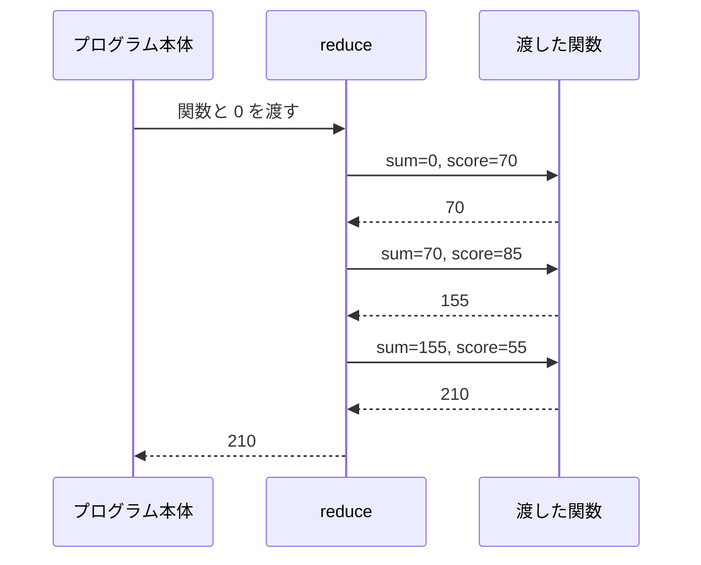

# 第5回　分割代入・スプレッド構文と配列メソッドの応用

## 1. 今日のゴール

- 分割代入で、オブジェクトや配列から必要な値を取り出せる
- スプレッド構文で、もとを変えずに新しい配列やオブジェクトを作れる
- `reduce` で合計を求め、`filter` と `map` をつなげて書ける

## 2. 教科書の該当節

| 節 | 見出し | 読み方 |
|---|---|---|
| 2.5 | ES2015以降の重要文法 | 分割代入、スプレッド構文の部分 |

教科書の目次の中で、今日の場所はここ（★が今日）。

| 章・節 | 見出し | この授業では |
|---|---|---|
| **2章** | **JavaScript/Node.jsの文法** | |
| 2.1 | 開発環境の導入 | 第1回 |
| 2.2 | JavaScript基礎 | 第1〜4回 |
| 2.3 | JavaScriptと継承 | 扱わない |
| 2.4 | JavaScriptとthis | 第4回（紹介のみ） |
| 2.5 | ES2015以降の重要文法 | ★ 今日（前回の続き） |

今日の教材の各部分と教科書の対応：

| 教材 | 内容 | 教科書 |
|---|---|---|
| 4.1〜4.3 | 分割代入 | 2.5 |
| 4.4 | スプレッド構文、項目名の省略 | 2.5 |
| 4.5、4.6 | reduce、メソッドをつなげる、シーケンス図 | 2.2（図は補足） |

これで教科書の2章は終わり。次回からは4章（非同期処理）に進む。

## 3. 前回のふりかえり

**Q1.** 次のプログラムを実行すると、何が表示されるか。

```js
const add = (a, b) => a + b;
const twice = (n) => {
  return n * 2;
};

console.log(twice(add(1, 2)));
```

**Q2.** 次のプログラムを実行すると、何が表示されるか（2行）。

```js
const nums = [1, 2, 3, 4];
const evens = nums.filter((n) => n % 2 === 0);

console.log(evens);
console.log(nums.length);
```

---

## 4. 解説と例題

今日のファイルは `lesson05` フォルダに作る。例題の完成したコードは `examples` フォルダに入っている。

今日の書き方は、どれも「同じことを短く書く」ためのものである。Expressのコードや、ネットの記事のサンプルに必ず出てくるので、読めるようにしておこう。

### 4.1 オブジェクトの分割代入

オブジェクトから、必要な項目だけを変数に取り出す書き方である。

`destructure-object.js`

```js
const student = { name: "佐藤", score: 70, club: "テニス" };

// これまでの書き方
const name1 = student.name;
const score1 = student.score;
console.log(name1, score1);

// 分割代入：必要な項目を、同じ名前の変数に取り出す
const { name, score } = student;
console.log(name, score);
```

実行結果：

```
佐藤 70
佐藤 70
```

- `const { name, score } = student;` は、`student.name` を変数 `name` に、`student.score` を変数 `score` に入れる
- `{ }` の中に書くのは、取り出したい**項目の名前**。その名前の変数ができる
- いらない項目（ここでは `club`）は書かなくてよい

左辺の `{ }` はオブジェクトを作っているのではなく、「この名前の項目を取り出す」という指定である。

`console.log(name, score)` のように `,` で区切ると、複数の値を空白で区切って1行に表示できる。

### 4.2 配列の分割代入

配列は、名前ではなく**順番**で取り出す。

`destructure-array.js`

```js
const colors = ["赤", "青", "黄"];

// 分割代入：先頭から順番に取り出す
const [first, second] = colors;
console.log(first);
console.log(second);
```

実行結果：

```
赤
青
```

| | オブジェクト | 配列 |
|---|---|---|
| 書き方 | `const { name, score } = student;` | `const [first, second] = colors;` |
| 何で決まるか | 項目の名前 | 並んでいる順番 |
| 変数の名前 | 項目と同じ名前になる | 自由に付けられる |

### 4.3 引数で分割代入する

関数の引数のところでも、分割代入が使える。オブジェクトを受け取る関数でよく使われる。

`destructure-args.js`

```js
const student = { name: "佐藤", score: 70 };

// これまでの書き方：オブジェクトを受け取って、中で取り出す
const show1 = (s) => {
  console.log(`${s.name}さん：${s.score}点`);
};

// 引数のところで分割代入する
const show2 = ({ name, score }) => {
  console.log(`${name}さん：${score}点`);
};

show1(student);
show2(student);

// forEach や map に渡す関数でも使える
const students = [
  { name: "鈴木", score: 85 },
  { name: "高橋", score: 55 },
];
students.forEach(({ name, score }) => {
  console.log(`${name}さん：${score}点`);
});
```

実行結果：

```
佐藤さん：70点
佐藤さん：70点
鈴木さん：85点
高橋さん：55点
```

`({ name, score }) => ...` は「オブジェクトを1つ受け取り、その中の `name` と `score` を使う」と読む。引数が2つあるわけではない点に注意しよう。

| 書き方 | 受け取るもの |
|---|---|
| `(name, score) => ...` | 引数が2つ |
| `({ name, score }) => ...` | 引数は1つ（オブジェクト）。その中身を取り出している |

### 4.4 スプレッド構文：中身を広げる

`...` を付けると、配列やオブジェクトの中身を「広げて」並べることができる。もとを変えずに、少しだけ違う新しいものを作るときに使う。

`spread.js`

```js
const fruits = ["りんご", "みかん"];

// 配列の中身を広げて、新しい配列を作る
const more = [...fruits, "ぶどう"];
console.log(more);
console.log(fruits); // もとの配列は変わらない

const student = { name: "佐藤", score: 70 };

// オブジェクトの中身を広げて、一部を上書きした新しいオブジェクトを作る
const updated = { ...student, score: 85 };
console.log(updated);
console.log(student); // もとのオブジェクトは変わらない

// 変数名と項目名が同じなら、まとめて書ける
const name = "鈴木";
const score = 90;
const another = { name, score }; // { name: name, score: score } と同じ
console.log(another);
```

実行結果：

```
[ 'りんご', 'みかん', 'ぶどう' ]
[ 'りんご', 'みかん' ]
{ name: '佐藤', score: 85 }
{ name: '佐藤', score: 70 }
{ name: '鈴木', score: 90 }
```

| 書き方 | 意味 |
|---|---|
| `[...fruits, "ぶどう"]` | `fruits` の中身を並べ、その後ろに `"ぶどう"` を足した新しい配列 |
| `{ ...student, score: 85 }` | `student` の項目を並べ、`score` だけ 85 にした新しいオブジェクト |
| `{ name, score }` | `{ name: name, score: score }` を短く書いたもの |

`push` は、もとの配列そのものを変える。スプレッド構文は、もとを残したまま新しいものを作る。

最後の `{ name, score }` は、4.1 の分割代入と見た目が同じである。`=` の**左**にあれば取り出し（分割代入）、**右**にあればオブジェクトを作っている。

### 4.5 reduce：1つの値にまとめる

`reduce` は、配列の中身を先頭から順番に使って、1つの値にまとめる。合計を求めるときによく使う。

`reduce.js`

```js
const scores = [70, 85, 55];

// for...of で合計を求める（第3回）
let total1 = 0;
for (const score of scores) {
  total1 = total1 + score;
}
console.log(total1);

// reduce で合計を求める
const total2 = scores.reduce((sum, score) => sum + score, 0);
console.log(total2);
```

実行結果：

```
210
210
```

`reduce` には2つのものを渡す。

```js
scores.reduce(   (sum, score) => sum + score   ,   0   );
//               └──── ① 渡す関数 ────┘     └ ② 最初の値
```

- ② の `0` が、最初の `sum` になる（`for...of` 版の `let total1 = 0;` に当たる）
- ① の関数は「今までの合計 `sum` と、今回の値 `score` を受け取り、新しい合計を返す」
- 関数が返した値が、次の回の `sum` になる

`reduce` の中で起きていることを、シーケンス図で見てみよう。



関数が返した値（点線の矢印）が、次に呼び出されるときの `sum` になっていることを確かめよう。

### 4.6 メソッドをつなげて書く

`filter` や `map` は新しい配列を返すので、その後ろに続けて `.map(...)` などを書くことができる。

`chain.js`

```js
const students = [
  { name: "佐藤", score: 70 },
  { name: "鈴木", score: 85 },
  { name: "高橋", score: 55 },
  { name: "田中", score: 90 },
];

// 60点以上の人の名前を取り出す
const passedNames = students
  .filter(({ score }) => score >= 60)
  .map(({ name }) => name);
console.log(passedNames);

// 平均点を求める
const total = students.reduce((sum, { score }) => sum + score, 0);
console.log(`平均は${total / students.length}点`);
```

実行結果：

```
[ '佐藤', '鈴木', '田中' ]
平均は75点
```

つなげて書いたものは、上から1行ずつ読めばよい。

| 行 | していること | 途中の結果 |
|---|---|---|
| `students` | 名簿全体 | 4人のオブジェクト |
| `.filter(({ score }) => score >= 60)` | 60点以上の人だけにする | 3人のオブジェクト |
| `.map(({ name }) => name)` | 名前だけにする | `[ '佐藤', '鈴木', '田中' ]` |

今日学んだ分割代入（`{ score }`）が、渡す関数の引数で使われている。

---

## 5. 図を読む問題

4.5 のシーケンス図を見て答えよう。

1. プログラム本体が `reduce` に渡しているものは、何と何か。
2. 渡した関数は、全部で何回呼び出されているか。
3. 2回目に呼び出されたときの `sum` は 70 である。この 70 は、どこから来た値か。
4. 最初の値を `0` ではなく `100` にすると、最後に返ってくる値はいくつになるか。

---

## 6. 演習（基本）

### 問1　本の情報を取り出す（`q1-destructure.js`）

次のオブジェクトから、分割代入で `title` と `price` を取り出し、表示する。

```js
const book = { title: "JavaScript入門", author: "山田", price: 2000, pages: 320 };
```

```
『JavaScript入門』は2000円です
```

### 問2　引数で分割代入する（`q2-args.js`）

次の名簿を、`forEach` と引数の分割代入を使って表示する。`club` は使わない。

```js
const students = [
  { name: "佐藤", score: 70, club: "テニス" },
  { name: "鈴木", score: 85, club: "野球" },
  { name: "高橋", score: 55, club: "テニス" },
];
```

```
佐藤さん：70点
鈴木さん：85点
高橋さん：55点
```

### 問3　もとを変えずに新しく作る（`q3-spread.js`）

スプレッド構文を使って、次の2つを作る。もとの配列とオブジェクトが変わっていないことも表示して確かめる。

1. `["月", "火"]` の後ろに `"水"` を足した新しい配列
2. `{ name: "佐藤", score: 70 }` の `score` を 100 にした新しいオブジェクト

```
[ '月', '火', '水' ]
[ '月', '火' ]
{ name: '佐藤', score: 100 }
{ name: '佐藤', score: 70 }
```

### 問4　成績データを集計する（`q4-grades.js`）

`exercises/grades.json` を自分のフォルダにコピーして読み込み（第3回 4.7 と同じ方法）、次の2つを表示する。

1. `reduce` で求めた平均点
2. `filter` と `map` をつなげて作った、60点以上の人の名前の配列

`exercises/grades.json`

```json
[
  { "name": "佐藤", "score": 70, "club": "テニス" },
  { "name": "鈴木", "score": 85, "club": "野球" },
  { "name": "高橋", "score": 55, "club": "テニス" },
  { "name": "田中", "score": 90, "club": "吹奏楽" },
  { "name": "伊藤", "score": 80, "club": "野球" },
  { "name": "渡辺", "score": 40, "club": "美術" }
]
```

```
平均は70点
[ '佐藤', '鈴木', '田中', '伊藤' ]
```

---

## 7. 演習（発展）

### 発展1　最高点の学生を探す（`x1-top.js`）

問4のデータから、`reduce` を使って最高点の学生を求める。

```
最高点は田中さんの90点
```

ヒント：

- `reduce` でまとめる値は、数でなくてもよい。「今までで一番点数の高い学生（オブジェクト）」をまとめていく
- 最初の値には、先頭の学生 `students[0]` を渡す
- 渡す関数の中で `if` を使い、点数の高いほうを `return` する

### 発展2　評価を足した新しい名簿を作る（`x2-with-grade.js`）

問4のデータから、`map` とスプレッド構文を使って、全員に評価（`grade`）の項目を足した**新しい配列**を作る。評価は第2回の `getGrade` で求める。先頭の1人を、もとの配列と新しい配列の両方から表示して、もとが変わっていないことを確かめる。

```
{ name: '佐藤', score: 70, club: 'テニス' }
{ name: '佐藤', score: 70, club: 'テニス', grade: 'B' }
```

---

## 8. まとめ

| キーワード | ひとこと |
|---|---|
| `const { name } = obj` | オブジェクトの分割代入。名前で取り出す |
| `const [a, b] = list` | 配列の分割代入。順番で取り出す |
| `({ name }) => ...` | 引数での分割代入。受け取るのはオブジェクト1つ |
| `...` | スプレッド構文。中身を広げて、新しいものを作る |
| `{ name, score }` | `{ name: name, score: score }` の短い書き方 |
| `reduce` | 配列を1つの値にまとめる。最初の値を渡す |
| メソッドをつなげる | `.filter(...).map(...)` と続けて書く |

これで前半A・JavaScriptの文法は一区切り。

**次回**：非同期処理①　コールバックとPromise。「時間のかかる処理を待つ」ための書き方を学ぶ。第4回の「関数を渡す」が、そのまま土台になる。
