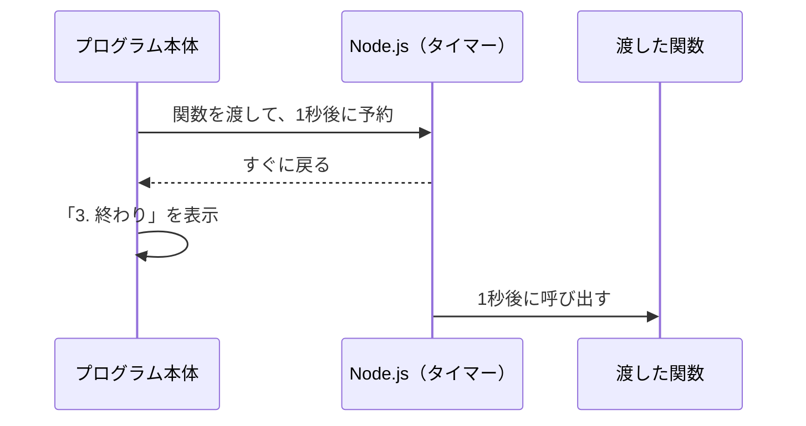

# 第6回　非同期処理①　コールバックとPromise

## 1. 今日のゴール

- 同期処理と非同期処理の違いを、実行の順番で説明できる
- `setTimeout` を使ったプログラムの、表示される順番を予想できる
- Promise の `then` と `catch` で、あとから届く結果を受け取れる

## 2. 教科書の該当節

| 節 | 見出し | 読み方 |
|---|---|---|
| 4.1 | 同期処理と非同期処理 | 今日の 4.1 |
| 4.2 | Callback | 今日の 4.2 |
| 4.3 | Promise | 今日の 4.3〜4.5 |

教科書の目次の中で、今日の場所はここ（★が今日）。3章（モジュール）は第9回で扱うので、先に4章へ進む。

| 章・節 | 見出し | この授業では |
|---|---|---|
| **4章** | **Node.jsにおける非同期処理（フロー制御）** | |
| 4.1 | 同期処理と非同期処理 | ★ 今日 |
| 4.2 | Callback | ★ 今日 |
| 4.3 | Promise | ★ 今日 |
| 4.4 | async/await | 次回 |
| 4.5 | ストリーム処理 | 次回（考え方だけ） |
| 4.6 | AsyncIterator | 扱わない |
| 4.7 | エラーハンドリングのまとめ | 次回 |
| 4.8 | Top-Level Await | 扱わない |

教科書のコードには、ファイルの読み書きを使った例が多い。この授業では、まずタイマー（`setTimeout`）で考え方をつかみ、次回 `fetch` で実際の通信に進む。

## 3. 前回のふりかえり

**Q1.** 次のプログラムを実行すると、何が表示されるか。

```js
const user = { name: "佐藤", age: 19, city: "東京" };
const { name, city } = user;

console.log(`${name}さんは${city}`);
```

**Q2.** 次のプログラムを実行すると、何が表示されるか（2行）。

```js
const nums = [1, 2, 3];
const more = [...nums, 4];

console.log(more.length);
console.log(nums.length);
```

---

## 4. 解説と例題

今日のファイルは `lesson06` フォルダに作る。例題の完成したコードは `examples` フォルダに入っている。

### 4.1 同期処理と非同期処理

これまでのプログラムは、上から順番に、1行が終わってから次の行に進んでいた。これを**同期処理**という。

しかし、通信やデータベースのように**時間のかかる処理**を待っている間、プログラム全体が止まってしまうと困る。そこでJavaScriptでは、時間のかかる処理は「終わったら知らせてもらう」ことにして、先に進む。これを**非同期処理**という。

まず、時間のかかる処理の代わりに、タイマーで試してみよう。`setTimeout(関数, ミリ秒)` は、指定した時間がたったら、渡した関数を呼び出してくれる（1000ミリ秒 = 1秒）。

`timer.js`

```js
console.log("1. 始め");

setTimeout(() => {
  console.log("2. 1秒たった");
}, 1000);

console.log("3. 終わり");
```

**予想してみよう**：実行する前に、3行が表示される順番を予想する。

<details>
<summary>実行結果を見る</summary>

```
1. 始め
3. 終わり
2. 1秒たった
```

`setTimeout` は「1秒後にこの関数を呼び出して」と**予約**するだけで、すぐに次の行へ進む。そのため「3. 終わり」が先に表示される。

</details>

シーケンス図で見ると、こうなる。



- 第4回の「関数を渡す」と同じ形である。渡した関数を呼び出すのは、プログラム本体ではなく Node.js である
- 違うのは、呼び出されるのが**あとになる**こと

**動かしてみよう**：`1000` を `0` に変えて実行する。0秒でも「3. 終わり」が先になることを確かめよう。予約した関数は、今の処理が全部終わってから呼び出される。

### 4.2 コールバックで順番を決める

非同期処理の結果を使いたいときや、「これが終わってから次をする」と順番を決めたいときは、**渡す関数の中に、次の処理を書く**。

`callback-order.js`

```js
setTimeout(() => {
  console.log("1秒後");
  setTimeout(() => {
    console.log("2秒後");
    setTimeout(() => {
      console.log("3秒後");
    }, 1000);
  }, 1000);
}, 1000);
```

実行結果：

```
1秒後
2秒後
3秒後
```

動きは正しいが、処理が増えるたびに字下げが深くなり、読みにくい。この形は「コールバック地獄」と呼ばれている。これを解決するために作られたのが、次の Promise である。

### 4.3 Promise：「あとで結果を届ける」という約束

**Promise**（プロミス）は、「今はまだ結果がないが、あとで届ける」という約束を表すオブジェクトである。

Promise には3つの状態がある。

| 状態 | 意味 |
|---|---|
| 待ち（pending） | まだ結果が出ていない |
| 成功（fulfilled） | うまくいって、結果が届いた |
| 失敗（rejected） | うまくいかず、エラーが届いた |

Promise を受け取ったら、`.then(関数)` で「成功したら、この関数を呼び出して」と頼んでおく。

`promise-wait.js`

```js
// ms ミリ秒たったら「成功」になる Promise を返す関数
const wait = (ms) => {
  return new Promise((resolve) => {
    setTimeout(resolve, ms);
  });
};

console.log("始め");

wait(1000).then(() => {
  console.log("1秒たった");
});

console.log("終わり");
```

実行結果：

```
始め
終わり
1秒たった
```

- `wait(1000)` は、すぐに Promise を返す（この時点では「待ち」の状態）
- 1秒後に Promise が「成功」になり、`then` に渡しておいた関数が呼び出される
- `then` も予約するだけなので、「終わり」が先に表示される

`wait` 関数の中身（`new Promise`）は、Promise を**作る側**の書き方である。今日大事なのは、Promise を**受け取って使う側**の `then` である。`wait` はこの先も道具として使うので、中身は「`resolve` を呼ぶと成功になる」とだけ知っておけばよい。

### 4.4 then をつなげる

`then` に渡す関数の中で、次の Promise を `return` すると、`then` を横につなげていくことができる。

`then-chain.js`

```js
const wait = (ms) => {
  return new Promise((resolve) => {
    setTimeout(resolve, ms);
  });
};

wait(1000)
  .then(() => {
    console.log("1秒後");
    return wait(1000);
  })
  .then(() => {
    console.log("2秒後");
    return wait(1000);
  })
  .then(() => {
    console.log("3秒後");
  });
```

実行結果：

```
1秒後
2秒後
3秒後
```

4.2 の `callback-order.js` と同じ動きだが、字下げが深くならない。「上から順番に起きる」ように読める。

大事なのは `return wait(1000);` の `return` である。これを忘れると、次の `then` は待たずにすぐ実行されてしまう。

### 4.5 結果を受け取る・失敗を受け取る

Promise は、成功したときに**値**を届けることができる。その値は、`then` に渡した関数の引数で受け取る。失敗したときは `catch` に渡した関数が呼び出される。

`then-catch.js`

```js
// 0.5秒後に点数を届ける。100点より大きければ失敗にする
const getScore = (score) => {
  return new Promise((resolve, reject) => {
    setTimeout(() => {
      if (score <= 100) {
        resolve(score);
      } else {
        reject(new Error("点数が正しくありません"));
      }
    }, 500);
  });
};

getScore(80)
  .then((score) => {
    console.log(`成功：${score}点`);
  })
  .catch((error) => {
    console.log(`失敗：${error.message}`);
  });

getScore(150)
  .then((score) => {
    console.log(`成功：${score}点`);
  })
  .catch((error) => {
    console.log(`失敗：${error.message}`);
  });
```

実行結果：

```
成功：80点
失敗：点数が正しくありません
```

| 書き方 | 呼び出されるとき | 引数で受け取るもの |
|---|---|---|
| `.then((値) => { ... })` | 成功したとき | 届いた値 |
| `.catch((error) => { ... })` | 失敗したとき | エラー |

- `new Error("メッセージ")` は、エラーを表すオブジェクトを作る書き方。メッセージは `error.message` で取り出せる
- `then` と `catch` は、どちらか一方だけが呼び出される

次回学ぶ `fetch` は、「通信の結果を届ける Promise」を返す関数である。使い方は今日の `getScore` と同じで、`then` と `catch` で結果を受け取る。

---

## 5. 図を読む問題

4.1 のシーケンス図を見て答えよう。

1. プログラム本体が Node.js（タイマー）に渡しているものは何か。
2. 「3. 終わり」が表示されるのは、渡した関数が呼び出される前か、後か。
3. 渡した関数を呼び出しているのは、プログラム本体と Node.js のどちらか。
4. `setTimeout` を、時間のかかる通信に置き換えて考える。通信の結果を待っている間、プログラム本体は止まっているか。

---

## 6. 演習（基本）

### 問1　順番当てクイズ①（`q1-quiz.js`）

`exercises/q1-quiz.js` を開き、**実行する前に** A〜D が表示される順番を予想してノートに書く。そのあと実行して確かめる。

`exercises/q1-quiz.js`

```js
// 問1：実行する前に、A〜D が表示される順番を予想しよう
console.log("A");

setTimeout(() => {
  console.log("B");
}, 2000);

setTimeout(() => {
  console.log("C");
}, 1000);

console.log("D");
```

### 問2　順番当てクイズ②（`q2-quiz.js`）

同じように、`exercises/q2-quiz.js` の表示の順番を予想してから実行する。

`exercises/q2-quiz.js`

```js
// 問2：実行する前に、A〜D が表示される順番を予想しよう
const wait = (ms) => {
  return new Promise((resolve) => {
    setTimeout(resolve, ms);
  });
};

console.log("A");

wait(1000).then(() => {
  console.log("B");
});

wait(0).then(() => {
  console.log("C");
});

console.log("D");
```

### 問3　カウントダウン（`q3-countdown.js`）

4.3 の `wait` 関数をコピーして使い、`then` をつなげて、1秒おきに次のように表示する。

```
3
2
1
発射！
```

「3」はすぐに表示し、そのあと1秒ごとに「2」「1」「発射！」を表示すること。

### 問4　成功と失敗を受け取る（`q4-divide.js`）

`exercises/q4-divide.js` には、割り算の結果を届ける Promise を返す関数 `divide` が書いてある。このファイルをコピーし、下の2つの呼び出しに `then` と `catch` を付けて、次のように表示する。

`exercises/q4-divide.js`

```js
// 問4：0.5秒後に a ÷ b の答えを届ける。b が 0 のときは失敗にする
const divide = (a, b) => {
  return new Promise((resolve, reject) => {
    setTimeout(() => {
      if (b === 0) {
        reject(new Error("0では割れません"));
      } else {
        resolve(a / b);
      }
    }, 500);
  });
};

// ここから下に then と catch を付けよう
divide(10, 2);

divide(10, 0);
```

```
答えは5
失敗：0では割れません
```

---

## 7. 演習（発展）

### 発展1　コールバックを Promise に書き換える（`x1-rewrite.js`）

次のプログラムと同じ動きをするものを、`wait` 関数と `then` のつなぎで書く。

```js
setTimeout(() => {
  console.log("お湯を沸かした");
  setTimeout(() => {
    console.log("麺をゆでた");
    setTimeout(() => {
      console.log("ラーメンができた");
    }, 1000);
  }, 1000);
}, 1000);
```

```
お湯を沸かした
麺をゆでた
ラーメンができた
```

### 発展2　Promise を返す関数を自分で作る（`x2-login.js`）

パスワードを受け取り、0.5秒後に結果を届ける Promise を返す関数 `login(password)` を作る。パスワードが `"nodejs"` なら `"ログイン成功"` という文字列を届け、それ以外なら `"パスワードが違います"` というエラーで失敗にする。

`login("nodejs")` と `login("abc")` を呼び出して、次のように表示する。

```
ログイン成功
失敗：パスワードが違います
```

ヒント：4.5 の `getScore` をまねて、`new Promise((resolve, reject) => { ... })` の形で書く。

---

## 8. まとめ

| キーワード | ひとこと |
|---|---|
| 同期処理 | 1つ終わってから次へ進む |
| 非同期処理 | 終わるのを待たずに先へ進み、終わったら知らせてもらう |
| `setTimeout(関数, ミリ秒)` | 時間がたったら関数を呼び出すよう予約する |
| コールバック | 渡しておいて、あとで呼び出してもらう関数 |
| Promise | 「あとで結果を届ける」という約束。待ち・成功・失敗の3つの状態 |
| `.then(関数)` | 成功したら呼び出してもらう。届いた値を引数で受け取る |
| `.catch(関数)` | 失敗したら呼び出してもらう。エラーを引数で受け取る |

**次回**：非同期処理②　async/await と fetch 入門。`then` をもっと読みやすく書く方法を学び、インターネットからデータを取ってくる。
