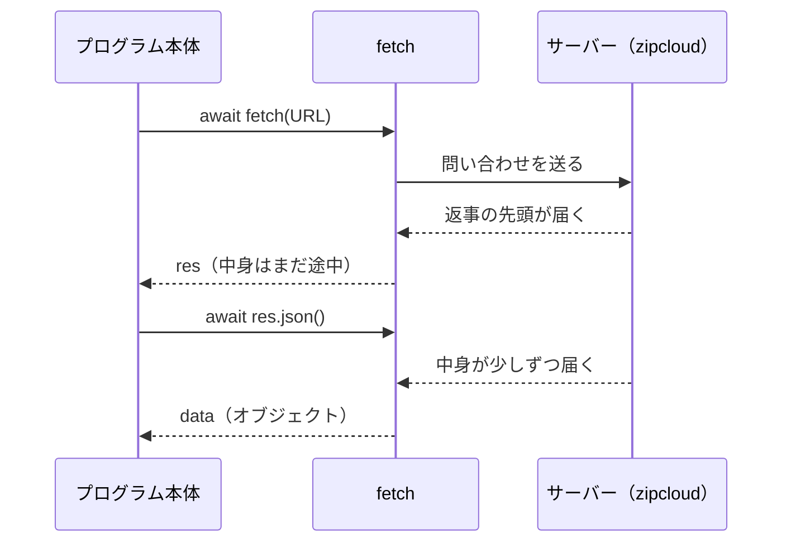

# 第7回　非同期処理②　async/await と fetch 入門

## 1. 今日のゴール

- `async` / `await` を使って、非同期処理を上から順に読める形で書ける
- `fetch` でインターネットからJSONを取得し、必要な値を表示できる
- 「データは少しずつ届く」ことを説明でき、失敗したときの処理を `try` / `catch` で書ける

## 2. 教科書の該当節

| 節 | 見出し | 読み方 |
|---|---|---|
| 4.4 | async/await | 今日の 4.1、4.2 |
| 4.7 | エラーハンドリングのまとめ | 今日の 4.2、4.5 |
| 4.5 | ストリーム処理 | 今日の 4.4 の参考。考え方だけ読めばよい |

教科書の目次の中で、今日の場所はここ（★が今日）。

| 章・節 | 見出し | この授業では |
|---|---|---|
| **4章** | **Node.jsにおける非同期処理（フロー制御）** | |
| 4.1 | 同期処理と非同期処理 | 前回 |
| 4.2 | Callback | 前回 |
| 4.3 | Promise | 前回 |
| 4.4 | async/await | ★ 今日 |
| 4.5 | ストリーム処理 | ★ 今日（考え方だけ） |
| 4.6 | AsyncIterator | 扱わない |
| 4.7 | エラーハンドリングのまとめ | ★ 今日 |
| 4.8 | Top-Level Await | 扱わない |

今日の教材の各部分と教科書の対応：

| 教材 | 内容 | 教科書 |
|---|---|---|
| 4.1、4.2 | async/await、try/catch | 4.4、4.7 |
| 4.3 | fetch、シーケンス図 | 教科書にない（補足） |
| 4.4 | ストリーム | 4.5 は別の種類のストリームの話。考え方の参考にする |
| 4.5 | 通信が失敗したとき | 4.7 |

## 3. 前回のふりかえり

`wait` は、前回作った「指定した時間がたったら成功になる Promise を返す関数」である。

**Q1.** 次のプログラムを実行すると、A・B・C はどの順番で表示されるか。

```js
console.log("A");

setTimeout(() => {
  console.log("B");
}, 0);

console.log("C");
```

**Q2.** 次のプログラムを実行すると、X・Y・Z はどの順番で表示されるか。

```js
wait(500)
  .then(() => {
    console.log("X");
    return wait(500);
  })
  .then(() => {
    console.log("Y");
  });

console.log("Z");
```

---

## 4. 解説と例題

今日のファイルは `lesson07` フォルダに作る。例題の完成したコードは `examples` フォルダに入っている。

今日の例題と演習は、インターネットにつながっている必要がある。

### 4.1 async / await：Promise を「待つ」

前回は、Promise の結果を `then` で受け取った。`await` を使うと、同じことを**上から順番に読める形**で書ける。

`await-wait.js`

```js
const wait = (ms) => {
  return new Promise((resolve) => {
    setTimeout(resolve, ms);
  });
};

async function main() {
  console.log("始め");

  await wait(1000);
  console.log("1秒後");

  await wait(1000);
  console.log("2秒後");
}

main();
```

実行結果：

```
始め
1秒後
2秒後
```

- `await Promise` と書くと、その Promise が成功するまで、**その関数の中の続きを待つ**
- `await` は、`async` を付けた関数の中でしか使えない

前回の `then` をつなげる書き方と比べてみよう。

| 前回（then） | 今日（await） |
|---|---|
| `wait(1000).then(() => { 次の処理 });` | `await wait(1000);`<br>`次の処理` |
| 次の処理を、渡す関数の中に書く | 次の処理を、次の行に書く |

この授業では、`await` を使うときは必ず次の形にする。

```js
async function main() {
  // ここに await を使った処理を書く
}

main();
```

`async function main() { ... }` で関数を作り、最後の `main();` で呼び出している。`main();` を書き忘れると、何も起きない（第2回の「作っただけでは動かない」）。

### 4.2 結果を受け取る・失敗を受け取る

Promise が届ける値は、`await` の結果として、そのまま変数に入れられる。失敗は `try` / `catch` で受け取る。

`await-catch.js`

```js
// 0.5秒後に点数を届ける。100点より大きければ失敗にする（前回と同じ関数）
const getScore = (score) => {
  return new Promise((resolve, reject) => {
    setTimeout(() => {
      if (score <= 100) {
        resolve(score);
      } else {
        reject(new Error("点数が正しくありません"));
      }
    }, 500);
  });
};

async function main() {
  try {
    const score1 = await getScore(80);
    console.log(`成功：${score1}点`);

    const score2 = await getScore(150);
    console.log(`成功：${score2}点`);
  } catch (error) {
    console.log(`失敗：${error.message}`);
  }

  console.log("終わり");
}

main();
```

実行結果：

```
成功：80点
失敗：点数が正しくありません
終わり
```

- `const score1 = await getScore(80);` で、届いた値 `80` が `score1` に入る
- `try { ... }` の中で失敗が起きると、残りを飛ばして `catch (error) { ... }` に移る。2つ目の「成功：」は表示されていない
- `catch` の後は、ふつうに続きが実行される

| | then / catch | await と try / catch |
|---|---|---|
| 成功の値 | `.then((値) => { ... })` | `const 値 = await ...;` |
| 失敗 | `.catch((error) => { ... })` | `try { ... } catch (error) { ... }` |

Javaの `try` / `catch` と、ほとんど同じ形である。

### 4.3 fetch：インターネットからデータを取ってくる

`fetch(URL)` は、そのURLに問い合わせて、返事を届けてくれる関数である。返事が届くまで時間がかかるので、`fetch` は Promise を返す。つまり `await` で待つ。

ここでは、郵便番号から住所を調べられる公開サービス（zipcloud）を使う。

`fetch-zip.js`

```js
async function main() {
  const res = await fetch("https://zipcloud.ibsnet.co.jp/api/search?zipcode=1000001");
  const data = await res.json();

  console.log(data);

  // 必要な値だけを取り出す（第5回の分割代入）
  const { address1, address2, address3 } = data.results[0];
  console.log(`${address1}${address2}${address3}`);
}

main();
```

実行結果：

```
{
  message: null,
  results: [
    {
      address1: '東京都',
      address2: '千代田区',
      address3: '千代田',
      kana1: 'ﾄｳｷｮｳﾄ',
      kana2: 'ﾁﾖﾀﾞｸ',
      kana3: 'ﾁﾖﾀﾞ',
      prefcode: '13',
      zipcode: '1000001'
    }
  ],
  status: 200
}
東京都千代田区千代田
```

`await` が2回あることに注目しよう。

| 行 | していること | 受け取るもの |
|---|---|---|
| `const res = await fetch(URL);` | 問い合わせを送り、返事が**届き始める**のを待つ | `res`（返事の入れ物。中身はまだ届いている途中） |
| `const data = await res.json();` | 返事の中身が**全部届く**のを待ち、JSONからオブジェクトに直す | `data`（オブジェクト） |

`res.json()` は、第3回の `JSON.parse` と同じ仕事（JSONの文字列をオブジェクトに直す）を、中身が全部届くのを待ってからしてくれる。

届いた `data` は、ただのオブジェクトである。どんな項目があるかを `console.log(data)` で確かめてから、`data.results[0]` のように取り出していく。

シーケンス図で見ると、こうなる。



### 4.4 データは少しずつ届く（ストリーム）

なぜ `await` が2回必要なのか。それは、ネットワークでは、データが**一度に全部ではなく、少しずつ届く**からである。このように、少しずつ流れてくるデータを**ストリーム**という。

`res.body` を使うと、届いたかたまりを1つずつ受け取ることができる。大きめのデータで試してみよう。

`stream.js`

```js
async function main() {
  const res = await fetch("https://pokeapi.co/api/v2/pokemon?limit=2000");

  let count = 0;
  let total = 0;

  // res.body から、届いたかたまりを1つずつ受け取る
  for await (const chunk of res.body) {
    count++;
    total = total + chunk.length;
    console.log(`${count}個目のかたまり：${chunk.length}バイト`);
  }

  console.log(`全部で${total}バイト`);
}

main();
```

実行結果の例（かたまりの数と大きさは、実行するたびに変わる）：

```
1個目のかたまり：9708バイト
2個目のかたまり：6676バイト
3個目のかたまり：4981バイト
（中略）
全部で93324バイト
```

- 約9万バイトのデータが、十数個のかたまりに分かれて届いている
- `for await (... of ...)` は、「次のかたまりが届くのを待ちながら繰り返す」`for...of` である
- `res.json()` は、このかたまりを最後まで受け取ってつなぎ合わせ、オブジェクトに直す作業を、まとめてやってくれている

ふだんは `await res.json()` と書けば十分で、`res.body` を自分で読むことはほとんどない。「データは少しずつ届く。だから待つ必要がある」と分かっていればよい。

教科書4.5の「ストリーム処理」は、ファイルを少しずつ読み書きする話である。扱うものは違うが、「大きなデータを、少しずつ流して処理する」という考え方は同じである。

### 4.5 通信が失敗したとき

通信には、失敗がつきものである。失敗には2種類ある。

| 失敗の種類 | 例 | fetch の動き |
|---|---|---|
| つながらない | ネットワークが切れている、URLのサーバーが存在しない | `fetch` が失敗する（`catch` に移る） |
| つながったが、断られた | 存在しないページ（404）、サーバーのエラー（500） | `fetch` は**成功する**。`res.ok` が `false` になる |

2つ目に注意が必要である。「見つかりません（404）」という返事も、返事が届いたという意味では成功だからである。そこで、`res.ok` を自分で確かめる。

`fetch-error.js`

```js
// ポケモンの情報を取ってくる。見つからなければ失敗にする
async function getPokemon(name) {
  const res = await fetch(`https://pokeapi.co/api/v2/pokemon/${name}`);

  if (!res.ok) {
    throw new Error(`見つかりませんでした（${res.status}）`);
  }

  return await res.json();
}

async function main() {
  try {
    const data1 = await getPokemon("pikachu");
    console.log(`${data1.name}：高さ${data1.height}、重さ${data1.weight}`);

    const data2 = await getPokemon("abcdefg");
    console.log(`${data2.name}：高さ${data2.height}、重さ${data2.weight}`);
  } catch (error) {
    console.log(`失敗：${error.message}`);
  }
}

main();
```

実行結果：

```
pikachu：高さ4、重さ60
失敗：見つかりませんでした（404）
```

- `res.ok` は、うまくいったとき `true`、断られたとき `false` になる。`res.status` には `200` や `404` などの番号（ステータスコード）が入っている
- `!` は「〜でない」という意味。`if (!res.ok)` は「うまくいっていなければ」と読む
- `throw new Error(...)` は、自分で失敗を起こす書き方。呼び出した側の `catch` に移る
- `async` を付けた関数は、`return` した値を届ける Promise を返す。だから `await getPokemon(...)` で受け取れる

---

## 5. 図を読む問題

4.3 のシーケンス図を見て答えよう。

1. プログラム本体が `await` で待っているのは、何回か。
2. `res` を受け取った時点で、返事の中身は全部届いているか。
3. `data.results` のように項目を取り出せるようになるのは、何本目の矢印の後か。
4. 第3回の「JSONファイルを読み込む」図と比べて、同じところを1つ挙げよう。

---

## 6. 演習（基本）

### 問1　カウントダウンを await で書く（`q1-countdown.js`）

前回の問3（カウントダウン）を、`then` を使わずに `async` / `await` で書き直す。

```
3
2
1
発射！
```

### 問2　郵便番号から住所を調べる（`q2-zip.js`）

4.3 と同じサービスを使い、郵便番号 `5300001` の住所を次の形で表示する。できたら、自分の家や学校の郵便番号でも試そう。

```
〒5300001 は 大阪府大阪市北区梅田
```

ヒント：URLの最後の `zipcode=` の後ろを変える。郵便番号を変数に入れておき、テンプレートリテラルでURLを作るとよい。

### 問3　ポケモンの情報を調べる（`q3-pokemon.js`）

PokeAPI（`https://pokeapi.co/api/v2/pokemon/名前`）を使い、`eevee` の情報を次の形で表示する。名前は英語の小文字で指定する。

```
No.133 eevee
高さ：3　重さ：65
```

ヒント：まず `console.log(data)` で全体を表示すると、とても長い。`console.log(Object.keys(data))` と書くと、項目の名前だけの一覧が見られる。番号は `id` に入っている。

### 問4　見つからないときの表示（`q4-notfound.js`）

問2のプログラムに、存在しない郵便番号 `0000000` を指定すると、エラーで止まってしまう。zipcloud は、見つからないとき `results` を `null` にして返してくるからである。

見つからないときは、次のように表示するよう直す。通信そのものが失敗したときのために、`try` / `catch` も付けること。

```
〒0000000 は見つかりませんでした
```

---

## 7. 演習（発展）

### 発展1　3つまとめて調べる（`x1-all.js`）

郵便番号 `1000001`、`5300001`、`0600000` の住所を表示する。

`Promise.all([Promise1, Promise2, ...])` を使うと、複数の Promise を**同時に**進めて、全部の結果がそろうのを待てる。結果は配列で届く。

```js
const results = await Promise.all([getAddress("1000001"), getAddress("5300001"), getAddress("0600000")]);
```

郵便番号を受け取って住所の文字列を返す `async` の関数 `getAddress` を作り、上の形で呼び出そう。

```
東京都千代田区千代田
大阪府大阪市北区梅田
北海道札幌市中央区
```

### 発展2　今の気温を表示する（`x2-weather.js`）

Open-Meteo（天気のデータを公開しているサービス）を使い、東京の今の気温を表示する。URLは次のとおり。

```
https://api.open-meteo.com/v1/forecast?latitude=35.68&longitude=139.76&current=temperature_2m
```

```
東京の今の気温は11.5℃です
```

気温の数字は、実行したときの実際の値になる。`console.log(data)` で届いたデータの形を調べ、気温がどこに入っているかを探そう。

---

## 8. まとめ

| キーワード | ひとこと |
|---|---|
| `await` | Promise が成功するまで待つ。届いた値を受け取れる |
| `async function main() { }` | `await` を使うための関数。最後に `main();` で呼び出す |
| `try { } catch (error) { }` | 失敗したとき、`catch` に移る |
| `fetch(URL)` | インターネットに問い合わせる。Promise を返す |
| `res.json()` | 中身が全部届くのを待ち、JSONをオブジェクトに直す |
| ストリーム | 少しずつ流れてくるデータ。だから2回待つ |
| `res.ok` / `res.status` | うまくいったか／ステータスコード（200、404 など） |

**次回**：fetch で作る面白プログラム。今日の `fetch` を使って、自分のアイデアでプログラムを作る。前半の到達確認の回でもある。
