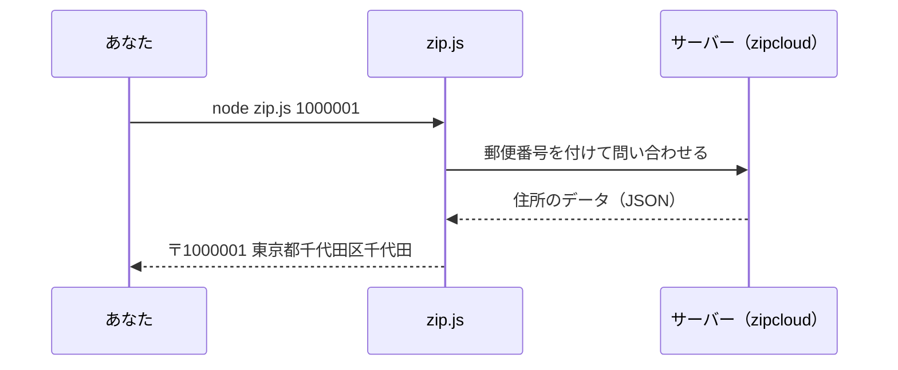

# 第8回　fetch で作る面白プログラム（ミニ制作）

## 1. 今日のゴール

- 公開されているサービス（API）を自分で選び、`fetch` で情報を取ってくるプログラムを作れる
- 実行するときに値を渡せるプログラム（`node zip.js 1000001` のような形）を作れる
- 見つからないときや通信に失敗したときにも、止まらずにメッセージを出せる

今日は前半（第1〜7回）の到達確認の回でもある。作ったプログラムを提出する。

## 2. 教科書の該当節

今日の内容は、教科書に対応する節がない。これまでに学んだ次の内容を、まとめて使う。

| 使うもの | 学んだ回 | 教科書 |
|---|---|---|
| 変数、`if`、テンプレートリテラル | 第1回 | 2.2 |
| 関数 | 第2回、第4回 | 2.2、2.5 |
| 配列、オブジェクト、JSON | 第3回 | 2.2 |
| `forEach` / `map` / `filter` | 第4回 | 2.2 |
| 分割代入 | 第5回 | 2.5 |
| `async` / `await`、`try` / `catch`、`fetch` | 第7回 | 4.4、4.7 |

教科書の5章（CLIツールの開発）は、今日のような「ターミナルで動かすプログラム」を本格的に作る話である。授業では扱わないが、興味のある人は読んでみよう。

## 3. 前回のふりかえり

**Q1.** 次のプログラムには、まちがいが1つある。どこか。

```js
async function main() {
  const res = await fetch("https://zipcloud.ibsnet.co.jp/api/search?zipcode=1000001");
  const data = res.json();
  console.log(data.results[0].address1);
}

main();
```

**Q2.** 存在しないポケモンの名前で PokeAPI に問い合わせると、ステータスコード 404 が返ってくる。このとき、`fetch` は失敗して `catch` に移るか。

---

## 4. 解説と例題

今日のファイルは `lesson08` フォルダに作る。例題の完成したコードは `examples` フォルダに入っている。

### 4.1 実行するときに値を渡す

これまでは、調べたい郵便番号をプログラムの中に直接書いていた。これでは、番号を変えるたびにプログラムを書き換えなければならない。

`node ファイル名` の後ろに書いた言葉は、プログラムの中で `process.argv` という配列から取り出せる。

`argv.js`

```js
// node argv.js 佐藤 のように実行する
const name = process.argv[2];

if (name === undefined) {
  console.log("使い方：node argv.js 名前");
} else {
  console.log(`こんにちは、${name}さん`);
}
```

`node argv.js 佐藤` と実行したとき：

```
こんにちは、佐藤さん
```

`node argv.js` とだけ実行したとき：

```
使い方：node argv.js 名前
```

- `process.argv[2]` に、ファイル名の後ろに書いた1つ目の言葉が入る（2つ目は `process.argv[3]`）
- 番号が 2 から始まるのは、`[0]` と `[1]` に `node` とファイルの場所が入っているから
- 何も書かずに実行すると `undefined` になる。そのときは使い方を表示すると親切である
- 受け取った値は、数字を書いても**文字列**になる（第1回の `"10" + 5`）

### 4.2 サンプル作品：郵便番号検索

前回の郵便番号検索を、実行するときに番号を渡せるように作り直したものである。今日作るプログラムの見本にしよう。

`zip.js`

```js
// 郵便番号から住所を調べる：node zip.js 1000001
async function main() {
  const zipcode = process.argv[2];

  // 番号が渡されなかったとき
  if (zipcode === undefined) {
    console.log("使い方：node zip.js 郵便番号（7けた）");
    return;
  }

  try {
    const res = await fetch(`https://zipcloud.ibsnet.co.jp/api/search?zipcode=${zipcode}`);
    const data = await res.json();

    // 見つからなかったとき
    if (data.results === null) {
      console.log(`〒${zipcode} は見つかりませんでした`);
      return;
    }

    // 見つかった住所をすべて表示する
    data.results.forEach(({ address1, address2, address3 }) => {
      console.log(`〒${zipcode}　${address1}${address2}${address3}`);
    });
  } catch (error) {
    console.log(`通信に失敗しました：${error.message}`);
  }
}

main();
```

`node zip.js 1000001` と実行したとき：

```
〒1000001　東京都千代田区千代田
```

`node zip.js 0000000` と実行したとき：

```
〒0000000 は見つかりませんでした
```

このプログラムは、4つの部分でできている。

| 部分 | していること |
|---|---|
| ① 受け取る | `process.argv[2]` で値を受け取る。なければ使い方を表示して終わる |
| ② 問い合わせる | `fetch` でデータを取ってくる |
| ③ 確かめる | 見つからなかったときのメッセージを出す |
| ④ 表示する | 必要な値だけを取り出して、見やすく表示する |

`return;` は、値を返さずに、そこで関数を終わらせる書き方である。「これ以上進めない」ときに使う。

プログラムの動きを、シーケンス図で見てみよう。



### 4.3 作り方の手順

新しいサービスを使うときは、いきなりプログラムを書かず、次の順番で進める。

1. **ブラウザでURLを開く**：どんなデータが返ってくるかを、自分の目で見る
2. **`console.log(data)` で全体を表示する**：プログラムから取れることを確かめる
3. **ほしい値の場所を探す**：`data.results[0].address1` のように、たどり方を調べる
4. **見やすく表示する**：テンプレートリテラルで文にする
5. **`process.argv` で値を渡せるようにする**
6. **うまくいかない場合の処理を足す**：値がない、見つからない、通信の失敗

一度に全部作ろうとせず、1つ進むたびに実行して確かめること。

### 4.4 使えるサービスの例

どれも登録なしで使える。URLの `{ }` の部分を、調べたい値に置き換える。

| サービス | URL | 取れるもの |
|---|---|---|
| 郵便番号検索（zipcloud） | `https://zipcloud.ibsnet.co.jp/api/search?zipcode={郵便番号}` | `results[0].address1`（都道府県）、`address2`、`address3` |
| ポケモン図鑑（PokeAPI） | `https://pokeapi.co/api/v2/pokemon/{英語名か番号}` | `id`、`name`、`height`、`weight`、`types`（タイプの配列） |
| 犬の画像（Dog API） | `https://dog.ceo/api/breeds/image/random` | `message`（画像のURL） |
| 犬種ごとの画像（Dog API） | `https://dog.ceo/api/breed/{犬種}/images/random` | `message`（画像のURL）。犬種は `shiba`、`akita` など |
| 今の天気（Open-Meteo） | `https://api.open-meteo.com/v1/forecast?latitude={緯度}&longitude={経度}&current=temperature_2m` | `current.temperature_2m`（気温） |
| 地名から緯度・経度（Open-Meteo） | `https://geocoding-api.open-meteo.com/v1/search?name={地名}&count=1&language=ja` | `results[0].latitude`、`longitude`、`name`。地名は `Tokyo`、`Osaka` のように英語で指定する |

配列の中身を1つの文字列につなげたいときは、`join` が使える。

`pokemon.js`

```js
// ポケモンの情報を調べる：node pokemon.js pikachu
async function main() {
  const name = process.argv[2];

  if (name === undefined) {
    console.log("使い方：node pokemon.js 名前（英語の小文字）か番号");
    return;
  }

  try {
    const res = await fetch(`https://pokeapi.co/api/v2/pokemon/${name}`);

    if (!res.ok) {
      console.log(`${name} は見つかりませんでした`);
      return;
    }

    const data = await res.json();
    const types = data.types.map(({ type }) => type.name).join("、");

    console.log(`No.${data.id} ${data.name}`);
    console.log(`タイプ：${types}`);
    console.log(`高さ：${data.height}　重さ：${data.weight}`);
  } catch (error) {
    console.log(`通信に失敗しました：${error.message}`);
  }
}

main();
```

`node pokemon.js charizard` と実行したとき：

```
No.6 charizard
タイプ：fire、flying
高さ：17　重さ：905
```

`["fire", "flying"].join("、")` は、配列の中身を `、` でつなげた文字列 `"fire、flying"` になる。

### 4.5 2つのサービスを組み合わせる（発展課題の見本）

1つ目のサービスで取った値を使って、2つ目のサービスに問い合わせることができる。次の例は、地名から緯度・経度を調べ、その場所の今の気温を表示する。このサービスは日本語の地名ではうまく探せないので、地名は英語で渡す。

`weather.js`

```js
// 地名から今の気温を調べる：node weather.js Tokyo
async function getPlace(name) {
  const res = await fetch(`https://geocoding-api.open-meteo.com/v1/search?name=${name}&count=1&language=ja`);
  const data = await res.json();

  // 見つからないときは results がない
  if (data.results === undefined) {
    throw new Error(`${name} は見つかりませんでした`);
  }
  return data.results[0];
}

async function getTemperature(latitude, longitude) {
  const res = await fetch(`https://api.open-meteo.com/v1/forecast?latitude=${latitude}&longitude=${longitude}&current=temperature_2m`);
  const data = await res.json();
  return data.current.temperature_2m;
}

async function main() {
  const name = process.argv[2];

  if (name === undefined) {
    console.log("使い方：node weather.js 地名（英語。Tokyo、Osaka など）");
    return;
  }

  try {
    const place = await getPlace(name);
    const temperature = await getTemperature(place.latitude, place.longitude);
    console.log(`${place.name}の今の気温は${temperature}℃です`);
  } catch (error) {
    console.log(`失敗：${error.message}`);
  }
}

main();
```

`node weather.js Tokyo` と実行したときの例（気温は、実行したときの実際の値になる）：

```
東京都の今の気温は11.5℃です
```

問い合わせを1つずつ関数に分けておくと、`main` の中が「場所を調べる → 気温を調べる → 表示する」と読めるようになる。

---

## 5. 図を読む問題

4.2 のシーケンス図を見て答えよう。

1. あなたが `zip.js` に渡している値は何か。プログラムの中では、どこから取り出せるか。
2. `zip.js` がサーバーから受け取るものは何か。
3. 郵便番号を渡さずに `node zip.js` と実行した場合、図の矢印のうち、起きないものはどれか。
4. 4.5 の `weather.js` を図にすると、サーバーへの問い合わせ（実線の矢印）は何本になるか。

---

## 6. 演習（基本）：ミニ制作

4.4 の表から使いたいサービスを1つ選び、**自分のプログラムを1つ作る**。ほかに使いたい公開サービスがあれば、教員に相談して使ってよい。

### 必ず入れること

| 番号 | 条件 |
|---|---|
| ① | `fetch` でデータを取ってくる |
| ② | 実行するときに値を渡せる（`process.argv`）。値がないときは使い方を表示する |
| ③ | 届いたデータから必要な値だけを取り出し、文として見やすく表示する（`console.log(data)` のままにしない） |
| ④ | 見つからないとき、通信に失敗したときに、エラーで止まらずメッセージを表示する |

サンプル作品（`zip.js`、`pokemon.js`）をそのまま出すのではなく、表示する内容や形を自分で工夫すること。

### アイデアの例

- 好きなポケモンを2匹指定して、高さと重さを比べる
- 犬種を指定して、画像のURLを3つ表示する
- 郵便番号を2つ指定して、同じ都道府県かどうかを判定する
- 緯度と経度を指定して、今の気温と「暑い／ちょうどいい／寒い」を表示する

### 提出するもの

1. 作ったプログラムのファイル
2. 次の3つを書いたテキストファイル（`readme.txt`）
   - 何をするプログラムか
   - 実行のしかた（例：`node dog.js shiba`）
   - 工夫したところ、むずかしかったところ

---

## 7. 演習（発展）

基本の4つの条件を満たした人は、次のどれかに挑戦しよう。

### 発展1　2つのサービスを組み合わせる

4.5 の `weather.js` のように、1つ目の結果を使って2つ目に問い合わせるプログラムを作る。

例：地名を2つ指定して、今の気温を比べる

### 発展2　複数の結果を集計する

`Promise.all`（前回の発展1）で複数のデータを同時に取り、`map` / `filter` / `reduce` で集計して表示する。

例：ポケモンを3匹指定して、いちばん重いものを表示する

---

## 8. まとめ

| キーワード | ひとこと |
|---|---|
| `process.argv[2]` | 実行するときに渡した1つ目の値。文字列で届く |
| `return;` | そこで関数を終わらせる |
| `配列.join("、")` | 配列の中身をつなげて1つの文字列にする |
| 作り方の手順 | ブラウザで見る → 全体を表示 → 値を探す → 見やすく → 値を渡す → 失敗に備える |
| 関数に分ける | 問い合わせを1つずつ関数にすると、全体が読みやすくなる |

これで前半は終わり。JavaScriptの文法と、非同期処理・`fetch` を学んだ。

**次回**：モジュールとnpm、はじめてのExpress。今日は「サーバーに問い合わせる側」のプログラムを作った。次回からは「問い合わせに答える側」、つまりサーバーを自分で作る。
