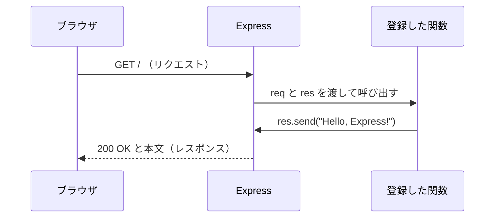

# 第9回　モジュールとnpm、はじめてのExpress

## 1. 今日のゴール

- `require` と `module.exports` で、プログラムを複数のファイルに分けられる
- `npm install` でライブラリを入れ、Expressで「Hello」を返すサーバーを作れる
- パスによって違う返事をするサーバーを作り、`req.params` と `req.query` で値を受け取れる

## 2. 教科書の該当節

| 節 | 見出し | 読み方 |
|---|---|---|
| 3.1 | CommonJS modules | 今日の 4.2 |
| 3.4 | 標準モジュール（Core API） | 今日の 4.2 |
| 3.5 | npmと外部モジュールの読み込み | 今日の 4.3 |
| 6.1 | Expressの基礎と導入 | 今日の 4.4 |
| 6.2 | Expressの必須機能 | 今日の 4.5（続きは第13・14回） |

教科書の目次の中で、今日の場所はここ（★が今日）。今日から後半の中心になる6章に入る。

| 章・節 | 見出し | この授業では |
|---|---|---|
| **3章** | **Node.jsとモジュール** | |
| 3.1 | CommonJS modules | ★ 今日 |
| 3.2 | ECMAScript modules | 扱わない（読み替え表だけ） |
| 3.3 | モジュールの使い分け | 扱わない |
| 3.4 | 標準モジュール（Core API） | ★ 今日 |
| 3.5 | npmと外部モジュールの読み込み | ★ 今日 |
| **6章** | **ExpressによるREST APIサーバー／Webサーバー** | |
| 6.1 | Expressの基礎と導入 | ★ 今日 |
| 6.2 | Expressの必須機能 | ★ 今日（第13・14回に続く） |
| 6.3〜 | エラーハンドリング、データベース連携 ほか | 第10回以降 |

## 3. 前回のふりかえり

**Q1.** `node zip.js 1000001` と実行したとき、プログラムの中で `1000001` を取り出すには、何と書けばよいか。

**Q2.** 次のプログラムを `node q2.js 3` と実行すると、何が表示されるか。

```js
const n = process.argv[2];
console.log(n + 1);
```

---

## 4. 解説と例題

今日は `lesson09` フォルダの中に、`hello-express` というフォルダを作って進める。例題の完成したコードは `examples/hello-express` に入っている。

### 4.1 これから作るもの：サーバー

前回までは、`fetch` でサーバーに**問い合わせる側**のプログラムを作ってきた。今日からは、問い合わせに**答える側**、つまりサーバーを作る。

| | これまで | これから |
|---|---|---|
| 作るもの | 問い合わせる側（クライアント） | 答える側（サーバー） |
| 動き方 | 実行すると、仕事をして終わる | 起動したら、問い合わせを待ち続ける |
| Javaでいうと | `main` メソッドのプログラム | Servlet（Tomcatの上で動く） |

JavaではTomcatというサーバーの上でServletを動かした。Node.jsでは、**Express**というライブラリを使って、サーバーそのものを自分のプログラムで作る。

### 4.2 モジュール：プログラムをファイルに分ける

Expressを使う前に、ほかのファイルに書かれたプログラムを使う方法を学ぶ。ファイルに分けたプログラムの1つ1つを**モジュール**という。

まず、自分で作ったファイルを使ってみよう。

`greeting.js`

```js
// あいさつの文を作る関数
const hello = (name) => {
  return `こんにちは、${name}さん`;
};

const goodbye = (name) => {
  return `さようなら、${name}さん`;
};

// ほかのファイルから使えるようにする
module.exports = { hello, goodbye };
```

`main.js`

```js
// greeting.js を読み込む（.js は省略できる）
const greeting = require("./greeting");

console.log(greeting.hello("佐藤"));
console.log(greeting.goodbye("佐藤"));

// 分割代入で、必要な関数だけ取り出すこともできる
const { hello } = require("./greeting");
console.log(hello("鈴木"));
```

実行結果（`node main.js`）：

```
こんにちは、佐藤さん
さようなら、佐藤さん
こんにちは、鈴木さん
```

| 書き方 | 意味 |
|---|---|
| `module.exports = { hello, goodbye };` | このファイルから、外に出すものを決める（第5回の `{ hello: hello, goodbye: goodbye }` の短い書き方） |
| `require("./greeting")` | ファイルを読み込み、`module.exports` に入れたものを受け取る |

`require` で読み込めるものは3種類ある。`( )` の中の書き方で区別する。

| 種類 | 書き方 | 例 |
|---|---|---|
| 自分で作ったファイル | `./` から始める | `require("./greeting")` |
| Node.js にはじめから入っているもの（標準モジュール） | 名前だけ | `require("fs")`（第3回で使った） |
| npm で入れたライブラリ | 名前だけ | `require("express")`（このあと使う） |

第3回で「決まり文句」と言った `const fs = require("fs");` は、ファイルを扱う標準モジュールを読み込んでいたのである。

> **`import` という書き方について**
> ネットの記事では、`require` の代わりに `import` を使ったコードをよく見かける。これは ECMAScript modules という別の方式である（教科書3.2）。この授業と教科書のサンプルは `require` に統一しているので、見かけたら次のように読み替えよう。
>
> | 記事で見かける書き方（import） | この授業の書き方（require） |
> |---|---|
> | `import express from "express";` | `const express = require("express");` |
> | `import { hello } from "./greeting.js";` | `const { hello } = require("./greeting");` |
> | `export const hello = ...` / `export default ...` | `module.exports = { hello };` |
>
> 2つの方式を1つのプロジェクトで混ぜると動かなくなる。記事のコードを写すときは、`require` の形に直してから使うこと。

### 4.3 npm：ライブラリを入れる

**npm** は、世界中の人が作ったライブラリ（パッケージ）を、自分のプロジェクトに入れるための道具である。Node.js と一緒にインストールされている。JavaでいうMavenやGradleに当たる。

`hello-express` フォルダで、次の2つのコマンドを順に実行する。

```powershell
npm init -y
npm install express
```

| コマンド | すること |
|---|---|
| `npm init -y` | このフォルダを1つのプロジェクトにする。`package.json` ができる |
| `npm install express` | Express をダウンロードして、このプロジェクトに入れる |

実行すると、フォルダの中に次のものが増える。

| できるもの | 中身 | 自分で書き換えるか |
|---|---|---|
| `package.json` | プロジェクトの情報と、使っているライブラリの一覧 | 必要なときだけ |
| `package-lock.json` | 入れたライブラリの正確なバージョンの記録 | 書き換えない |
| `node_modules` フォルダ | ダウンロードされたライブラリの本体 | 書き換えない |

`package.json` の中には、次のような部分ができている。これが「このプロジェクトは express を使っている」という記録である。

`package.json`

```json
{
  "name": "hello-express",
  "version": "1.0.0",
  "private": true,
  "dependencies": {
    "express": "^5.3.0"
  }
}
```

（`npm init -y` が作る `package.json` には、ほかにも項目がある。上は大事な部分だけを残したもの。）

`node_modules` はとても大きいので、人に渡したり、Gitに入れたりしない。`package.json` さえあれば、受け取った人が `npm install` と実行するだけで、同じライブラリが入る。`examples` フォルダのコードを動かすときも、まず `npm install` を実行すること。

### 4.4 はじめてのExpress

いよいよサーバーを作る。

`hello.js`

```js
const express = require("express");

const app = express();
const port = 3000;

// GET / へのリクエストが来たら、この関数を呼び出してもらう
app.get("/", (req, res) => {
  res.send("Hello, Express!");
});

// 3000番で待ち始める
app.listen(port, () => {
  console.log(`http://localhost:${port} で待っています`);
});
```

`node hello.js` と実行すると、次のように表示されたまま、プログラムは終わらない。

```
http://localhost:3000 で待っています
```

ブラウザで `http://localhost:3000` を開くと、`Hello, Express!` と表示される。

| 行 | していること |
|---|---|
| `const app = express();` | サーバーの本体を作る |
| `app.get("/", 関数);` | 「`/` にGETのリクエストが来たら、この関数を呼び出して」と登録する |
| `(req, res) => { ... }` | リクエストが来るたびに呼び出される関数。`req` がリクエスト、`res` がレスポンス |
| `res.send("...")` | ブラウザに返事を送る |
| `app.listen(3000, 関数);` | 3000番のポートで待ち始める。待ち始めたら関数が呼び出される |

第4回の「関数を渡す」と同じ形である。`app.get` は関数を登録するだけで、その関数を呼び出すのは、リクエストが来たときのExpressである。

Servletと比べてみよう。

| Servlet（Java） | Express |
|---|---|
| `@WebServlet("/hello")` | `app.get("/hello", ...)` の1つ目の引数 |
| `doGet(request, response)` | `(req, res) => { ... }` |
| `request` / `response` | `req` / `res` |
| `response.getWriter().println("...")` | `res.send("...")` |
| Tomcat を起動する | `node hello.js` |

**サーバーの止め方と、書き換えたとき**

- 止めるときは、ターミナルで `Ctrl + C` を押す
- プログラムを書き換えたら、**一度止めて、もう一度 `node hello.js` で起動し直す**。起動し直さないと、書き換えは反映されない

ブラウザとサーバーのやりとりを、シーケンス図で見てみよう。



### 4.5 ルーティング：パスによって返事を変える

`app.get` を並べると、パスごとに違う返事ができる。リクエストを、パスに合った関数へ振り分けることを**ルーティング**という。

`app.js`

```js
const express = require("express");

const app = express();
const port = 3000;

// トップページ
app.get("/", (req, res) => {
  res.send("<h1>はじめてのExpress</h1>");
});

// /hello
app.get("/hello", (req, res) => {
  res.send("こんにちは");
});

// /users/1 や /users/25 のように、パスの一部を受け取る
app.get("/users/:id", (req, res) => {
  const id = req.params.id;
  res.send(`ユーザー番号は ${id} です`);
});

// /search?q=express のように、? の後ろの値を受け取る
app.get("/search", (req, res) => {
  const q = req.query.q;
  res.send(`「${q}」を検索しました`);
});

app.listen(port, () => {
  console.log(`http://localhost:${port} で待っています`);
});
```

`hello.js` を止めてから `node app.js` で起動し、ブラウザで次のURLを開いて確かめよう。

| 開くURL | 表示されるもの |
|---|---|
| `http://localhost:3000/` | 大きな文字で「はじめてのExpress」 |
| `http://localhost:3000/hello` | こんにちは |
| `http://localhost:3000/users/25` | ユーザー番号は 25 です |
| `http://localhost:3000/search?q=express` | 「express」を検索しました |
| `http://localhost:3000/abc` | Cannot GET /abc（登録していないパス。404 Not Found） |

URLから値を受け取る方法は2つある。

| | パスの一部（パスパラメータ） | `?` の後ろ（クエリ文字列） |
|---|---|---|
| URLの例 | `/users/25` | `/search?q=express` |
| 登録の書き方 | `app.get("/users/:id", ...)` | `app.get("/search", ...)` |
| 受け取り方 | `req.params.id` | `req.query.q` |
| Servletでは | （URLパターンの工夫が必要） | `request.getParameter("q")` |

- `:id` の `:` は「ここには何が来てもよい。来たものを `id` という名前で受け取る」という印
- `res.send` にHTMLの文字列を渡すと、ブラウザはHTMLとして表示する
- どちらで受け取った値も**文字列**である。計算に使うときは `Number( )` で数値に直す

---

## 5. 図を読む問題

4.4 のシーケンス図を見て答えよう。

1. ブラウザがExpressに送っているものを何というか。
2. 登録した関数を呼び出しているのは、ブラウザとExpressのどちらか。
3. `res.send(...)` を実行しているのは、どの登場人物か。
4. ブラウザを再読み込みすると、この図のやりとりは何回起きるか。

---

## 6. 演習（基本）

演習用に、`lesson09` の中に `practice` フォルダを作り、その中で `npm init -y` と `npm install express` を実行してから始める。

サーバーのプログラムは、どれも3000番を使う。次の問題に進むときは、前のサーバーを `Ctrl + C` で止めること。

### 問1　自分のモジュールを作る（`calc.js`、`q1-main.js`）

2つの数の足し算をする `add` と、掛け算をする `multiply` を `calc.js` に作り、`module.exports` で外に出す。`q1-main.js` から読み込んで、次のように表示する。

```
3 + 5 = 8
3 × 5 = 15
```

### 問2　自己紹介サーバー（`q2-app.js`）

次の3つのパスに答えるサーバーを作る。内容は自分のことに変えてよい。

| パス | 返すもの |
|---|---|
| `/` | `<h1>佐藤のページ</h1>` |
| `/hobby` | `趣味はゲームです` |
| `/school` | `情報系の学科で学んでいます` |

### 問3　値を受け取る（`q3-app.js`）

次の2つのパスに答えるサーバーを作る。

| 開くURL | 表示されるもの |
|---|---|
| `/greet/佐藤` | `佐藤さん、こんにちは` |
| `/add?a=3&b=5` | `3 + 5 = 8` |

ヒント：クエリ文字列の値は文字列なので、そのまま足すと `35` になってしまう。

### 問4　今の時刻を返す（`q4-app.js`）

`/time` を開くと、今の日時を返すサーバーを作る。ブラウザを再読み込みするたびに、時刻が変わることを確かめる。

```
今は 2026/11/15 10:30:00 です
```

ヒント：`new Date().toLocaleString("ja-JP")` と書くと、今の日時を表す文字列になる。これを、登録する関数の**中**に書くこと。

---

## 7. 演習（発展）

### 発展1　見つからないときは 404 を返す（`x1-app.js`）

次の配列を使い、`/users/:id` で、その番号のユーザーの名前を返すサーバーを作る。

```js
const users = [
  { id: 1, name: "佐藤" },
  { id: 2, name: "鈴木" },
  { id: 3, name: "高橋" },
];
```

| 開くURL | 表示されるもの |
|---|---|
| `/users/2` | `鈴木さんのページ` |
| `/users/9` | `ユーザーが見つかりません`（ステータスコードは 404） |

ヒント：

- `find` で探す。`req.params.id` は文字列なので、数値に直してから比べる
- `res.status(404).send("...")` と書くと、ステータスコードを 404 にして返事を送れる
- ステータスコードは、ブラウザの開発者ツール（`F12`）の「ネットワーク」で確かめられる

### 発展2　サーバーの中で fetch する（`x2-app.js`）

`/zip/1000001` を開くと、zipcloud（第7回）に問い合わせて住所を返すサーバーを作る。

```
〒1000001 は 東京都千代田区千代田
```

ヒント：登録する関数に `async` を付けると、中で `await` が使える。`app.get("/zip/:zipcode", async (req, res) => { ... })`

---

## 8. まとめ

| キーワード | ひとこと |
|---|---|
| `module.exports` / `require` | ファイルから外に出す／ほかのファイルを読み込む |
| `npm install 名前` | ライブラリを入れる。`package.json` に記録される |
| `node_modules` | ライブラリの本体。人に渡さない。`npm install` で入れ直せる |
| `app.get(パス, 関数)` | そのパスにGETが来たら呼び出す関数を登録する |
| `req` / `res` | リクエスト／レスポンス |
| `res.send(...)` | 返事を送る |
| `req.params` / `req.query` | パスの一部／`?` の後ろの値を受け取る |
| `app.listen(3000)` | 3000番で待ち始める。止めるのは `Ctrl + C` |

**次回**：EJS基礎①　テンプレートに値を渡す。`res.send` にHTMLを文字列で書くのは大変なので、JSPのようにHTMLのひな形を別のファイルに分ける。超簡単掲示板づくりが始まる。
