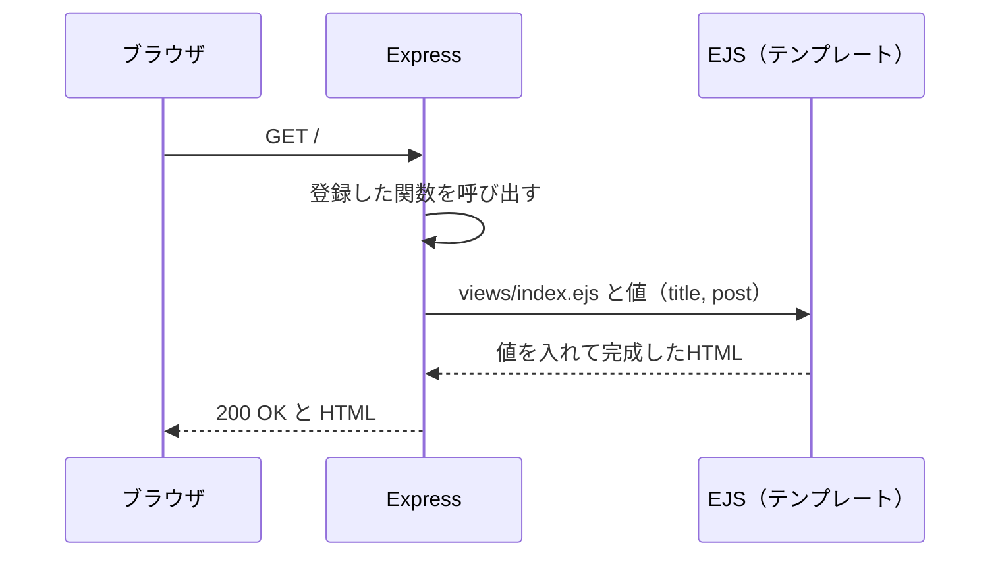

# 第10回　EJS基礎①　テンプレートに値を渡す

## 1. 今日のゴール

- `res.render` で、HTMLのひな形（テンプレート）に値を渡して表示できる
- `<%= %>` で値を表示でき、`<%=` と `<%-` の違い（エスケープ）を説明できる
- 「超簡単掲示板」の投稿を、Expressの中に書いたHTMLの文字列ではなく、テンプレートで表示できる

## 2. 教科書の該当節

| 節 | 見出し | 読み方 |
|---|---|---|
| 6.5 | ビューテンプレート | ★ 今日の 4.2〜4.7（第11・12回に続く） |
| 6.6 | 静的ファイル配信 | 第12回で扱う |

教科書の目次の中で、今日の場所はここ（★が今日）。

| 章・節 | 見出し | この授業では |
|---|---|---|
| 6章 | ExpressによるREST APIサーバー／Webサーバー | |
| 6.1〜6.2 | Expressの基礎、必須機能 | 第9回で扱った |
| 6.3 | エラーハンドリング | 第14回（REST API）で扱う |
| **6.5** | **ビューテンプレート** | **★ 今日（第11・12回に続く）** |
| 6.6 | 静的ファイル配信 | 第12回 |

> 教科書との対応は、目次の見出しだけを見て決めた節単位である。本文の内容は、教科書で確認しておくこと。

## 3. 前回のふりかえり

**Q1.** `greeting.js` の中の関数 `hello` を、別のファイル `main.js` から使えるようにするには、`greeting.js` の最後に何を書くか。

**Q2.** `app.get("/users/:id", ...)` の関数の中で、`/users/7` にアクセスされたときの `req.params.id` は、数値の `7` か。それとも文字列の `"7"` か。

---

## 4. 解説と例題

### 4.1 これまでの方法の、困るところ

第9回では、サーバーの返事をこう書いた。

```js
app.get("/", (req, res) => {
  res.send("<h1>はじめてのExpress</h1>");
});
```

短いうちは問題ない。しかし、掲示板のように、HTMLの中に投稿の名前や本文を入れたくなると、次のように文字列の中にHTMLを書くことになる。

```js
res.send(`
  <h1>超簡単掲示板</h1>
  <p>名前：${post.name}</p>
  <p>本文：${post.message}</p>
`);
```

- HTMLの形がプログラムの中に埋もれ、デザインを直すのが大変になる
- HTMLを書く人（見た目）と、プログラムを書く人（データ）の作業が分けにくい

そこで、HTMLのひな形を、プログラムとは別のファイルに分ける。Javaでいうと、JSPのファイルに当たるものを作る。Node.js では、このひな形を**テンプレート**と呼び、今回は **EJS** というテンプレートエンジンを使う。

### 4.2 EJSの準備：views フォルダとファイル

EJSは、npmで入れるライブラリである。`bbs` という名前のフォルダを作り、その中で次の2つのコマンドを実行する。

```powershell
npm init -y
npm install express ejs
```

テンプレートは、`views` という名前のフォルダに置く。拡張子は `.ejs` にする。

```
bbs/
  app.js          … サーバーのプログラム
  package.json    … npm が作る
  views/
    index.ejs     … テンプレート（HTMLのひな形）
```

`app.js` に、次の1行を書く。これで「テンプレートは EJS で書く」と Express に伝わる。

```js
app.set("view engine", "ejs");
```

今回の例題は、このフォルダ構成で作ったものである。完成したコードは `examples/bbs` に入っている。

### 4.3 テンプレートに値を渡す：res.render

まず、サーバーのプログラムを見てみよう。

`bbs/app.js`

```js
const express = require("express");

const app = express();
const port = 3000;

// テンプレート（views フォルダの .ejs ファイル）を使う設定
app.set("view engine", "ejs");

// 投稿は、まだ固定のデータ（データベースも配列もこの回では使わない）
const post = {
  id: 1,
  name: "佐藤",
  message: "こんにちは。はじめての投稿です",
  created_at: "2026/11/15 10:30:00",
};

app.get("/", (req, res) => {
  // views/index.ejs を読み込み、2番目の引数の値をテンプレートに渡す
  res.render("index", { title: "超簡単掲示板", post });
});

app.listen(port, () => {
  console.log(`http://localhost:${port} で待っています`);
});
```

`res.render("index", { ... })` の意味は次のとおり。

| 書いたもの | 意味 |
|---|---|
| `"index"` | `views/index.ejs` を使う（拡張子は書かない） |
| `{ title: "超簡単掲示板", post }` | テンプレートに渡す値。`title` という名前と、`post` という名前で使える |

`{ title: "...", post }` の `post` は、`post: post` の省略形である（第5回の書き方）。

### 4.4 テンプレートで値を表示する：`<%= %>`

次に、テンプレートを見てみよう。

`bbs/views/index.ejs`

```ejs
<!DOCTYPE html>
<html lang="ja">
<head>
  <meta charset="UTF-8">
  <title><%= title %></title>
</head>
<body>
  <h1><%= title %></h1>
  <div>
    <p>名前：<%= post.name %></p>
    <p>本文：<%= post.message %></p>
    <p>日時：<%= post.created_at %></p>
  </div>
</body>
</html>
```

テンプレートの中の `<%= ... %>` は、**JavaScriptの式を書く場所**である。この部分は、実行したときに値に置き換わる。

| テンプレートの中 | 置き換わる値 |
|---|---|
| `<%= title %>` | `"超簡単掲示板"` |
| `<%= post.name %>` | `"佐藤"`（`post` の `name` の値） |
| `<%= post.message %>` | `"こんにちは。はじめての投稿です"` |

`<%= %>` の中は、ふつうのJavaScriptと同じように書ける。たとえば `<%= post.name + "さん" %>` のように、計算や連結もできる。

`node app.js` で起動し、`http://localhost:3000` を開くと、次のように表示される。

```
超簡単掲示板
名前：佐藤
本文：こんにちは。はじめての投稿です
日時：2026/11/15 10:30:00
```

ブラウザの「ページのソースを表示」で見ると、`<%= ... %>` の部分が値に置き換わったHTMLになっていることが分かる。

> **動かしてみよう**
> 1. `app.js` の `post.name` を自分の名前に変える。サーバーを `Ctrl + C` で止めて、`node app.js` で起動し直し、ブラウザを再読み込みする
> 2. サーバーを止めずに、`index.ejs` の文字を変えて保存し、ブラウザを再読み込みする

2 では、サーバーを起動し直さなくても、テンプレートの変更がすぐ表示に出る。一方、`app.js` を変えたときは起動し直さないと反映されない。どこを変えたら起動し直すのかを、ここで覚えておこう。

### 4.5 エスケープ：`<%=` と `<%-`

投稿の本文に、次のような文字を書かれたらどうなるだろうか。

```
<b>太字</b> と <script>x</script>
```

テンプレートには、`<%= %>` と `<%- %>` の2種類がある。違いを確かめよう。

`app.js` の `message` を、次のように書き換える（残りは変えない）。

```js
message: "<b>太字</b> と <script>x</script>",
```

`index.ejs` の本文の行を、次の2行に変える。

```ejs
<p>エスケープあり：<%= post.message %></p>
<p>エスケープなし：<%- post.message %></p>
```

サーバーを起動し直して、ブラウザで表示する。

- 「エスケープあり」の行には、`<b>太字</b> と <script>x</script>` という**文字**がそのまま表示される
- 「エスケープなし」の行は、`太字` が太字になって表示される。`<script>` は中身が実行されるので、画面には何も出ない

ブラウザのソースを見ると、違いがはっきりする。

```html
<p>エスケープあり：&lt;b&gt;太字&lt;/b&gt; と &lt;script&gt;x&lt;/script&gt;</p>
<p>エスケープなし：<b>太字</b> と <script>x</script></p>
```

| 書き方 | 動き | 使う場面 |
|---|---|---|
| `<%= %>` | `<` や `>` を `&lt;` `&gt;` に変える（**エスケープする**）。文字として表示される | 投稿の名前・本文など、人が入力した値 |
| `<%- %>` | 変えずに、HTMLとしてそのまま出す | 自分たちで用意したHTMLの部品（第12回のヘッダーなど）。人が入力した値には使わない |

> **なぜ `<%=` を使うか**
> 掲示板の本文は、ほかの人が書いたものである。`<%- %>` で出すと、書かれたHTMLやスクリプトが、見たほかの人のブラウザで実行されてしまう。人が入力した値は、必ず `<%= %>` で出す。

### 4.6 JSPやThymeleafとの比べ方

| 目的 | Java（JSP） | Java（Thymeleaf） | Node.js（EJS） |
|---|---|---|---|
| 値を渡す | `request.setAttribute` ＋ フォワード | モデルに `addAttribute` | `res.render("index", { ... })` |
| 値を表示する（エスケープする） | JSTL の `<c:out>` | `th:text="${...}"` | `<%= ... %>` |
| 表示する（エスケープしない） | JSPの `<%= ... %>` | `th:utext` | `<%- ... %>` |

> **注意**：JSPの `<%= %>` は、エスケープせずにそのまま出力する。EJSの `<%= %>` は、エスケープする。同じ見た目の書き方でも、意味が反対なので気をつけること。

### 4.7 ふたつのエラーの読み方

テンプレートを書いていると、次の2つのエラーがよく出る。どちらも、ブラウザには「500」のエラー画面が出て、ターミナルにエラーの内容が表示される。今のうちに読み方を知っておこう。

**(a) テンプレートに、値を渡し忘れた**

`index.ejs` で `<%= nama %>` と書いたが、`app.js` で `nama` を渡していないとき。ターミナルには次のように表示される（パスは省略）。

```
ReferenceError: ...\views\index.ejs:2
    1| <h1><%= title %></h1>
 >> 2| <p><%= nama %></p>
    3|

nama is not defined
```

- `nama is not defined` は「`nama` という名前が定義されていない」という意味
- `>>` が指す行を見る。名前の打ちまちがい（`name` と `nama`）、または `res.render` に値を渡していないことが多い

**(b) テンプレートのフォルダが見つからない**

`bbs` の外で `node bbs/app.js` と起動したとき。ターミナルには次のように表示される（パスは省略）。

```
Error: Failed to lookup view "index" in views directory "...\views"
```

- Expressは、**起動したフォルダの中の `views` フォルダ**を探す
- 対策は、`cd bbs` で `bbs` フォルダに移動してから `node app.js` と起動すること

---

## 5. 図を読む問題

次のシーケンス図は、`/` にアクセスしたときの流れを表している。



1. `views/index.ejs` を読み、値を入れて完成したHTMLを作っているのは、どの登場人物か。
2. `title` と `post` を、テンプレートに渡しているのは、どの登場人物か。
3. EJS（テンプレート）から Express へ向かう点線の矢印は、何を返していることを表しているか。
4. 第9回の図では、`res.send("...")` の文字列をブラウザに送っていた。今回の図で、ブラウザに送られるものは何か。

---

## 6. 演習（基本）

演習は、`bbs` フォルダの中で行う。`app.js` を変えたら、サーバーを `Ctrl + C` で止めてから、`node app.js` で起動し直すこと。`views` の中だけを変えたときは、保存してブラウザを再読み込みすればよい。

### 問1　掲示板の名前と投稿を変える

`app.js` の `title` を「わたしの掲示板」に変え、`post` の `name` と `message` を自分の内容にする。ブラウザで次のように表示されればよい。

```
わたしの掲示板
名前：（自分の名前）
本文：（自分の書いた文）
日時：2026/11/15 10:30:00
```

### 問2　`/about` のページを作る（`views/about.ejs`）

`/about` にアクセスすると、「この掲示板について」のページを表示するようにする。

- `views/about.ejs` を作り、`<h1>` に `<%= title %>` を入れる
- `app.js` に `app.get("/about", ...)` を書き、`res.render("about", { title: "この掲示板について" })` と書く

ブラウザで `http://localhost:3000/about` を開いて確かめる。

ヒント：`app.get` の書き方は第9回と同じ。テンプレートの名前は `"about"` と、拡張子を除いて書く。

### 問3　複数の値を渡す

問2の `/about` で、作者の名前と版の番号も表示する。

```
作者：佐藤（版 1）
```

- `res.render("about", { title: ..., owner: "佐藤", version: 1 })` のように、値を2つ以上渡す
- テンプレートでは `<p>作者：<%= owner %>（版 <%= version %>）</p>` と書く

### 問4　エスケープを確かめて、説明する（記述）

本文に `<b>太字</b>` と書いたとき、`<%= %>` と `<%- %>` で表示がどう違うかを確かめる。次の2つの質問に、ノートに答えを書く。

1. `<%= %>` と `<%- %>` の表示は、どこがどう違ったか
2. 掲示板の本文には、どちらを使うべきか。理由も書く

---

## 7. 演習（発展）

### 発展1　文字数を表示する

テンプレートの `<%= %>` の中に、JavaScriptの式を書いてみる。投稿の本文の文字数を、次のように表示する。

```
本文（15文字）：こんにちは。はじめての投稿です
```

- 文字数は、文字列の `length` で求められる（`post.message.length`）
- `<%# コメント %>` と書くと、画面に出ないコメントになる。テンプレートに説明を書くときに使ってみよう

### 発展2　危険な例を説明する（記述）

`<%- %>` で、ほかの人が入力した本文を出すと、なぜ危ないのかを3〜4行で説明する。「見る人のブラウザ」と「スクリプト」という言葉を使うこと。

ヒント：第11回以降の掲示板では、投稿は本当にほかの人が書く。その投稿が、見る人のブラウザでどう扱われるかを考える。

---

## 8. まとめ

| キーワード | ひとこと |
|---|---|
| テンプレート | HTMLのひな形。`views` フォルダに、拡張子 `.ejs` で置く |
| `app.set("view engine", "ejs")` | テンプレートは EJS で書く、と Express に伝える |
| `res.render("名前", 値)` | `views/名前.ejs` を使い、値を渡して、完成したHTMLを返す |
| `<%= 式 %>` | 値を表示する。`<` や `>` をエスケープする |
| `<%- 式 %>` | エスケープせずに出す。人が入力した値には使わない |

**次回**：EJS基礎②　条件分岐と繰り返し。投稿が1件から、複数の件数に増える。`<% %>` で、if と forEach を書く。掲示板は次の回から、`/` を `/posts`（一覧）に変える。
