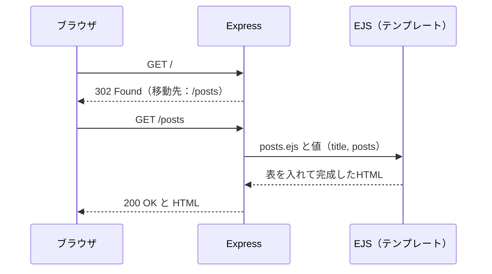

# 第11回　EJS基礎②　条件分岐と繰り返し

## 1. 今日のゴール

- `<% %>` で `if` と `forEach` を書き、配列の中身を表（表形式）にして表示できる
- 投稿が0件のときに、別の文を表示できる
- `res.redirect` で、ブラウザを別のURLに移動させられる

## 2. 教科書の該当節

| 節 | 見出し | 読み方 |
|---|---|---|
| 6.5 | ビューテンプレート | ★ 今日の 4.2〜4.5（前回の続き） |

教科書の目次の中で、今日の場所はここ（★が今日）。

| 章・節 | 見出し | この授業では |
|---|---|---|
| **6章** | **ExpressによるREST APIサーバー／Webサーバー** | |
| 6.5 | ビューテンプレート | ★ 今日（前回の続き。第12回も続く） |
| 6.6 | 静的ファイル配信 | 第12回 |

> 教科書との対応は、目次の見出しだけを見て決めた節単位である。本文の内容は、教科書で確認しておくこと。

## 3. 前回のふりかえり

**Q1.** 人が入力した本文を表示するとき、`<%= %>` と `<%- %>` のどちらを使うか。その理由は何か。

**Q2.** `res.render("about", { ... })` の `"about"` は、どのファイルを使うという意味か。

---

## 4. 解説と例題

### 4.1 投稿が増えると、1つずつは書けない

前回のテンプレートは、投稿1件を `post.name` のように1つずつ表示していた。投稿が3件、10件と増えると、同じ行を何回も書くことになる。

そこで、投稿を**配列**に入れ、テンプレートの中で**繰り返す**。JavaScriptの `forEach`（第4回）を、テンプレートの中で使うのである。

まず、サーバーのプログラムを見てみよう。投稿は、前回の1件から、配列に変わっている。

`bbs/app.js`

```js
const express = require("express");

const app = express();
const port = 3000;

app.set("view engine", "ejs");

// 投稿は、まだ固定のデータ（配列に3件入れておく。第13回から、フォームで増やせるようにする）
const posts = [
  { id: 1, name: "佐藤", message: "こんにちは。はじめての投稿です", created_at: "2026/11/15 10:30:00" },
  { id: 2, name: "鈴木", message: "今日は暑いですね", created_at: "2026/11/15 11:05:00" },
  { id: 3, name: "高橋", message: "EJSの授業がおもしろい", created_at: "2026/11/15 13:20:00" },
];

// トップページは、投稿の一覧に移動させる
app.get("/", (req, res) => {
  res.redirect("/posts");
});

app.get("/posts", (req, res) => {
  res.render("posts", { title: "超簡単掲示板", posts });
});

app.listen(port, () => {
  console.log(`http://localhost:${port} で待っています`);
});
```

前回の `index.ejs` は、一覧を表示する `posts.ejs` に名前を変える。今回の `app.js` では、`/posts` で一覧を表示する。`/` にアクセスすると、`/posts` に移動する（4.5 で説明する）。

テンプレートの全体は次のとおり。4.3 と 4.4 で、部分ごとに説明する。

`bbs/views/posts.ejs`

```ejs
<!DOCTYPE html>
<html lang="ja">
<head>
  <meta charset="UTF-8">
  <title><%= title %></title>
</head>
<body>
  <h1><%= title %></h1>

  <% if (posts.length === 0) { %>
    <p>まだ投稿がありません</p>
  <% } else { %>
    <p>投稿は <%= posts.length %> 件です</p>
    <table border="1">
      <tr>
        <th>番号</th>
        <th>名前</th>
        <th>本文</th>
        <th>日時</th>
      </tr>
      <% posts.forEach((post) => { %>
        <tr>
          <td><%= post.id %></td>
          <td><%= post.name %></td>
          <td><%= post.message %></td>
          <td><%= post.created_at %></td>
        </tr>
      <% }); %>
    </table>
  <% } %>
</body>
</html>
```

### 4.2 `<% %>` と `<%= %>`：値を出すか、処理をするか

テンプレートの中には、3種類の書き方がある。

| 書き方 | 意味 | 例 |
|---|---|---|
| `<%= 式 %>` | 式の値を表示する（エスケープする） | `<%= post.name %>` |
| `<% 処理 %>` | 処理をするだけ。値は表示しない | `<% if (...) { %>` |
| `<%# コメント %>` | 画面に出ないコメント | `<%# 説明 %>` |

`<% %>` は、JavaScriptの文を書く場所である。`if` や `forEach` のような、値を出さない文は `<% %>` に書く。

### 4.3 条件分岐：`if` で表示を変える

投稿が0件のときは、表ではなく「まだ投稿がありません」と表示したい。`if` と `else` を、`<% %>` の中に書く。

`bbs/views/posts.ejs`（条件分岐の部分）

```ejs
<% if (posts.length === 0) { %>
  <p>まだ投稿がありません</p>
<% } else { %>
  <p>投稿は <%= posts.length %> 件です</p>
  （表を表示する）
<% } %>
```

- `if (...) { %>` の `{` と、`<% } else { %>` の `}` は、必ず対で書く
- `<% } %>` で、ifのブロックが閉じる。閉じ忘れると、エラーになる
- 中の HTML（`<p>` など）は、条件が成り立ったときだけ表示される

動かしてみよう：`app.js` の `posts` を `[]` に変えて（空の配列にして）、ブラウザで `/posts` を開く。サーバーを起動し直すこと。確認したら、3件に戻しておく。

### 4.4 繰り返し：`forEach` で表の行を作る

配列の中身を、1件ずつ表の行にする。`forEach` の中に、`<tr>` を書く。

`bbs/views/posts.ejs`（表の部分）

```ejs
<table border="1">
  <tr>
    <th>番号</th>
    <th>名前</th>
    <th>本文</th>
    <th>日時</th>
  </tr>
  <% posts.forEach((post) => { %>
    <tr>
      <td><%= post.id %></td>
      <td><%= post.name %></td>
      <td><%= post.message %></td>
      <td><%= post.created_at %></td>
    </tr>
  <% }); %>
</table>
```

| 書いたもの | 意味 |
|---|---|
| `posts.forEach((post) => { %>` | `posts` の中身を1件ずつ `post` に入れて、次の行を繰り返す |
| `<% }); %>` | 繰り返しの終わり。`});` は第4回の `forEach` と同じ |
| `<td><%= post.name %></td>` | 今の `post` の名前を表示する |

`forEach` の `(post) => { ... }` の部分は、第4回のアロー関数である。テンプレートの中でも、同じJavaScriptとして動く。

### 4.5 表示してみよう：一覧と、トップページからの移動

`node app.js` で起動し、ブラウザで2つのURLを開く。

| 開くURL | 起きること | 表示 |
|---|---|---|
| `http://localhost:3000/` | `/posts` に移動する | （一覧のページになる） |
| `http://localhost:3000/posts` | 一覧を表示する | 表（3件）と「投稿は 3 件です」 |

`/` を開いたときの流れは、次のシーケンス図で確かめよう。



- `res.redirect("/posts")` は、「ほかのURLに移動しなさい」という返事を送る。ブラウザは、自動的に `/posts` を開き直す
- この返事は `302`。ブラウザの開発者ツール（`F12`）の「ネットワーク」で、最初のリクエストに `302` が出ていることを確かめられる
- 移動させることで、「トップページの中身」と「一覧」を、同じ場所（`/posts`）で管理できる

### 4.6 件数が違うとき：`posts` の中身が変わっても同じ書き方

`forEach` は、配列の件数が何件でも、同じ書き方で動く。`posts` に4件目を足せば、表に4行目が増える。

テンプレートを直さなくてよい。ここが、1件ずつ書いていた前回と違う大事なところである。

### 4.7 JSP・Thymeleafとの比べ方

| 目的 | JSP（JSTL） | Thymeleaf | EJS |
|---|---|---|---|
| 条件分岐 | `<c:if test="${...}">` | `th:if="${...}"` | `<% if (...) { %> ... <% } %>` |
| 繰り返し | `<c:forEach items="${posts}" var="post">` | `th:each="post : ${posts}"` | `<% posts.forEach((post) => { %> ... <% }); %>` |
| 値の表示 | `${post.name}` | `th:text="${post.name}"` | `<%= post.name %>` |

- JSPの昔の書き方では、`<% for (...) { %>` と書く「スクリプトレット」も使われた。EJSの `<% %>` は、これに近い
- EJSは、条件も繰り返しも、JavaScriptの `if` と `forEach` をそのまま書く。新しい書き方を覚えなくてよいのが長所
- Thymeleafは、HTMLの属性の形で書く。EJSは、HTMLの中に JavaScript を書く

### 4.8 エラーの読み方：`posts` を渡し忘れた

`app.js` で `posts` を `res.render` に渡し忘れると、次のエラーになる（ターミナルの表示を一部省略した）。

```
ReferenceError: ...\views\posts.ejs:10
    8|   <h1><%= title %></h1>
    9|
 >> 10|   <% if (posts.length === 0) { %>
   11|     <p>まだ投稿がありません</p>
 ...
posts is not defined
```

- `posts is not defined` は、前回の `nama is not defined` と同じ意味で、「`posts` という名前が渡されていない」
- `>>` が指す行（この例では10行目）を見て、`res.render` の中に `posts` があるかを確かめる

---

## 5. 図を読む問題

4.5 のシーケンス図を見て答えよう。

1. `302 Found` の返事を送っているのは、どの登場人物か。
2. 2回目の `GET /posts` の後、表の行（`<tr>`）を作っているのは、どの登場人物か。
3. ブラウザが `/posts` を開くのは、何回か。
4. `/` にアクセスしたとき、ブラウザが最初に受け取るものは、表のHTMLか。それとも別の返事か。

---

## 6. 演習（基本）

演習は `bbs` フォルダの中で行う。`app.js` を変えたら、サーバーを `Ctrl + C` で止めてから `node app.js` で起動し直すこと。`views` の中だけを変えたときは、保存してブラウザを再読み込みすればよい。

### 問1　投稿を2件増やして、5件にする

`posts` の配列に、自分の投稿を2件追加する（`id` は4と5、`created_at` は適当な日時）。`/posts` を開いて、5件の表と、「投稿は 5 件です」が表示されることを確かめる。

### 問2　件数が多いときに、ひとこと表示する（`views/posts.ejs`）

投稿が5件以上あるときだけ、件数の表示の下に、次の1行を表示する。

```
にぎわっています
```

- 「投稿は 5 件です」の `<p>` の下に、`<% if (...) { %>` 〜 `<% } %>` を書く（4.3 の書き方）
- 条件は、`posts.length >= 5`
- 問1で5件にしてあるので、表示されるはずである。`app.js` の投稿を1件減らして4件にすると、表示されなくなることを確かめる（確かめたら、5件に戻す）

### 問3　名前で絞り込んで表示する（`views/posts.ejs`）

`forEach` の前に、`posts.filter(...)` を使って、名前が「佐藤」の投稿だけを表示する。

- 表示する配列は `posts.filter((post) => post.name === "佐藤")` で作れる
- 件数の表示は、絞り込んだ後の件数にする

ヒント：`forEach` を `posts.filter(...).forEach(...)` のようにつなげて書くと、絞り込みと繰り返しを1行で書ける（第5回の「メソッドをつなげる」）。

### 問4　本文だけを番号付きリストにする（記述と、コードの両方）

表の代わりに、`<ol>`（番号付きリスト）で、本文だけを並べる。

```html
<ol>
  <li>こんにちは。はじめての投稿です</li>
  ...
</ol>
```

- `<ol>` の中に、`forEach` で `<li><%= post.message %></li>` を書く
- ノートに、表（`<table>`）とリスト（`<ol>`）の、テンプレートでの書き方の違いを書く

---

## 7. 演習（発展）

### 発展1　新しい投稿から順に表示する

表の行を、`id` の大きい順（新しい順）に並べる。`posts` の配列を直接並べ替えると、元の配列も変わってしまう。コピーを作ってから並べ替えること。

ヒント：`[...posts]` は、`posts` の中身をコピーする（第5回のスプレッド構文）。`reverse()` は、配列の順番を逆にするメソッドである（この回で初めて使う）。`[...posts].reverse()` と書くと、コピーを逆順にできる。

### 発展2　偶数行の色を変える

表の行を、1行おきに色を変える。`forEach` の2番目の引数 `i`（0から始まる番号）を使う。

```ejs
<% posts.forEach((post, i) => { %>
  <tr style="background-color: <%= i % 2 === 0 ? '#eeeeee' : '#ffffff' %>;">
    ...
  </tr>
<% }); %>
```

- `i % 2 === 0` は、偶数かどうかを調べる（第1回の `%` の余りを使う）
- 三項演算子（`条件 ? 値1 : 値2`）は、条件によって2つの値のどちらかを選ぶ書き方である。条件が正しければ値1、そうでなければ値2になる。`if` より短く書けるので、この回で初めて使う

---

## 8. まとめ

| キーワード | ひとこと |
|---|---|
| `<% %>` | 処理をする（値は出さない） |
| `<% if (...) { %> ... <% } %>` | 条件によって表示を変える |
| `<% 配列.forEach((x) => { %> ... <% }); %>` | 配列の中身を1件ずつ繰り返して表示する |
| `res.redirect("/posts")` | ほかのURLに移動させる（302） |
| `<%= %>` | 値を表示する（エスケープする） |

**次回**：EJS基礎③　部品化と静的ファイル。ヘッダーとフッターを別のファイルに分けて、どのページにも同じものを出す。CSSも読み込む。
