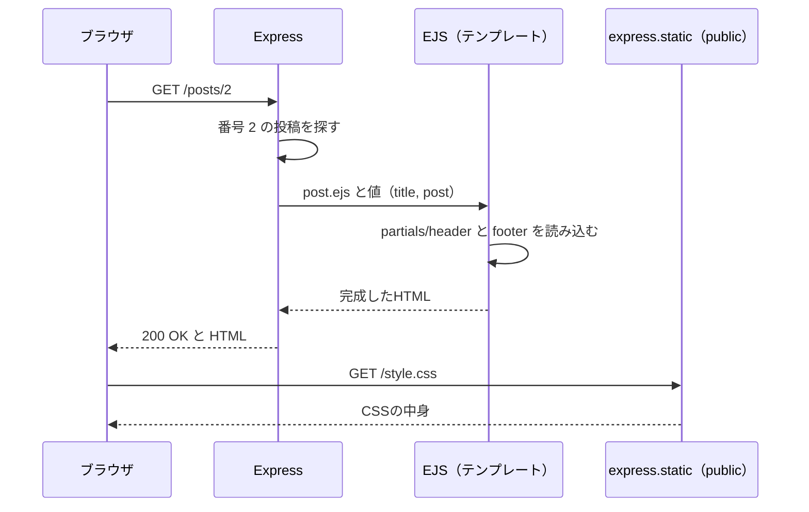

# 第12回　EJS基礎③　部品化と静的ファイル

## 1. 今日のゴール

- `include` で、ヘッダーとフッターを別のファイルにして、どのページにも同じものを出せる
- `express.static` で、CSSのファイルを読み込ませられる
- 一覧の本文から、投稿の詳細ページ（`/posts/:id`）に移動できる

## 2. 教科書の該当節

| 節 | 見出し | 読み方 |
|---|---|---|
| 6.5 | ビューテンプレート | ★ 今日の 4.2（部品化） |
| 6.6 | 静的ファイル配信 | ★ 今日の 4.3（CSS） |

教科書の目次の中で、今日の場所はここ（★が今日）。

| 章・節 | 見出し | この授業では |
|---|---|---|
| **6章** | **ExpressによるREST APIサーバー／Webサーバー** | |
| 6.5 | ビューテンプレート | ★ 今日（部品化） |
| 6.6 | 静的ファイル配信 | ★ 今日（CSS） |

> 教科書との対応は、目次の見出しだけを見て決めた節単位である。本文の内容は、教科書で確認しておくこと。

## 3. 前回のふりかえり

**Q1.** `posts` が空の配列（`[]`）のとき、`/posts` にはどの文が表示されるか。

**Q2.** `res.redirect("/posts")` を実行したとき、サーバーが返す返事のステータスコードは何か。

---

## 4. 解説と例題

### 4.1 同じ部品を、どのページにも書く問題

掲示板には、いくつかのページがある（一覧、詳細）。どのページも、同じヘッダー（上の帯）とフッター（下の一言）がほしい。

前回までは、ページごとに `<!DOCTYPE html>` から `</html>` までを書いていた。ページが増えると、同じ部分を何回も書くことになり、直すときは全部のファイルを直さなければならない。

そこで、同じ部分を、**部品（パーシャル）**のファイルに分ける。Javaでいうと、JSPの `include` や、Thymeleafの `fragment` に当たる。

完成した例は `examples/bbs` に入っている。今回のフォルダ構成は次のとおり。

```
bbs/
  app.js
  package.json
  public/
    style.css               … CSS（ブラウザに、そのまま配るファイル）
  views/
    partials/
      header.ejs            … 部品：ヘッダー（上の帯）
      footer.ejs            … 部品：フッター（下の一言）
    posts.ejs               … 一覧
    post.ejs                … 詳細
```

### 4.2 部品を読み込む：`include`

まず、ヘッダーの部品を見てみよう。

`bbs/views/partials/header.ejs`

```ejs
<!DOCTYPE html>
<html lang="ja">
<head>
  <meta charset="UTF-8">
  <title><%= title %></title>
  <link rel="stylesheet" href="/style.css">
</head>
<body>
  <header>
    <a href="/posts">超簡単掲示板</a>
  </header>
  <main>
```

`header.ejs` の中の `<%= title %>` は、`include` のときに渡された値を使う。ページごとに違うタイトルを、部品に渡せる。

一覧ページ（`posts.ejs`）は、部品を次のように読み込む。

`bbs/views/posts.ejs`（先頭と末尾）

```ejs
<%- include("partials/header", { title: title }) %>

  <h1><%= title %></h1>
  （一覧の内容）

<%- include("partials/footer") %>
```

| 書いたもの | 意味 |
|---|---|
| `include("partials/header", { title: title })` | `partials/header.ejs` を読み込み、`title` を渡す |
| `include("partials/footer")` | `partials/footer.ejs` を読み込む（値は渡さない） |
| `<%- %>` | 読み込んだHTMLを、そのまま出す（エスケープしない） |

- `include` の結果は、HTMLの部品である。前回の `<%- %>` の説明（自分たちで用意したHTMLを、そのまま出す）と同じ使い方になる
- 部品のパスは、`include` を書いたテンプレートのフォルダから見た位置で書く。`posts.ejs` は `views` の中にあるので、`partials/header` と書く

> **動かしてみよう**
> `footer.ejs` の文字を自分の名前に変えて、保存してブラウザを再読み込みする。すべてのページのフッターが、同時に変わることを確かめる。

### 4.3 CSSを読み込ませる：`express.static`

ヘッダーの `<link rel="stylesheet" href="/style.css">` は、CSSを読み込む命令である。しかし、Expressは `/style.css` というページを持っていない。このままでは404になる。

そこで、`app.js` に次の1行を書く。

`bbs/app.js`（前半）

```js
// public フォルダの中のファイル（CSSなど）を、そのままURLで配れるようにする
app.use(express.static("public"));
```

| 書いたもの | 意味 |
|---|---|
| `app.use(...)` | すべてのリクエストに対して、順に動く部品（ミドルウェア）を登録する |
| `express.static("public")` | `public` フォルダの中のファイルを、そのままURLで配る |

- `public/style.css` は、`http://localhost:3000/style.css` で開ける
- `express.static` は、テンプレート（EJS）を通さない。CSSは、そのままの中身を返す
- `app.use` は、第9回の `app.get` と違い、パスを決めずに、すべてのリクエストで動く。ミドルウェアは、第13回（`express.urlencoded`）と第14回（`express.json`）でも使う

Servletでは、WebContentの中のCSSを、Tomcatが自動で配っていた。Expressでは、どのフォルダを配るかを `express.static` で自分が決める。

### 4.4 詳細ページ：`/posts/:id`

一覧の本文をクリックすると、その投稿の詳細ページに移動したい。第9回の `req.params` と、第9回の発展1（見つからないときは404）を組み合わせる。

`bbs/app.js`（詳細の部分）

```js
// 投稿の詳細ページ。/posts/2 のように、番号で1件の投稿を探す
app.get("/posts/:id", (req, res) => {
  const id = Number(req.params.id);
  const post = posts.find((p) => p.id === id);

  if (post === undefined) {
    res.status(404).send("その投稿は見つかりません");
    return;
  }

  res.render("post", { title: "投稿の詳細", post });
});
```

- `req.params.id` は文字列なので、`Number( )` で数値に直してから、`find` で探す
- 見つからないときは、`return` で関数を終わらせ、404 の返事を送る。`return` を書き忘れると、下の `res.render` も呼ばれてしまう（第9回の発展1）
- 一覧ページの本文は、次のように詳細ページへのリンクになっている

`bbs/views/posts.ejs`（表の1行）

```ejs
<td><a href="/posts/<%= post.id %>"><%= post.message %></a></td>
```

### 4.5 詳細ページを表示してみよう

`node app.js` で起動し、次のURLを開く。

| 開くURL | 表示されるもの |
|---|---|
| `http://localhost:3000/posts` | 一覧（本文をクリックできる） |
| `http://localhost:3000/posts/2` | 番号 2 の詳細（鈴木の投稿） |
| `http://localhost:3000/posts/9` | その投稿は見つかりません（404） |
| `http://localhost:3000/style.css` | CSSの中身（テキストとして表示される） |

ブラウザの見た目が、CSSで変わっていることを確かめよう。

シーケンス図で、詳細ページの流れを確かめよう。



- HTMLは、EJSを通って作られる。CSSは、EJSを通らず、`express.static` が `public` から直接返す
- ブラウザは、HTMLを受け取った後に、その中の `<link>` を見て、CSSを改めて取りに行く

### 4.6 JSPやThymeleafとの比べ方

| 目的 | Java（JSP） | Java（Thymeleaf） | Node.js（EJS） |
|---|---|---|---|
| 部品を読み込む | `<%@ include file="header.jsp" %>` | `th:replace="~{fragments/header :: header}"` | `<%- include("partials/header") %>` |
| 静的なファイル（CSS） | WebContent に置けば、Tomcat が配る | Spring Boot なら `static` フォルダに置けば配られる | `app.use(express.static("public"))` で、配るフォルダを指定する |

- JSPの `include` は、ページを作るときに部品を取り込む。EJSの `include` も、同じく描画のときに取り込む
- Expressは、配るフォルダを自分で決める。`public` 以外のファイルは、URLで開けない。ここが、自分で書く分の違い

### 4.7 エラーの読み方：部品が見つからない

部品のパスを間違えると、次のエラーになる（確認済み）。

```
Error: ...\views\posts.ejs:1
Could not find the include file "partial/header"
```

- `Could not find the include file` は、「部品のファイルが見つからない」という意味
- `partial`（s がない）と書いた、ファイル名の打ちまちがいが多い。`partials` フォルダの名前を確かめる

もう1つ、`express.static` は、起動したフォルダの中の `public` を探す（第10回の `views` と同じ）。`bbs` の外から `node bbs/app.js` と起動すると、`/style.css` は404になる。`cd bbs` で移動してから起動すること（確認済み）。

---

### 4.8 完成したファイル（全体）

この回の終わりの状態は、次のとおり（`examples/bbs` にも入っている）。前の回の続きから作る場合は、変わったところだけを直してもよい。

`bbs/app.js`

```js
const express = require("express");

const app = express();
const port = 3000;

app.set("view engine", "ejs");

// public フォルダの中のファイル（CSSなど）を、そのままURLで配れるようにする
app.use(express.static("public"));

// 投稿は、まだ固定のデータ（第13回から、フォームで増やせるようにする）
const posts = [
  { id: 1, name: "佐藤", message: "こんにちは。はじめての投稿です", created_at: "2026/11/15 10:30:00" },
  { id: 2, name: "鈴木", message: "今日は暑いですね", created_at: "2026/11/15 11:05:00" },
  { id: 3, name: "高橋", message: "EJSの授業がおもしろい", created_at: "2026/11/15 13:20:00" },
];

// トップページは、投稿の一覧に移動させる
app.get("/", (req, res) => {
  res.redirect("/posts");
});

app.get("/posts", (req, res) => {
  res.render("posts", { title: "超簡単掲示板", posts });
});

// 投稿の詳細ページ。/posts/2 のように、番号で1件の投稿を探す
app.get("/posts/:id", (req, res) => {
  const id = Number(req.params.id);
  const post = posts.find((p) => p.id === id);

  if (post === undefined) {
    res.status(404).send("その投稿は見つかりません");
    return;
  }

  res.render("post", { title: "投稿の詳細", post });
});

app.listen(port, () => {
  console.log(`http://localhost:${port} で待っています`);
});
```

`bbs/views/posts.ejs`

```ejs
<%- include("partials/header", { title: title }) %>

  <h1><%= title %></h1>

  <% if (posts.length === 0) { %>
    <p>まだ投稿がありません</p>
  <% } else { %>
    <p>投稿は <%= posts.length %> 件です</p>
    <table>
      <tr>
        <th>番号</th>
        <th>名前</th>
        <th>本文</th>
        <th>日時</th>
      </tr>
      <% posts.forEach((post) => { %>
        <tr>
          <td><%= post.id %></td>
          <td><%= post.name %></td>
          <td><a href="/posts/<%= post.id %>"><%= post.message %></a></td>
          <td><%= post.created_at %></td>
        </tr>
      <% }); %>
    </table>
  <% } %>

<%- include("partials/footer") %>
```

`bbs/views/post.ejs`

```ejs
<%- include("partials/header", { title: title }) %>

  <h1><%= title %></h1>

  <div class="post">
    <p>番号：<%= post.id %></p>
    <p>名前：<%= post.name %></p>
    <p>本文：<%= post.message %></p>
    <p>日時：<%= post.created_at %></p>
  </div>
  <p><a href="/posts">一覧に戻る</a></p>

<%- include("partials/footer") %>
```

`bbs/views/partials/header.ejs`

```ejs
<!DOCTYPE html>
<html lang="ja">
<head>
  <meta charset="UTF-8">
  <title><%= title %></title>
  <link rel="stylesheet" href="/style.css">
</head>
<body>
  <header>
    <a href="/posts">超簡単掲示板</a>
  </header>
  <main>
```

`bbs/views/partials/footer.ejs`

```ejs
  </main>
  <footer>
    <p>超簡単掲示板（授業で作った例）</p>
  </footer>
</body>
</html>
```

`bbs/public/style.css`

```css
body {
  font-family: sans-serif;
  margin: 0;
  background: #f5f7fa;
  color: #222;
}

header {
  background: #1f3a5f;
  padding: 12px 24px;
}

header a {
  color: #fff;
  text-decoration: none;
  font-weight: bold;
}

main {
  padding: 16px 24px;
}

table {
  border-collapse: collapse;
  background: #fff;
}

th {
  background: #4f81bd;
  color: #fff;
}

th,
td {
  border: 1px solid #aaa;
  padding: 6px 10px;
}

.post {
  background: #fff;
  border-left: 6px solid #4f81bd;
  padding: 12px 16px;
}

footer {
  padding: 12px 24px;
  color: #666;
  font-size: 14px;
}
```
---

## 5. 図を読む問題

4.5 のシーケンス図を見て答えよう。

1. 部品（`header.ejs`、`footer.ejs`）を読み込んでいるのは、どの登場人物か。
2. 番号 2 の投稿を探しているのは、どの登場人物か。
3. `/style.css` は、EJSを通るか。通らないなら、誰が返すか。
4. `/posts/9` にアクセスしたとき、ブラウザが受け取るステータスコードは何か。

---

## 6. 演習（基本）

演習は `bbs` フォルダの中で行う。`app.js` を変えたら、サーバーを `Ctrl + C` で止めてから `node app.js` で起動し直すこと。`views` や `public` の中だけを変えたときは、保存してブラウザを再読み込みすればよい。

### 問1　CSSとフッターを変える（`public/style.css`、`views/partials/footer.ejs`）

1. `public/style.css` の `h1` に、文字の色を付ける（例：`color: #c0392b;`）。一覧と詳細の両方の `h1` の色が変わることを確かめる
2. `views/partials/footer.ejs` の文字を、自分の名前を含むものに変える。すべてのページのフッターが変わることを確かめる

- CSSが変わらないときは、ブラウザで強制的に読み直す（`Ctrl + F5`）

### 問2　「この掲示板について」のページを、部品つきで作る（`views/about.ejs`、`app.js`、`views/partials/header.ejs`）

`/about` にアクセスすると、ヘッダーとフッターの付いた「この掲示板について」のページを表示する。

1. `views/about.ejs` を作る。`post.ejs` をまねて、最初と最後で `include` を使い、ヘッダーとフッターを読み込む。間に、`<h1><%= title %></h1>` と、掲示板の説明の文（`<p>`）を1つ書く
2. `app.js` に `app.get("/about", ...)` を書き、`res.render("about", { title: "この掲示板について" })` と書く
3. `views/partials/header.ejs` の `<header>` の中に、`<a href="/about">この掲示板について</a>` を足す

一覧・詳細・`/about` の、どのページのヘッダーにも、リンクが出ることを確かめる。

ヒント：

- `app.get("/about", ...)` は、`app.get("/posts/:id", ...)` と別のパスなので、どこに書いてもよい
- 2つのリンクがくっついて見えるときは、`style.css` の `header a` に `margin-right: 16px;` を足す

### 問3　404のページを、ヘッダーとフッターつきにする（`views/not-found.ejs`、`app.js`）

`/posts/9` の404の表示を、「その投稿は見つかりません」だけの文字ではなく、ヘッダーとフッターのあるページにする。

1. `views/not-found.ejs` を作り、`include` でヘッダーとフッターを読み込む
2. `app.js` で、`res.status(404).render("not-found", { title: "見つかりません" })` と書く

ヒント：`res.status(404)` の後に `render` を書くと、ステータスコードが404のままページを返せる。

### 問4　名前ごとの一覧ページを作る（`app.js`、`views/posts.ejs`）

`/users/佐藤` のように開くと、その名前の人の投稿だけを、一覧の表で表示する。

| 開くURL | 表示されるもの |
|---|---|
| `/users/佐藤` | 見出し「佐藤さんの投稿」と、佐藤さんの投稿だけの表 |
| `/users/山田` | 見出し「山田さんの投稿」と、「まだ投稿がありません」 |

1. `app.js` に `app.get("/users/:name", ...)` を書く。`req.params.name` で名前を受け取る（第9回）
2. `posts.filter(...)` で、その名前の投稿だけの配列を作る（第4回）
3. 新しいテンプレートは作らない。`res.render("posts", { title: ..., posts: 絞り込んだ配列 })` と書いて、一覧のテンプレートをそのまま使う
4. `views/posts.ejs` の表の名前を、`<a href="/users/<%= post.name %>"><%= post.name %></a>` に変えて、名前から移動できるようにする

ヒント：

- 見出しは、テンプレートリテラルで `` `${name}さんの投稿` `` と作る
- 今回は、名前は文字列のまま比べる。`Number( )` は使わない
- 同じテンプレートに、違う配列を渡すだけで、別のページになる。0件のときの表示（第11回の `if`）も、そのまま働く

---

## 7. 演習（発展）

### 発展1　前の投稿・次の投稿へのリンク

詳細ページに、「前の投稿」と「次の投稿」のリンクを付ける。

- 前の投稿は、番号が1つ小さい投稿。`id - 1` の投稿が存在するときだけ、リンクを表示する
- 次の投稿は、`id + 1` の投稿が存在するときだけ表示する

ヒント：

- 詳細ページは、今は `posts` を受け取っていない。`app.js` の `res.render("post", ...)` に `posts` を追加する（`{ title: "投稿の詳細", post, posts }`）
- `posts.find((p) => p.id === post.id - 1)` で前の投稿を探せる。見つからなかったら `undefined` なので、`if` で分ける

### 発展2　長い本文は省略して表示する

一覧の本文を、20文字を超えたら途中から `…` にして表示する。詳細ページには、全文を表示する。

- 文字数は `post.message.length`、先頭の20文字は `post.message.slice(0, 20)` で取り出せる。`slice` は、文字列の一部を切り出すメソッドである（この回で初めて使う）
- 三項演算子（`条件 ? 値1 : 値2`）を、テンプレートの `<%= %>` の中で使う。条件が正しければ値1、そうでなければ値2になる（第11回の発展2と同じ）

---

## 8. まとめ

| キーワード | ひとこと |
|---|---|
| `include("partials/...")` | 部品のファイルを読み込む。`<%- %>` で出す |
| `app.use(express.static("public"))` | `public` の中のファイルを、そのままURLで配る |
| `/posts/:id` | 番号で1件の投稿を探す詳細ページ |
| `return` | 404を返したら、関数を終わらせる |

**次回**：フォーム処理。掲示板に投稿フォームを付け、POSTで投稿を受け取る。投稿の後は、PRG（投稿の後に移動する）で二重投稿を防ぐ。
