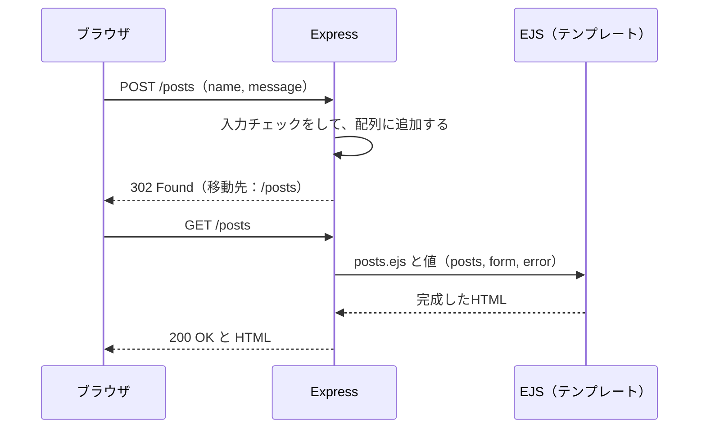

# 第13回　フォーム処理

## 1. 今日のゴール

- HTMLのフォームで入力した値を、POSTで送り、サーバーで `req.body` として受け取れる
- 入力チェックを行い、不正なときは400を返して、入力した値を残したまま表示できる
- 投稿の後は移動（リダイレクト）させる理由（PRG）を説明できる

## 2. 教科書の該当節

| 節 | 見出し | 読み方 |
|---|---|---|
| 6.2 | Expressの必須機能 | ★ 今日の 4.2〜4.4（POST、フォームの値の受け取り） |

教科書の目次の中で、今日の場所はここ（★が今日）。

| 章・節 | 見出し | この授業では |
|---|---|---|
| **6章** | **ExpressによるREST APIサーバー／Webサーバー** | |
| 6.2 | Expressの必須機能 | ★ 今日（POST。続きは第14回） |
| 6.5 | ビューテンプレート | 第10〜12回で扱った |

> 教科書との対応は、目次の見出しだけを見て決めた節単位である。本文の内容は、教科書で確認しておくこと。

## 3. 前回のふりかえり

**Q1.** `header.ejs` の中の `<%= title %>` の値は、どこから来るか。

**Q2.** `/posts/9` にアクセスしたとき、サーバーが返すステータスコードは何か。

---

## 4. 解説と例題

### 4.1 フォームで値を送る

掲示板に投稿するには、名前と本文を入力する画面が必要である。HTMLの `<form>` で作る。

`bbs/views/posts.ejs`（フォームの部分）

```ejs
<form method="POST" action="/posts">
  <p>
    <label>名前：<input type="text" name="name" value="<%= form.name %>"></label>
  </p>
  <p>
    <label>本文：<textarea name="message" rows="3" cols="40"><%= form.message %></textarea></label>
  </p>
  <button type="submit">投稿する</button>
</form>
```

| 書いたもの | 意味 |
|---|---|
| `method="POST"` | 送る方法。値をリクエストの中に入れて送る（URLには出ない） |
| `action="/posts"` | 送る先のURL |
| `name="name"` | 送る値の名前。サーバーでは、この名前で受け取る |
| `<button type="submit">` | 押すと、フォームの中身を送る |

`value="<%= form.name %>"` は、入力欄に最初から入っている値である。今は空の文字（`""`）が入る。エラーのときに、入力した値を残すために使う（4.3で説明する）。

### 4.2 サーバーで受け取る：`app.post` と `req.body`

フォームは `POST /posts` で送られる。第9回の `app.get` と同じ書き方で、`app.post` を使う。

`bbs/app.js`（前半）

```js
// フォームから送られた値（name=...&message=...）を、req.body で受け取れるようにする
app.use(express.urlencoded({ extended: false }));
```

`bbs/app.js`（投稿を受け取る部分）

```js
app.post("/posts", (req, res) => {
  const body = req.body ?? {};
  const name = (body.name ?? "").trim();
  const message = (body.message ?? "").trim();
  // （入力チェックは4.3）
});
```

| 書いたもの | 意味 |
|---|---|
| `express.urlencoded(...)` | フォームの値（`name=...&message=...`）を読み取って、`req.body` に入れる部品 |
| `app.post("/posts", ...)` | `POST /posts` が来たときに呼ぶ関数を登録する（`app.get` の POST 版） |
| `req.body.name` | フォームの `name` の値 |
| `.trim()` | 前後の空白を取り除く |
| `??` | 左の値が `undefined`（または `null`）のときだけ、右の値を使う |

- `req.body` は、フォームの形式（`name=...&message=...`）で届かなかったときは `undefined` になる（Express 5 では、空のオブジェクトにはならない）。たとえば、JSONで送られたときがこれに当たる。そのため、`?? {}` で、空のオブジェクトに置き換えておく
- 受け取った値は、すべて文字列である

`express.urlencoded` は、第12回の `express.static` と同じく `app.use` で登録する部品（ミドルウェア）である。`app.use` の登録は、`app.post` より前に書く。

### 4.3 入力チェック：不正なら400を返す

名前と本文が空のままでは、投稿として意味がない。入力チェックを行い、不正なときは**ステータスコード 400**（Bad Request：送られた内容が正しくない）を返す。

```js
if (name === "" || message === "") {
  showList(res, 400, "名前と本文を入力してください", form);
  return;
}
if (name.length > 20) {
  showList(res, 400, "名前は20文字以内にしてください", form);
  return;
}
```

- `showList` は、一覧のページを描画する関数。エラーの文と、入力した値（`form`）を渡す
- `form` を渡すと、テンプレートの `value="<%= form.name %>"` に入るので、入力した値が消えない
- `return` で、関数をここで終わらせる（第12回の詳細ページと同じ）

`posts.ejs` のエラーの表示は、次のとおり。

```ejs
<% if (error) { %>
  <p class="error"><%= error %></p>
<% } %>
```

`error` が `null`（エラーなし）のときは、`if` の中を表示しない。

> **動かしてみよう**
> 1. 名前を空にして「投稿する」を押す。エラーの文と、本文の入力が残っていることを確かめる
> 2. 名前に21文字以上を入れて送り、エラーを確かめる

### 4.4 投稿の後は移動する：PRG

投稿が成功したら、一覧ページを表示するのではなく、**移動させる**。

```js
const now = new Date().toLocaleString("ja-JP");
posts.push({ id: nextId, name, message, created_at: now });
nextId += 1;

res.redirect("/posts");
```

なぜ移動させるのか。投稿の結果を直接表示すると、ブラウザの再読み込み（F5）で、最後のリクエスト（POST）が再び送られてしまう。同じ投稿が何回も増える。

そこで、投稿（POST）の後は、`res.redirect` で移動させる。ブラウザは `GET /posts` を送り直すので、再読み込みしても、もう一度 POST が送られることはない。

これを **PRG**（Post → Redirect → Get）という。

| 段階 | 送るもの | 返事 |
|---|---|---|
| Post | `POST /posts`（フォームの値） | `302`（移動の返事。移動先は `/posts`） |
| Redirect | （ブラウザが自動で移動する） | |
| Get | `GET /posts` | `200`（一覧のHTML） |

シーケンス図で流れを確かめよう。



> **動かしてみよう**
> 投稿の後で、ブラウザの再読み込み（F5）を押す。投稿が増えないことを確かめる。開発者ツール（`F12`）の「ネットワーク」では、最後のリクエストが `GET /posts` になっている。

注意：投稿は、メモリ（配列）に入るだけである。サーバーを `Ctrl + C` で止めると、投稿は消える。保存は、第15回・16回でデータベースを使って行う。

### 4.5 JavaのServletと比べる

| Servlet（Java） | Express |
|---|---|
| `doPost(request, response)` | `app.post("/posts", (req, res) => { ... })` |
| `request.getParameter("name")` | `req.body.name` |
| `response.sendRedirect("/posts")` | `res.redirect("/posts")` |
| `response.setStatus(400)` | `res.status(400)` |
| フォームは、`<form method="post">` で送る | 同じ（`method="POST"`） |

- Servletでは、`getParameter` で1つずつ値を取り出す。Expressでは、`express.urlencoded` が、すべての値を `req.body` にまとめて入れてくれる
- Thymeleafでは、`th:object` と `th:field` で、フォームとオブジェクトを結ぶ。この授業では、テンプレートの `value="<%= ... %>"` で同じことをする

### 4.6 エラーの読み方：入力が来ていないとき

フォームの形式ではない内容（たとえばJSON）が届くと、`req.body` は `undefined` のままになる。`?? {}` を書いていないと、次のエラーになる（この授業の例では、`?? {}` があるので起きない。確認済み）。

```
TypeError: Cannot read properties of undefined (reading 'name')
```

- `Cannot read properties of undefined` は、「`undefined` の中から値を読もうとした」という意味
- `reading 'name'` は、`name` を読もうとした、という意味
- 対策は2つ。`app.use(express.urlencoded(...))` を、`app.post` より前に書く。`req.body ?? {}` と書く

---

### 4.7 完成したファイル（全体）

この回の終わりの状態は、次のとおり（`examples/bbs` にも入っている）。前の回の続きから作る場合は、変わったところだけを直してもよい。

`bbs/app.js`

```js
const express = require("express");

const app = express();
const port = 3000;

app.set("view engine", "ejs");

// public フォルダの中のファイル（CSSなど）を、そのままURLで配る
app.use(express.static("public"));

// フォームから送られた値（name=...&message=...）を、req.body で受け取れるようにする
app.use(express.urlencoded({ extended: false }));

// 投稿は、まだメモリの上の配列（サーバーを止めると消える。第15回・16回でデータベースに保存する）
const posts = [
  { id: 1, name: "佐藤", message: "こんにちは。はじめての投稿です", created_at: "2026/11/15 10:30:00" },
  { id: 2, name: "鈴木", message: "今日は暑いですね", created_at: "2026/11/15 11:05:00" },
  { id: 3, name: "高橋", message: "EJSの授業がおもしろい", created_at: "2026/11/15 13:20:00" },
];
let nextId = 4;

// トップページは、投稿の一覧に移動させる
app.get("/", (req, res) => {
  res.redirect("/posts");
});

// 一覧と投稿フォーム。エラーがあったときは、入力した値を残すために form を渡す
function showList(res, status, error, form) {
  res.status(status).render("posts", {
    title: "超簡単掲示板",
    posts,
    error,
    form,
  });
}

app.get("/posts", (req, res) => {
  showList(res, 200, null, { name: "", message: "" });
});

// 投稿を受け取る。成功したら一覧に移動する（PRG：投稿の後は移動させて、二重投稿を防ぐ）
app.post("/posts", (req, res) => {
  const body = req.body ?? {};
  const name = (body.name ?? "").trim();
  const message = (body.message ?? "").trim();
  const form = { name, message };

  // 入力チェック
  if (name === "" || message === "") {
    showList(res, 400, "名前と本文を入力してください", form);
    return;
  }
  if (name.length > 20) {
    showList(res, 400, "名前は20文字以内にしてください", form);
    return;
  }

  const now = new Date().toLocaleString("ja-JP");
  posts.push({ id: nextId, name, message, created_at: now });
  nextId += 1;

  res.redirect("/posts");
});

// 投稿の詳細ページ。/posts/2 のように、番号で1件の投稿を探す
app.get("/posts/:id", (req, res) => {
  const id = Number(req.params.id);
  const post = posts.find((p) => p.id === id);

  if (post === undefined) {
    res.status(404).send("その投稿は見つかりません");
    return;
  }

  res.render("post", { title: "投稿の詳細", post });
});

app.listen(port, () => {
  console.log(`http://localhost:${port} で待っています`);
});
```

`bbs/views/posts.ejs`

```ejs
<%- include("partials/header", { title: title }) %>

  <h1><%= title %></h1>

  <form method="POST" action="/posts">
    <p>
      <label>名前：<input type="text" name="name" value="<%= form.name %>"></label>
    </p>
    <p>
      <label>本文：<textarea name="message" rows="3" cols="40"><%= form.message %></textarea></label>
    </p>
    <% if (error) { %>
      <p class="error"><%= error %></p>
    <% } %>
    <button type="submit">投稿する</button>
  </form>

  <% if (posts.length === 0) { %>
    <p>まだ投稿がありません</p>
  <% } else { %>
    <p>投稿は <%= posts.length %> 件です</p>
    <table>
      <tr>
        <th>番号</th>
        <th>名前</th>
        <th>本文</th>
        <th>日時</th>
      </tr>
      <% posts.forEach((post) => { %>
        <tr>
          <td><%= post.id %></td>
          <td><%= post.name %></td>
          <td><a href="/posts/<%= post.id %>"><%= post.message %></a></td>
          <td><%= post.created_at %></td>
        </tr>
      <% }); %>
    </table>
  <% } %>

<%- include("partials/footer") %>
```

`bbs/public/style.css`

```css
body {
  font-family: sans-serif;
  margin: 0;
  background: #f5f7fa;
  color: #222;
}

header {
  background: #1f3a5f;
  padding: 12px 24px;
}

header a {
  color: #fff;
  text-decoration: none;
  font-weight: bold;
}

main {
  padding: 16px 24px;
}

table {
  border-collapse: collapse;
  background: #fff;
}

th {
  background: #4f81bd;
  color: #fff;
}

th,
td {
  border: 1px solid #aaa;
  padding: 6px 10px;
}

.post {
  background: #fff;
  border-left: 6px solid #4f81bd;
  padding: 12px 16px;
}

footer {
  padding: 12px 24px;
  color: #666;
  font-size: 14px;
}

.error {
  color: #c0392b;
  font-weight: bold;
}
```
---

## 5. 図を読む問題

4.4 のシーケンス図を見て答えよう。

1. `POST /posts` の内容（名前と本文）を送っているのは、どの登場人物か。
2. `302 Found` の返事を送っているのは、どの登場人物か。
3. 投稿の後、ブラウザが最後に送るリクエストは、`POST` と `GET` のどちらか。
4. 入力が空だったとき、サーバーが返すステータスコードは何か。

---

## 6. 演習（基本）

演習は `bbs` フォルダの中で行う。`app.js` を変えたら、サーバーを `Ctrl + C` で止めてから `node app.js` で起動し直すこと。`views` や `public` の中だけを変えたときは、保存してブラウザを再読み込みすればよい。

### 問1　投稿して、二重投稿にならないことを確かめる（記述）

フォームで名前と本文を入力して投稿する。一覧の最後に自分の投稿が増え、件数（「投稿は 4 件です」）も増えていることを確かめる。そのあと、ブラウザの再読み込み（F5）を押し、件数が増えないことを確かめる。次の問いに、ノートに答える。

- 投稿の後、ブラウザが最後に送ったリクエストは、何か
- もし `res.redirect` を使わず、そのまま一覧を表示していたら、再読み込みで何が起きるか

### 問2　本文の最大文字数（100文字）を決める（`app.js`）

本文が100文字を超えたら、エラーにする。

- `if (message.length > 100)` を追加し、`showList(res, 400, "本文は100文字以内にしてください", form)` と書く
- 100文字を超える文字列で確かめる。エラーのとき、入力した本文が残ることも確かめる

ヒント：`"あ".repeat(101)` と書くと、101文字の文字列を作れる（`repeat` は、文字列を指定した回数だけ繰り返すメソッド。この回で初めて使う）。ターミナルで `node -e "console.log('あ'.repeat(101))"` と実行すると、101文字が表示される。それをコピーして、入力欄に貼り付けるとよい。

### 問3　「件名」の入力欄を足す（`views/posts.ejs`、`app.js`）

投稿に、**件名**（`subject`）という項目を足す。フォームで入力し、サーバーで受け取り、一覧に表示するまでを、自分で書く。今日の 4.1〜4.4 を、もう1つの項目で、はじめからたどる問題である。

できあがりの動き

| すること | 結果 |
|---|---|
| 名前・件名・本文を入力して投稿する | 一覧の表の「件名」の列に出る |
| 件名を空にして投稿する | 400 で「件名を入力してください」と出る。名前と本文は、入力欄に残る |
| 件名に31文字以上を入れて投稿する | 400 で「件名は30文字以内にしてください」と出る。入力した件名も残る |

手順

1. `posts.ejs` のフォームに、件名の入力欄を足す（名前の欄をまねる。`name="subject"`、`value="<%= form.subject %>"`）
2. `app.js` の最初の3件の投稿に、`subject` を足す（例：`subject: "はじめまして"`）
3. `app.get("/posts", ...)` で渡している `form` に、`subject: ""` を足す（足さないと、`<%= form.subject %>` が `undefined` と表示される）
4. `app.post("/posts", ...)` で、`body.subject` を受け取る（`name` と同じ書き方。`trim` も付ける）。`form` にも入れる
5. 入力チェックを2つ足す（空のとき、30文字を超えたとき）
6. `posts.push({ ... })` に、`subject` を足す
7. `posts.ejs` の表に、「件名」の見出し（`<th>`）と、中身（`<td><%= post.subject %></td>`）を足す

ヒント：`title` という名前は、ページの題名（`<%= title %>`）ですでに使っている。だから、この項目の名前は `subject` にしている。

### 問4　入力した値が残る理由を説明する（記述）

問3で、件名を空にして投稿すると、エラーになっても、名前と本文は入力欄に残った。`value="<%= form.name %>"` の部分が、どのように働いているかを、ノートに説明する。

- エラーのとき、`form` には何が入っているか
- テンプレートの `<%= %>` は、何をしているか（第10回の内容）
- 問3の手順3を忘れると、最初に `/posts` を開いたとき、件名の欄に何が表示されるか

---

## 7. 演習（発展）

### 発展1　新しい投稿を、一覧の上に表示する

一覧の表を、新しい投稿から順に並べる。`posts` の配列を直接並べ替えると、元の配列も変わってしまう。コピーを作ってから並べ替えること。

ヒント：第11回の発展1と同じく、`[...posts].reverse()` を使う（コピーを逆順にする）。テンプレートの `forEach` の対象を変える。

### 発展2　禁止する言葉を入れたらエラーにする

名前か本文に、`NG` という言葉が入っていたら、エラーにする。

- `name.includes("NG")` で、文字列に言葉が含まれるかを調べられる。`includes` は、文字列（や配列）の中に、指定したものがあるかを `true` / `false` で返すメソッドである（この回で初めて使う）
- 本文と名前のどちらかに `NG` が入っていたら、「不適切な言葉が入っています」と400で返す

---

## 8. まとめ

| キーワード | ひとこと |
|---|---|
| `<form method="POST" action="...">` | フォームの値を、POSTで送る |
| `express.urlencoded` | フォームの値を `req.body` に入れる（`app.use` で登録） |
| `app.post(パス, 関数)` | POSTのリクエストを受け取る |
| `400` | 送られた内容が不正（入力チェックで返す） |
| `res.redirect` | 移動させる。PRGで、二重投稿を防ぐ |

**次回**：REST API。掲示板の投稿を、JSONで返すAPIにする。`/api/posts` で、一覧と1件を取得し、画面のJavaScriptから表示する。
