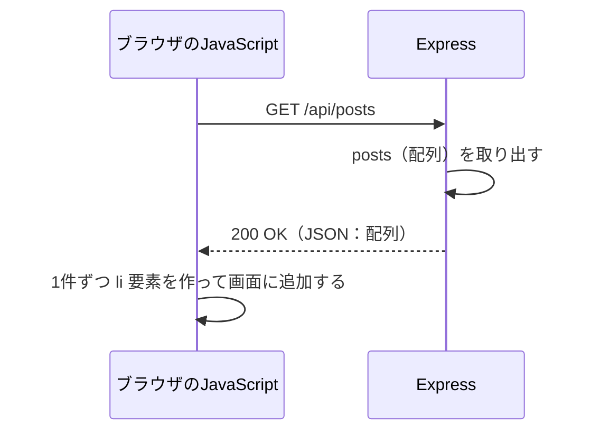

# 第14回　REST API

## 1. 今日のゴール

- URLで投稿（資源）を表し、HTTPメソッド（GET・POST）で操作するAPIを作れる
- `res.json` でJSONを返し、`express.json` でJSONを受け取れる
- ステータスコード（200・201・400・404）の意味を説明し、使い分けられる
- ブラウザのJavaScript（`fetch`）でAPIを呼び、一覧の表示と、フォームからの投稿ができる

## 2. 教科書の該当節

| 節 | 見出し | 読み方 |
|---|---|---|
| 6.2 | Expressの必須機能 | ★ 今日の 4.2〜4.4（JSONの受け取りと返し方） |
| 6.3 | 包括的エラーハンドリング | ★ 今日の 4.4 と 4.7（ステータスコードとエラーの返し方） |

教科書の目次の中で、今日の場所はここ（★が今日）。

| 章・節 | 見出し | この授業では |
|---|---|---|
| **6章** | **ExpressによるREST APIサーバー／Webサーバー** | |
| 6.2 | Expressの必須機能 | ★ 今日（JSON） |
| 6.3 | 包括的エラーハンドリング | ★ 今日（ステータスコード） |

> 教科書との対応は、目次の見出しだけを見て決めた節単位である。本文の内容は、教科書で確認しておくこと。

## 3. 前回のふりかえり

**Q1.** フォームで投稿に成功したとき、サーバーは `res.redirect("/posts")` で、どのステータスコードを返すか。

**Q2.** `express.urlencoded` を書かないと、フォームの投稿で `req.body` は何になるか。

---

## 4. 解説と例題

### 4.1 REST：URLで「もの」を表す

ここまで作ってきたURLは、画面（HTML）を返すものだった。`/posts` は一覧の画面、`/posts/2` は詳細の画面である。

これに対して、プログラムどうしが使うためのURLを**API**と呼ぶ。API の URL は、HTML ではなく、データ（JSON）を返す。

API を設計するときの考え方を、**REST** という。REST では、次の2つを分けて考える。

| 考えること | 掲示板での例 |
|---|---|
| URL で「もの」（資源）を表す | 投稿の集まり：`/api/posts`、1件：`/api/posts/2` |
| HTTP のメソッドで「操作」を表す | GET（取る）、POST（作る）、PUT（直す）、DELETE（消す） |

掲示板のAPIは、次の表のとおり。

| メソッド | URL | すること | 返すもの | 成功のステータス |
|---|---|---|---|---|
| GET | `/api/posts` | 一覧を取る | 投稿の配列（JSON） | 200 |
| GET | `/api/posts/2` | 1件を取る | 投稿1件（JSON） | 200 |
| POST | `/api/posts` | 投稿を作る | 作った投稿（JSON） | 201 |
| PUT | `/api/posts/2` | 直す（発展） | 直した投稿（JSON） | 200 |
| DELETE | `/api/posts/2` | 消す（発展） | なし | 204 |

同じ「投稿」を、画面用の URL（`/posts`）と API 用の URL（`/api/posts`）で分けている。画面の URL は HTML を返し、API の URL は JSON を返す。

### 4.2 `res.json`：JSONで返す

JSON は、第3回で学んだ、データを文字列で書く形式である。Express では、`res.json` で配列やオブジェクトをそのまま JSON にして返せる。

`bbs/app.js`（一覧のAPI）

```js
// 一覧を取得する
app.get("/api/posts", (req, res) => {
  res.json(posts);
});
```

- `res.json(posts)` は、配列を JSON の文字列にして返す。JavaScript の `JSON.stringify` と同じ働き
- 返事の `Content-Type` は `application/json` になる。ブラウザや、プログラムは、この表示を見て JSON だと分かる
- 第9回の `res.send` は、文字列（HTML）を返すための道具。JSON には `res.json` を使う

### 4.3 `express.json`：JSONで受け取る

APIでは、プログラムが JSON で値を送ってくることがある。そのときは、`express.json` を使う。

`bbs/app.js`（前半）

```js
// フォームの値（urlencoded）と、JSON の値の両方を受け取れるようにする
app.use(express.urlencoded({ extended: false }));
app.use(express.json());
```

| 送り方 | 中身の形 | 受け取り方 |
|---|---|---|
| フォーム（HTML） | `name=佐藤&message=...` | `express.urlencoded` が `req.body` に入れる |
| API（JSON） | `{"name":"佐藤","message":"..."}` | `express.json` が `req.body` に入れる |

- 両方とも、受け取った値は `req.body` に入る。だから、投稿を処理する部分は同じ書き方でよい
- JSON で送るときは、`Content-Type: application/json` を付ける（付けないと、`express.json` は読まない）

JSON で送れることを、まず PowerShell から1回だけ確かめよう（画面のフォームから送る方法は、4.6 で作る）。サーバーを起動してから、次のコマンドを実行する。

```powershell
Invoke-RestMethod -Method Post -Uri http://localhost:3000/api/posts -ContentType "application/json; charset=utf-8" -Body '{"name":"田中","message":"よろしく"}'
```

返ってきた内容（`id`、`name`、`message`、`created_at`）が、そのまま表示される。`/api/posts` を開くと、一覧の最後に増えている。

### 4.4 ステータスコード：結果を番号で伝える

APIは、結果を**ステータスコード**で伝える。プログラムは、本文より先にステータスコードを見て、次の動きを決める。

| コード | 意味 | 掲示板での例 |
|---|---|---|
| 200 OK | 成功（取れた） | 一覧、1件の取得 |
| 201 Created | 成功（作られた） | 投稿が作られた |
| 400 Bad Request | 送られた内容が正しくない | 名前が空 |
| 404 Not Found | そのものが見つからない | `/api/posts/9` |

```js
// 投稿する。成功したら 201（作成された）と、作った投稿を返す
app.post("/api/posts", (req, res) => {
  // （入力チェック）
  if (name === "" || message === "") {
    res.status(400).json({ error: "名前と本文を入力してください" });
    return;
  }
  // （投稿を作る）
  res.status(201).json(post);
});
```

- エラーのときも、`{ "error": "..." }` の形の JSON を返す。プログラムが、メッセージを取り出せるようにするため
- 画面の投稿（第13回）は、400 のときに HTML を返した。API は JSON を返す。同じ判断でも、返す形が違う

> **動かしてみよう**
> 1. `http://localhost:3000/api/posts/9` を開く。ステータス 404 と、JSON のエラーを確かめる（開発者ツールの「ネットワーク」で確認できる）
> 2. PowerShell で、`name` を空にして投稿する。400 のエラーになることを確かめる

### 4.5 ブラウザのJavaScriptからAPIを呼ぶ：一覧を表示する

ここからは、ブラウザの中で動くJavaScriptを書く。`/api/posts` を呼び、取得した投稿を画面に表示する。第7回の `fetch` と、第4回の `forEach` を使う。

`bbs/public/api-list.js`（一覧を表示する部分）

```js
const list = document.querySelector("#api-list");

// 投稿1件を、<li>にして一覧に追加する（文字はtextContentで入れる）
function addItem(post) {
  const item = document.createElement("li");
  item.textContent = `${post.name}：${post.message}`;
  list.appendChild(item);
}

// 一覧を取得して表示する
async function showPosts() {
  // 1. APIに問い合わせる
  const response = await fetch("/api/posts");
  // 2. 返ってきたJSONを、JavaScriptの配列にする
  const posts = await response.json();
  // 3. 1件ずつ、画面に追加する
  posts.forEach((post) => {
    addItem(post);
  });
}

showPosts();
```

| 書いたもの | 意味 |
|---|---|
| `fetch("/api/posts")` | APIに問い合わせる（第7回） |
| `response.json()` | 返ってきたJSONを、JavaScriptの配列やオブジェクトにする |
| `document.querySelector("#api-list")` | HTMLの `id="api-list"` の要素を探す |
| `document.createElement("li")` | 新しい `<li>` を作る |
| `item.textContent = ...` | 文字として入れる（HTMLとしては解釈しない） |

`api-list.js` は、`views/api-view.ejs` の中で、`<script src="/api-list.js"></script>` として読み込まれる。`/api-view` を開くと、一覧が表示される。

- `app.js` はサーバー（Node.js）で動く。`public/api-list.js` は、ブラウザに送られて、**ブラウザの中で動く**。同じJavaScriptでも、動く場所が違う
- `textContent` と、`innerHTML` の違いに注意する。`innerHTML` に投稿の文字を入れると、第10回の `<%- %>` と同じく、書かれたHTMLやスクリプトが実行されてしまう。投稿は必ず `textContent` で入れる

シーケンス図で流れを確かめよう。



- 画面（HTML）は、Expressが作って送る。一覧の中身は、ブラウザのJavaScriptが、後から取りに行って作る
- 第9回の図と比べると、「返すのがHTMLではなくJSON」であるところが違う

### 4.6 ブラウザのJavaScriptから投稿する

次に、画面のフォームから、APIに投稿する。第13回のフォームは、ブラウザが値を送り、ページごと移動した。今回は、JavaScriptが `fetch` で送り、**ページは移動しない**。

`bbs/views/api-view.ejs`（フォームの部分）

```ejs
  <form id="api-form">
    <p><label>名前：<input type="text" id="api-name"></label></p>
    <p><label>本文：<input type="text" id="api-message" size="40"></label></p>
    <button type="submit">APIで投稿する</button>
  </form>
```

`bbs/public/api-list.js`（投稿する部分）

```js
const form = document.querySelector("#api-form");

// 「APIで投稿する」が押されたら、APIにPOSTで送る
form.addEventListener("submit", async (event) => {
  // 1. ブラウザがふつうに送信して、ページが移動するのを止める
  event.preventDefault();

  // 2. 入力された値を、JSONにして送る
  const name = document.querySelector("#api-name").value;
  const message = document.querySelector("#api-message").value;
  const response = await fetch("/api/posts", {
    method: "POST",
    headers: { "Content-Type": "application/json" },
    body: JSON.stringify({ name, message }),
  });

  // 3. 返ってきた投稿を、一覧に追加する
  const post = await response.json();
  addItem(post);
  form.reset();
});
```

| 書いたもの | 意味 |
|---|---|
| `form.addEventListener("submit", 関数)` | フォームが送信されるときに呼ぶ関数を登録する（第4回の「関数を渡す」と同じ形） |
| `event.preventDefault()` | ブラウザのふつうの動き（送信してページを移動する）を止める |
| `document.querySelector("#api-name").value` | 入力欄に入力された文字 |
| `method: "POST"` | POSTで送る（書かないと GET になる） |
| `headers: { "Content-Type": "application/json" }` | 「中身はJSON」と伝える。これがないと、`express.json` は読まない（4.3） |
| `body: JSON.stringify({ name, message })` | オブジェクトを、JSONの文字列にして送る（第3回） |
| `form.reset()` | 入力欄を空に戻す |

- `fetch` の2つ目の引数に、送り方をオブジェクトで渡す。4.3 の PowerShell の `-Method`、`-ContentType`、`-Body` と、同じ3つを指定している
- サーバーの `POST /api/posts` は、作った投稿を JSON で返す（201）。それを `addItem` に渡すので、ページを読み込み直さなくても、一覧に1行増える

| | 第13回のフォーム | 今日のフォーム |
|---|---|---|
| 送るのは | ブラウザ（`method="POST"`） | JavaScript（`fetch`） |
| 送る形 | `name=...&message=...` | JSON |
| サーバーの返事 | 302 で移動（PRG） | 201 と、作った投稿（JSON） |
| 画面 | ページごと読み込み直す | 増えた1行だけを足す |

> **動かしてみよう**
> 1. `/api-view` のフォームで投稿する。ページが移動せずに、一覧に1行増えることを確かめる。開発者ツール（`F12`）の「ネットワーク」で、`POST /api/posts` のステータスが 201 であることを見る
> 2. `/posts` を開く。同じ投稿が、第13回の表にも入っていることを確かめる（保存先は、同じ配列である）
> 3. 名前を空にして投稿する。一覧に `undefined：undefined` と出てしまう。なぜそうなるかを考えよう（問3で直す）

### 4.7 JavaのServletと比べる

| Java（Servlet） | Node.js（Express） |
|---|---|
| `response.setContentType("application/json")` と、JSONを手で作る（または Gson や Jackson を使う） | `res.json(データ)` |
| `response.setStatus(201)` | `res.status(201)` |
| `request.getReader()` で本体を読み、JSONを変換する | `express.json()` が、`req.body` に入れてくれる |
| JavaScript の `fetch` は、Servletと関係がない | `fetch` で、同じサーバーのAPIを呼ぶ |

### 4.8 エラーの読み方：HTMLが返ってきた

ブラウザのJavaScriptが、APIのURLを間違えると、Expressは404のHTMLを返す。そのHTMLを `response.json()` で読むと、次のエラーになる（確認済み）。

```
SyntaxError: Unexpected token '<', "<!DOCTYPE "... is not valid JSON
```

- `Unexpected token '<'` は、「JSONの中に、`<`（HTMLの始まり）が現れた」という意味
- 対策は、URLを確かめること（`/api/posts` と書いたか）。`response.ok` を使えば、うまくいかなかったときに別の処理ができる（問3で扱う）

---

### 4.9 完成したファイル（全体）

この回の終わりの状態は、次のとおり（`examples/bbs` にも入っている）。前の回の続きから作る場合は、変わったところだけを直してもよい。

`bbs/app.js`

```js
const express = require("express");

const app = express();
const port = 3000;

app.set("view engine", "ejs");

// public フォルダの中のファイル（CSSや、ブラウザで動くJavaScript）を、そのままURLで配る
app.use(express.static("public"));

// フォームの値（urlencoded）と、JSON の値の両方を受け取れるようにする
app.use(express.urlencoded({ extended: false }));
app.use(express.json());

// 投稿は、まだメモリの上の配列（サーバーを止めると消える。第15回・16回でデータベースに保存する）
const posts = [
  { id: 1, name: "佐藤", message: "こんにちは。はじめての投稿です", created_at: "2026/11/15 10:30:00" },
  { id: 2, name: "鈴木", message: "今日は暑いですね", created_at: "2026/11/15 11:05:00" },
  { id: 3, name: "高橋", message: "EJSの授業がおもしろい", created_at: "2026/11/15 13:20:00" },
];
let nextId = 4;

// ---- 画面（HTML）----

app.get("/", (req, res) => {
  res.redirect("/posts");
});

function showList(res, status, error, form) {
  res.status(status).render("posts", {
    title: "超簡単掲示板",
    posts,
    error,
    form,
  });
}

app.get("/posts", (req, res) => {
  showList(res, 200, null, { name: "", message: "" });
});

app.post("/posts", (req, res) => {
  const body = req.body ?? {};
  const name = (body.name ?? "").trim();
  const message = (body.message ?? "").trim();
  const form = { name, message };

  if (name === "" || message === "") {
    showList(res, 400, "名前と本文を入力してください", form);
    return;
  }
  if (name.length > 20) {
    showList(res, 400, "名前は20文字以内にしてください", form);
    return;
  }

  posts.push({ id: nextId, name, message, created_at: new Date().toLocaleString("ja-JP") });
  nextId += 1;

  res.redirect("/posts");
});

app.get("/posts/:id", (req, res) => {
  const id = Number(req.params.id);
  const post = posts.find((p) => p.id === id);

  if (post === undefined) {
    res.status(404).send("その投稿は見つかりません");
    return;
  }

  res.render("post", { title: "投稿の詳細", post });
});

// APIを使うページ（一覧も投稿も、ブラウザのJavaScriptが /api/posts を呼んで行う）
app.get("/api-view", (req, res) => {
  res.render("api-view", { title: "APIを使った掲示板" });
});

// ---- API（JSON）----

// 一覧を取得する
app.get("/api/posts", (req, res) => {
  res.json(posts);
});

// 1件を取得する。見つからなければ 404
app.get("/api/posts/:id", (req, res) => {
  const id = Number(req.params.id);
  const post = posts.find((p) => p.id === id);

  if (post === undefined) {
    res.status(404).json({ error: "その投稿は見つかりません" });
    return;
  }

  res.json(post);
});

// 投稿する。成功したら 201（作成された）と、作った投稿を返す
app.post("/api/posts", (req, res) => {
  const body = req.body ?? {};
  const name = (body.name ?? "").trim();
  const message = (body.message ?? "").trim();

  if (name === "" || message === "") {
    res.status(400).json({ error: "名前と本文を入力してください" });
    return;
  }

  const post = { id: nextId, name, message, created_at: new Date().toLocaleString("ja-JP") };
  posts.push(post);
  nextId += 1;

  res.status(201).json(post);
});

app.listen(port, () => {
  console.log(`http://localhost:${port} で待っています`);
});
```

`bbs/views/api-view.ejs`

```ejs
<%- include("partials/header", { title: title }) %>

  <h1><%= title %></h1>
  <p>この一覧は、ブラウザのJavaScriptが <code>/api/posts</code> から取得して表示している。</p>

  <form id="api-form">
    <p><label>名前：<input type="text" id="api-name"></label></p>
    <p><label>本文：<input type="text" id="api-message" size="40"></label></p>
    <button type="submit">APIで投稿する</button>
  </form>

  <ul id="api-list"></ul>
  <script src="/api-list.js"></script>

<%- include("partials/footer") %>
```

`bbs/public/api-list.js`

```js
// /api/posts の投稿を、画面に表示する。フォームからの投稿も、APIで送る
const list = document.querySelector("#api-list");
const form = document.querySelector("#api-form");

// 投稿1件を、<li>にして一覧に追加する（文字はtextContentで入れる）
function addItem(post) {
  const item = document.createElement("li");
  item.textContent = `${post.name}：${post.message}`;
  list.appendChild(item);
}

// 一覧を取得して表示する
async function showPosts() {
  // 1. APIに問い合わせる
  const response = await fetch("/api/posts");
  // 2. 返ってきたJSONを、JavaScriptの配列にする
  const posts = await response.json();
  // 3. 1件ずつ、画面に追加する
  posts.forEach((post) => {
    addItem(post);
  });
}

// 「APIで投稿する」が押されたら、APIにPOSTで送る
form.addEventListener("submit", async (event) => {
  // 1. ブラウザがふつうに送信して、ページが移動するのを止める
  event.preventDefault();

  // 2. 入力された値を、JSONにして送る
  const name = document.querySelector("#api-name").value;
  const message = document.querySelector("#api-message").value;
  const response = await fetch("/api/posts", {
    method: "POST",
    headers: { "Content-Type": "application/json" },
    body: JSON.stringify({ name, message }),
  });

  // 3. 返ってきた投稿を、一覧に追加する
  const post = await response.json();
  addItem(post);
  form.reset();
});

showPosts();
```

---

## 5. 図を読む問題

4.5 のシーケンス図を見て答えよう。

1. `GET /api/posts` を送っているのは、どの登場人物か。
2. 返すものは、HTMLか、それともJSONか。
3. li 要素を作って画面に追加しているのは、どの登場人物か。
4. もし `/api/post`（sがない）と書いてしまったら、ブラウザは何を受け取るか。

---

## 6. 演習（基本）

演習は `bbs` フォルダの中で行う。`app.js` を変えたら、サーバーを `Ctrl + C` で止めてから `node app.js` で起動し直すこと。`public` や `views` の中だけを変えたときは、保存してブラウザを再読み込みすればよい。

### 問1　APIの返事を見る（記述）

ブラウザで、次の3つを開く。開発者ツール（`F12`）の「ネットワーク」で、それぞれの「ステータス」と「Content-Type」を調べ、画面に見えたものと合わせてノートに書く。

- `http://localhost:3000/api/posts`
- `http://localhost:3000/api/posts/2`
- `http://localhost:3000/api/posts/9`

### 問2　名前で絞り込めるAPIにする（`app.js`）

`/api/posts?name=佐藤` のように `name` を付けたときは、その名前の投稿だけを返すようにする。`name` を付けないときは、今までどおり全部を返す。

| 開くURL | 返るもの |
|---|---|
| `/api/posts` | 全部の投稿（200） |
| `/api/posts?name=佐藤` | 佐藤さんの投稿だけの配列（200） |
| `/api/posts?name=山田` | 空の配列 `[]`（200） |

- `app.get("/api/posts", ...)` の中を書き換える。`?` の後ろの値は `req.query.name` で受け取る（第9回）
- 付いていないとき、`req.query.name` は `undefined` になる。`if` で分ける
- 絞り込みは `posts.filter(...)` を使う（第4回）

確かめたら、ノートに答える：`?name=山田` のとき、404 ではなく、200 と空の配列を返すのはなぜか（ヒント：`/api/posts` という「もの」は、あるか、ないか）。

### 問3　投稿のエラーを、画面に出す（`views/api-view.ejs`、`public/api-list.js`）

4.6 の「動かしてみよう」の3で、名前を空にして投稿すると、一覧に `undefined：undefined` と出た。サーバーは 400 と `{ "error": "名前と本文を入力してください" }` を返しているのに、それを投稿として一覧に足しているからである。

400 のときは、一覧に足さずに、エラーの文をフォームの下に表示するよう直す。

1. `api-view.ejs` のフォームの下に、`<p id="api-error" class="error"></p>` を足す
2. `api-list.js` で、`response.json()` の結果を受け取った後、`response.ok` を調べる（第7回）
3. `response.ok` が `false` のときは、`#api-error` の `textContent` に、返ってきた `error` の文を入れて、`return` で終わる
4. 成功したときは、`#api-error` の `textContent` を空の文字（`""`）にしてから、一覧に足す

名前を空にして投稿し、エラーの文が出ること、そのあと正しく投稿すると、エラーの文が消えて一覧に1行増えることを確かめる。

### 問4　一覧に、本文の文字数を付ける（`public/api-list.js`）

`addItem` を変えて、一覧の各行を次のように表示する。

```
佐藤：こんにちは。はじめての投稿です（15文字）
```

- `post.message.length` で文字数を求める
- `item.textContent` に入れる文字列を、テンプレートリテラルで作る（第1回）

### 提出課題（中盤の到達確認）：投稿に「カテゴリ」を足す

第9〜14回のまとめとして、掲示板に機能を1つ足して提出する。授業の中で終わらなかった分は、次回までに仕上げる。

この回の終わりの `bbs` フォルダを、`bbs-report` という名前でコピーし、その中で作業する（`bbs` は、この先の回でも使うので、変えずに残しておく）。

投稿に、**カテゴリ**（`category`）という項目を足す。カテゴリは、「雑談」「質問」「お知らせ」の3つから選ぶ。

**必ず入れること**

| 番号 | 条件 | 使う回 |
|---|---|---|
| ① | 最初からある3件の投稿に、`category` を足す | 第11回 |
| ② | `/posts` のフォームに、カテゴリを選ぶ `<select name="category">` を足す。エラーで戻ったときも、選んだものが残る | 第13回 |
| ③ | サーバーで入力チェックをする。3つ以外の値が送られたら、400 と「カテゴリを選んでください」を返す | 第13回 |
| ④ | 一覧の表と、詳細ページに、カテゴリを表示する | 第11・12回 |
| ⑤ | `POST /api/posts` でも `category` を受け取り、同じ入力チェックをする。`GET /api/posts` の JSON にも `category` が入る | 第14回 |

ヒント：

- 3つのカテゴリは、`const CATEGORIES = ["雑談", "質問", "お知らせ"];` のように配列にしておく。入力チェックは `CATEGORIES.includes(category)` で書ける。`配列.includes(値)` は、配列の中にその値があれば `true`、なければ `false` になる
- `<select>` の中身は、`CATEGORIES` をテンプレートに渡して、`forEach` で `<option>` を作るとよい。選んだものを残すには、`<option value="..." <%= c === form.category ? "selected" : "" %>>` と書く。`条件 ? 値1 : 値2` は、条件が正しければ値1、そうでなければ値2になる書き方（三項演算子）である。ここでは、選んだカテゴリの `<option>` にだけ `selected` と出力される
- 画面の投稿（`POST /posts`）と、API の投稿（`POST /api/posts`）の両方を直すこと。片方だけ直すと、カテゴリのない投稿ができてしまう

注意：⑤を入れると、`/api-view` のフォームは、カテゴリを送っていないので、投稿が 400（「カテゴリを選んでください」）になる。これは、入力チェックが正しく働いている結果である。問3を済ませていれば、エラーの文が画面に出る。

できた人は、`/api-view` のフォームにもカテゴリの `<select>` を足し、`fetch` で送る JSON に `category` を入れて、投稿できるように直そう（必須ではない）。

**提出するもの**

1. `bbs-report` フォルダ（`node_modules` フォルダは入れない。第9回）
2. 次の3つを書いたテキストファイル（`readme.txt`）
   - ①〜⑤のうち、できたものの番号
   - 確かめ方（開いたURLや、入力した値と、その結果）
   - 工夫したところ、むずかしかったところ

---

## 7. 演習（発展）

### 発展1　PUT（直す）とDELETE（消す）を作る

`/api/posts/:id` に、次の2つを追加する。

- `PUT`：本文（`req.body`）の `name` と `message` で、投稿を直す。成功したら200と、直した投稿を返す。見つからなければ404を返す
- `DELETE`：投稿を配列から消す。成功したら `204`（中身なし）を返す。見つからなければ404を返す

ヒント：

- `app.put("/api/posts/:id", ...)`、`app.delete("/api/posts/:id", ...)` と書く
- 配列の中の位置は `posts.findIndex((p) => p.id === id)` で求められる（`find` の位置を返す版。この回で初めて使う）。`-1` なら見つからない
- 消すには `posts.splice(位置, 1)` を使う。`splice` は、途中の要素を取り除くメソッドである（第3回の `pop` は最後の1つだけ）
- `204` のときは `res.status(204).end()` と書く（中身を返さない）
- 直す・消すを、PowerShell（`Invoke-RestMethod -Method Put` と `-Method Delete`）で確かめる

### 発展2　画面に「消す」ボタンを付ける

発展1の `DELETE` を、`/api-view` の画面から呼ぶ。一覧の各行に「消す」ボタンを付け、押すと、その投稿が消えるようにする。

- `addItem` の中で、`document.createElement("button")` でボタンを作り、`textContent` を「消す」にして、`item.appendChild(button)` で行に足す
- ボタンに `button.addEventListener("click", async () => { ... })` で、押されたときの関数を登録する
- 関数の中で、`` fetch(`/api/posts/${post.id}`, { method: "DELETE" }) `` を呼ぶ。`response.ok` が `true` なら、`item.remove()` で、その行を画面から消す
- 204 は中身がないので、`response.json()` は呼ばない

---

## 8. まとめ

| キーワード | ひとこと |
|---|---|
| REST | URLで「もの」を表し、メソッドで操作する |
| `res.json(データ)` | JSONで返す。`Content-Type` は `application/json` |
| `express.json()` | JSONで届いた値を、`req.body` に入れる |
| `res.status(201)` / `400` / `404` | 作られた／内容が不正／見つからない |
| `fetch` と `response.json()` | ブラウザのJavaScriptが、APIを呼んで、JSONを受け取る |
| `fetch(URL, { method: "POST", ... })` | ブラウザのJavaScriptから、JSONで投稿する |
| `addEventListener("submit", 関数)` | フォームが送信されるときに呼ぶ関数を登録する |
| `textContent` | 画面に文字として入れる（HTMLとして解釈させない） |

**次回**：PostgreSQLへの接続とCRUD。掲示板の投稿を、メモリの配列ではなく、データベースに保存する。データベースは、各自のPCに入れて使う。
