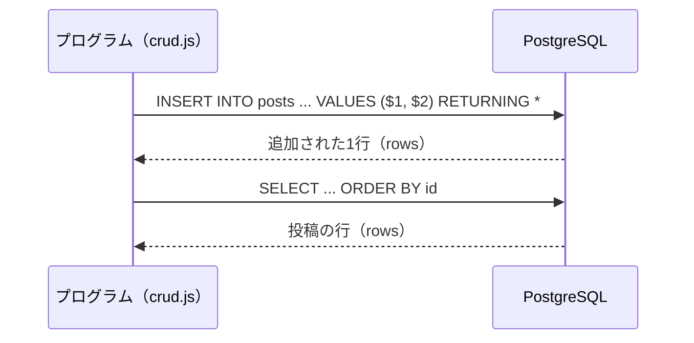

# 第15回　PostgreSQLへの接続とCRUD

## 1. 今日のゴール

- `pg` ライブラリで、PostgreSQL に接続できる
- 接続情報を `.env` に分け、Git に入れないようにできる
- `SELECT`・`INSERT`・`UPDATE`・`DELETE` を、JavaScriptから実行できる
- `$1`、`$2`（プレースホルダ）を使う理由と、SQLインジェクションの危なさを説明できる

## 2. 教科書の該当節

この回は、教科書の中心の節を使わない。教科書6.4（データベース連携）は、例がRedisを使うため、この授業では扱わない。データベースの書き方は、この回の教材（補足資料）で学ぶ。

| 章・節 | 見出し | この授業では |
|---|---|---|
| 6.4 | データベース連携 | 扱わない（教科書の例はRedisを使うため。授業ではPostgreSQLを使う） |
| 6.7〜6.8 | ルーティングとファイル分割 | 第16回で、考え方だけ参照する |

> 教科書との対応は、目次の見出しだけを見て決めた。この回の内容は補足資料である。

## 3. 前回のふりかえり

**Q1.** `res.json(データ)` と `res.send(文字列)` は、それぞれ何を返すための道具か。

**Q2.** 投稿（API）が成功して、新しい投稿が作られたときに返すステータスコードは何か。

**Q3.** （以前の授業で習った SQL の思い出し）`posts` という表から、`id` が 2 の行だけを取り出す SQL を書こう。列は、すべて取り出してよい。

---

## 4. 解説と例題

### 4.1 配列は、サーバーを止めると消える

第13回と第14回の掲示板は、投稿を配列（メモリ）に入れていた。サーバーを `Ctrl + C` で止めると、投稿はすべて消える。

そこで、投稿を**データベース**に保存する。データベースは、サーバーを止めても、データを残しておける。この授業では、**PostgreSQL**（ポストグレス）を使う。

Javaでは、JDBC で `Connection` を作り、`PreparedStatement` で SQL を実行した。Node.js では、`pg` というライブラリで同じことをする。

### 4.2 準備：PostgreSQL と、データベースを用意する

この授業では、各自のPCに PostgreSQL を入れて使う（グループ開発でも、各自のPCのDBを使う）。インストールの手順は、教員が配布した資料に従う。

インストールしたら、次の2つを用意する。

| 用意するもの | 名前（この授業の例） |
|---|---|
| データベース（入れ物） | `node_bbs` |
| 接続するユーザー | `postgres`（インストール時に決めたパスワードを使う） |

データベースは、pgAdmin の画面から作れる。または、`psql` で次のように作る。

```sql
CREATE DATABASE node_bbs;
```

> パスワードは、他人に教えない。Git に入れない（4.3 の `.env` で扱う）。

### 4.3 接続情報を `.env` に分ける

接続するための情報（住所、ユーザー名、パスワード）は、プログラムの中に直接書かない。`.env` というファイルに分ける。

`.env.example` を、`.env` という名前でコピーし、自分の値を書く。

```
PGHOST=localhost
PGPORT=5432
PGUSER=postgres
PGPASSWORD=自分のパスワード
PGDATABASE=node_bbs
```

- `.env` は、Git に入れない。`.gitignore` に `.env` が書いてあるので、Git は無視する
- `.env.example` には、本当のパスワードを書かない。見本として、Git に入れてよい
- 今回のフォルダで、`npm install` を実行しておく（`pg` と `dotenv` が入る）

`db.js` は、接続の準備をしている。

`db.js`

```js
// 接続（Pool）を1つ作り、ほかのファイルから使えるようにする
require("dotenv").config();
const { Pool } = require("pg");

// 接続情報（PGHOST、PGUSER、PGPASSWORD、PGDATABASE など）は、環境変数から自動で読まれる
const pool = new Pool();

module.exports = pool;
```

| 書いたもの | 意味 |
|---|---|
| `require("dotenv").config()` | `.env` の中身を、環境変数として読み込む |
| `new Pool()` | 接続の置き場（Pool）を作る。接続は、必要なときに作られ、使い回される |
| `module.exports = pool` | ほかのファイルで `require("./db")` と読み込んで使う |

- Pool は、JDBC の接続プール（DataSource）と同じ考え方
- `pool.query(...)` で SQL を実行する。接続を取り出して、使い終わると戻すのは、Pool がしてくれる

### 4.4 テーブルを作る：`schema.sql` と `init-db.js`

テーブルは、表（行と列）の形を決めたものである。掲示板の投稿の表は、次のとおり。

`schema.sql`

```sql
-- 掲示板の投稿を入れる表（テーブル）
CREATE TABLE IF NOT EXISTS posts (
  id SERIAL PRIMARY KEY,
  name TEXT NOT NULL,
  message TEXT NOT NULL,
  created_at TIMESTAMP NOT NULL DEFAULT CURRENT_TIMESTAMP
);
```

| 書いたもの | 意味 |
|---|---|
| `CREATE TABLE posts` | `posts` という表を作る |
| `id SERIAL PRIMARY KEY` | 番号。1、2、3…と自動で増える。行を見分ける主キー |
| `name TEXT NOT NULL` | 名前。文字。空（NULL）は入れられない |
| `created_at TIMESTAMP ... DEFAULT CURRENT_TIMESTAMP` | 日時。省略すると、今の時刻が入る |
| `IF NOT EXISTS` | すでに表があれば、作らない（何回実行しても安全） |

`init-db.js` は、この SQL ファイルを読んで、実行する。

`init-db.js`

```js
// schema.sql を読んで、posts テーブルを作る（何回実行しても、すでにあれば作らない）
const fs = require("fs");
const pool = require("./db");

async function main() {
  const sql = fs.readFileSync("schema.sql", "utf8");
  await pool.query(sql);
  console.log("posts テーブルを用意しました");
  await pool.end();
}

main().catch((error) => {
  console.error("エラー：", error.message);
  pool.end();
});
```

```powershell
node init-db.js
```

- `psql` が使えないときも、この方法でテーブルを作れる
- `pool.end()` は、最後に接続を閉じる。閉じないと、プログラムが終わらない

### 4.5 CRUD：一覧・登録・更新・削除

データベースの基本の4つの操作を、CRUD と呼ぶ（Create、Read、Update、Delete）。SQL と、JavaScript の関数の対応は次のとおり。

| 操作 | SQL | JavaScript の関数（`crud.js`） |
|---|---|---|
| 一覧（Read） | `SELECT ... FROM posts ORDER BY id` | `listPosts()` |
| 登録（Create） | `INSERT INTO posts (name, message) VALUES ($1, $2)` | `addPost(name, message)` |
| 更新（Update） | `UPDATE posts SET message = $2 WHERE id = $1` | `updatePost(id, message)` |
| 削除（Delete） | `DELETE FROM posts WHERE id = $1` | `deletePost(id)` |

`crud.js` の一部（登録）を見てみよう。

```js
// 登録（INSERT）。$1、$2 に値を入れる（プレースホルダ）。RETURNING * で、入った行を返す
async function addPost(name, message) {
  const result = await pool.query(
    "INSERT INTO posts (name, message) VALUES ($1, $2) RETURNING *",
    [name, message]
  );
  return result.rows[0];
}
```

| 書いたもの | 意味 |
|---|---|
| `$1`、`$2` | 値を入れる場所（プレースホルダ）。値は、2つ目の引数の配列の順に入る |
| `[name, message]` | `$1` に `name`、`$2` に `message` が入る |
| `RETURNING *` | 登録した行を、そのまま返してもらう（作られた `id` が分かる） |
| `result.rows` | 返ってきた行の配列。`result.rows[0]` は1行目 |

削除では、`result.rowCount`（消せた件数）を使う。`UPDATE` と `DELETE` の結果も、`rows` と `rowCount` で受け取る。

### 4.6 プレースホルダ：`$1` を使う理由（SQLインジェクション）

値を、SQLの文字に直接つなげると、危ないことが起きる。

```js
// 危ない書き方（つなげて作る）
const name = req.body.name;
pool.query(`SELECT * FROM posts WHERE name = '${name}'`);
```

もし、入力された名前が `' OR '1'='1` だったら、SQLは次のようになる。

```sql
SELECT * FROM posts WHERE name = '' OR '1'='1'
```

`'1'='1'` は、いつも正しい。だから、全部の投稿が表示されてしまう。これを **SQLインジェクション** という。SQLの文を、入力の値で書き換えられてしまう攻撃である。

プレースホルダを使うと、値は「文字」として扱われ、SQLの文の一部にはならない。

```js
// 安全な書き方（プレースホルダ）
pool.query("SELECT * FROM posts WHERE name = $1", [name]);
```

- 値は、必ず `$1`、`$2` と書き、2つ目の引数に渡す
- SQLの文を、テンプレートリテラル（`` ` ``）で、値を入れて作らない

> ここで、自分たちのPCのDBで、わざと危ない書き方を試すことはしない。危なさは、上の SQL を読んで、なぜ全部表示されるかを説明できればよい。

### 4.7 コンソールで試す：`main.js`

`main.js` は、一覧・登録・更新・削除を順に試すプログラムである。

`main.js`

```js
// コンソールで、一覧・登録・更新・削除を順に試す
const pool = require("./db");
const { listPosts, addPost, updatePost, deletePost } = require("./crud");

async function main() {
  console.log("--- 最初の一覧 ---");
  console.table(await listPosts());

  const added = await addPost("田中", "よろしくお願いします");
  console.log(`--- 登録しました（id=${added.id}）---`);

  const updated = await updatePost(added.id, "よろしくお願いします（直しました）");
  console.log(`--- 更新しました：${updated.message} ---`);

  const count = await deletePost(added.id);
  console.log(`--- 削除した件数：${count} ---`);

  console.log("--- 最後の一覧 ---");
  console.table(await listPosts());

  await pool.end();
}

main().catch((error) => {
  console.error("エラー：", error.message);
  pool.end();
});
```

```powershell
node main.js
```

- 最後の一覧は、登録した投稿が消えているので、最初の一覧と同じになる
- `console.table` は、配列を表のように表示する

シーケンス図で、プログラムとデータベースのやりとりを確かめよう。



### 4.8 JDBCと比べる

| JDBC（Java） | pg（Node.js） |
|---|---|
| `Connection` | `Pool`（必要なときに接続を借りる） |
| `PreparedStatement` と `?` | `pool.query(SQL, [値])` と `$1`、`$2` |
| `ResultSet` | `result.rows`（配列） |
| `executeUpdate` の戻り値（件数） | `result.rowCount` |

### 4.9 よく出るエラー

次のエラーは、PostgreSQL に接続するときによく出る。読み方を知っておこう。

| エラー（の一部） | 意味 | 対策 |
|---|---|---|
| `password authentication failed` | パスワードが違う | `.env` の `PGPASSWORD` を確かめる |
| `database "node_bbs" does not exist` | データベースを作っていない | 4.2 で `node_bbs` を作る |
| `relation "posts" does not exist` | テーブルを作っていない | `node init-db.js` を実行する |
| `ECONNREFUSED` | PostgreSQL が動いていない | PostgreSQL のサービスを起動する |

---

## 5. 図を読む問題

4.7 のシーケンス図を見て答えよう。

1. `INSERT` を送っているのは、どの登場人物か。
2. `rows`（行）を返しているのは、どの登場人物か。
3. `$1` と `$2` に入るのは、何か。
4. `SELECT` の返事（`rows`）は、1行か、それとも複数行か。

---

## 6. 演習（基本）

演習は、`examples` フォルダの中で行う。まず `npm install` と、`.env` の作成、`node init-db.js` を済ませておくこと。

### 問1　テーブルを作って、確かめる（記述）

`node init-db.js` を実行して、「posts テーブルを用意しました」と表示されることを確かめる。pgAdmin か `psql` で、`posts` 表の列の名前を、ノートに書く。

### 問2　1件登録して、idを表示する（`add.js`）

`crud.js` の `addPost` を使い、「おはようございます」という投稿を1件登録する。登録した投稿の `id` を表示する。

ヒント：`const { addPost } = require("./crud");` で読み込む。最後に `pool.end()` を書く。

### 問3　本文を直す（`update.js`）

`updatePost` を使い、問2で登録した投稿の本文を変える。変えた後の `message` を表示する。

### 問4　削除して、件数を確かめる（`delete.js`）

`deletePost` を使い、問2の投稿を消す。戻り値（消せた件数）を表示する。次に、存在しない `id`（例：`999999`）で消して、件数が `0` になることを確かめる。

---

## 7. 演習（発展）

### 発展1　SQLインジェクションを、SQLを読んで説明する（記述）

4.6 の危ない書き方で、入力が `' OR '1'='1` のとき、SQL がどうなるかを書く。また、プレースホルダにすると、同じ入力がどう扱われるかを書く（値は「文字」として扱われ、SQLの文を変えられない）。

### 発展2　名前で検索する（`search.js`）

名前で投稿を探す関数 `searchByName(name)` を、`crud.js` に追加する。`SELECT ... WHERE name = $1` を使い、結果の `rows` を返す。

ヒント：`SELECT id, name, message, created_at FROM posts WHERE name = $1 ORDER BY id`。値は `[name]` で渡す。

---

## 8. まとめ

| キーワード | ひとこと |
|---|---|
| `pg` の `Pool` | 接続を作って、使い回す |
| `.env` | 接続情報を書く。Git に入れない |
| `CREATE TABLE` | 表（テーブル）の形を決める |
| `SELECT` / `INSERT` / `UPDATE` / `DELETE` | 一覧・登録・更新・削除 |
| `$1`、`$2` | 値を入れる場所。SQLインジェクションを防ぐ |
| `rows` / `rowCount` | 返ってきた行 / 件数 |

**次回**：超簡単掲示板のDB化。第13回・第14回の掲示板の保存先を、配列からデータベースに置き換える。
