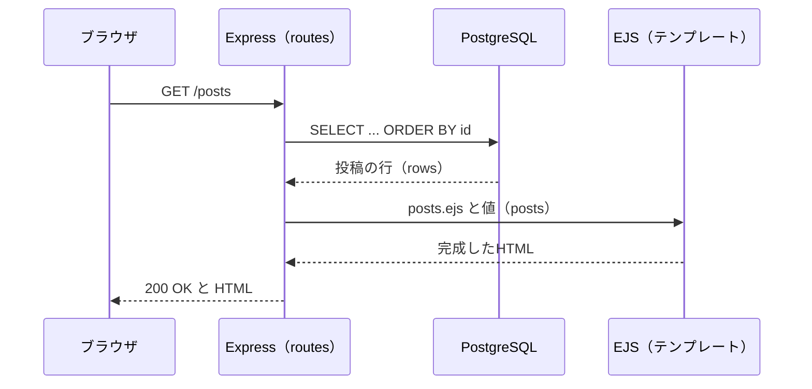

# 第16回　超簡単掲示板のDB化

## 1. 今日のゴール

- 掲示板の保存先を、配列からPostgreSQLに置き換えられる
- 保存の仕事（`posts.js`）と、画面やAPIの仕事（`routes` フォルダ）を分けられる
- `express.Router` で、ルートをファイルごとにまとめられる
- 投稿が、サーバーを止めても残ることを確かめられる

## 2. 教科書の該当節

| 節 | 見出し | 読み方 |
|---|---|---|
| 6.7 | ルーティングとファイル分割の考え方 | 考え方だけ参照する。コードは、この回の掲示板で書き直したものを使う |
| 6.8 | ファイル分割の実践 | 同上 |

教科書の目次の中で、今日の場所はここ。教科書のコードは、この授業の掲示板（PostgreSQL）と違うものがあるので、そのまま写さない。

| 章・節 | 見出し | この授業では |
|---|---|---|
| 6章 | ExpressによるREST APIサーバー／Webサーバー | |
| 6.7〜6.8 | ルーティングとファイル分割 | 考え方だけ参照（今日） |

> 教科書との対応は、目次の見出しだけを見て決めた。本文の内容は、教科書で確認しておくこと。

## 3. 前回のふりかえり

**Q1.** `pool.query("SELECT ... WHERE name = $1", [name])` の `[name]` は、何のために渡すか。

**Q2.** `result.rows` と `result.rowCount` は、それぞれ何を表すか。

---

## 4. 解説と例題

### 4.1 変わるのは「保存先」だけ

第13〜14回の掲示板は、投稿を配列に入れていた。第15回で、データベースに保存する関数（`listPosts`、`addPost` など）を作った。

今日は、掲示板の画面とAPIを、その関数を使うように変える。考え方は、**保存先だけを入れ替える**ことである。

| 場面 | 配列の時（第13〜14回） | データベースの時（今日） |
|---|---|---|
| 一覧 | `posts` を使う | `await listPosts()` |
| 1件 | `posts.find(...)` | `await findPost(id)` |
| 登録 | `posts.push(...)` | `await addPost(name, message)` |
| 画面（EJS）の書き方 | 同じ | 同じ（変えない） |

画面の書き方（`posts.ejs`、`post.ejs`）は、ほとんど変えない。データの出どころが変わるだけだからである。

### 4.2 フォルダを分ける

今日の掲示板は、ファイルを次のように分ける。

```
bbs/
  app.js            … 起動。部品を組み立てて、ルートを付ける
  db.js             … 接続（第15回と同じ）
  posts.js          … 投稿を出し入れする関数（SQLはここだけに書く）
  routes/
    pages.js        … 画面（HTML）のルート
    api.js          … API（JSON）のルート
  views/            … EJS の画面
  public/           … CSS と、ブラウザのJavaScript
  schema.sql        … 表の作成（第15回と同じ）
  init-db.js        … schema.sql を実行する（第15回と同じ）
```

分ける理由は、「どこに何が書いてあるか」がすぐ分かり、直すところが1か所になるためである。

| 役割 | ファイル | Javaでいうと |
|---|---|---|
| 保存の仕事（SQL） | `posts.js` | DAO（データアクセスオブジェクト） |
| 画面とAPIの振り分け | `routes/*.js` | Controller（Servlet） |
| 画面の描画 | `views/*.ejs` | JSP・Thymeleaf |

### 4.3 保存の仕事：`posts.js`

`posts.js` は、SQLを書く場所である。ルート（画面やAPI）からは、関数を呼ぶだけになる。

`bbs/posts.js`（一覧と登録）

```js
// 一覧（SELECT）
async function listPosts() {
  const result = await pool.query("SELECT id, name, message, created_at FROM posts ORDER BY id");
  return result.rows.map(format);
}

// 登録（INSERT）。登録した1件を返す
async function addPost(name, message) {
  const result = await pool.query(
    "INSERT INTO posts (name, message) VALUES ($1, $2) RETURNING id, name, message, created_at",
    [name, message]
  );
  return format(result.rows[0]);
}
```

- 値は、必ず `$1`、`$2` で書く（第15回。SQLインジェクションを防ぐ）
- `format` は、日時（`Date`）を画面に出しやすい文字（`2026/11/15 10:30:00`）に直す

`format` は、次のとおり。

```js
// 日時（Date）を、画面に表示する文字に直す
function format(row) {
  return { ...row, created_at: row.created_at.toLocaleString("ja-JP") };
}
```

- 日時は、データベースから `Date` という形で返ってくる。そのままでは、画面に長い文字（`Sun Nov 15 2026 ...`）が出てしまう
- `...row` は、`row` の中身を全部コピーする（第5回のスプレッド構文）

### 4.4 画面のルート：`routes/pages.js`

`express.Router` は、ルートをまとめる道具である。`app.js` の `app` と同じように `get` や `post` を書けるが、ファイルごとに分けられる。

`bbs/routes/pages.js`（一覧）

```js
const express = require("express");
const { listPosts, findPost, addPost } = require("../posts");

const router = express.Router();

router.get("/posts", async (req, res) => {
  await showList(res, 200, null, { name: "", message: "" });
});

// （中略：投稿、詳細、api-view のルート）

module.exports = router;
```

- `router.get` は、`app.get` と同じ書き方。最後に `module.exports = router` で外に出す
- `app.js` では、`app.use("/", pagesRouter)` で、このルートを付ける

`async` と `await` を、ルートの関数に書く。データベースへの問い合わせは時間がかかるので、結果が来るまで待つ。

```js
router.get("/posts/:id", async (req, res) => {
  const id = Number(req.params.id);
  // 数字でないIDは、データベースに送らず、404にする
  const post = Number.isInteger(id) ? await findPost(id) : undefined;

  if (post === undefined) {
    res.status(404).send("その投稿は見つかりません");
    return;
  }

  res.render("post", { title: "投稿の詳細", post });
});
```

- `Number.isInteger(id)` で、数字かどうかを確かめる。`/posts/abc` のとき、`Number("abc")` は `NaN` になり、データベースに送ると、エラーになるため
- `Number.isInteger(id) ? await findPost(id) : undefined` は、三項演算子（`条件 ? 値1 : 値2`）。数字のときだけ `findPost` を呼び、そうでなければ `undefined` にする（第11回の発展2で初めて使った）
- 見つからなければ、404を返す（第12回と同じ）

### 4.5 API のルート：`routes/api.js`

API のルートは、`routes/api.js` にまとめた。`app.js` で `/api/posts` の下に付けてあるので、ここでは `/` と `/:id` と書く。

`bbs/app.js`（API のルートを付ける部分）

```js
app.use("/api/posts", apiRouter);
```

`bbs/routes/api.js`（一部）

```js
// GET /api/posts：一覧
router.get("/", async (req, res) => {
  res.json(await listPosts());
});

// POST /api/posts：投稿。成功したら 201 と、作った投稿を返す
router.post("/", async (req, res) => {
  // （入力チェック 400）
  const post = await addPost(name, message);
  res.status(201).json(post);
});
```

- `/api/posts` と `/` を合わせると、`GET /api/posts` の URL になる
- 第14回の API と、URL と返事は同じ。違うのは、中身が配列ではなく、データベースだという点

### 4.6 データベースのエラーは、500になる

`async` の関数の中でエラーが起きると、Express 5 はエラーを受け取って、500（サーバーの内部エラー）を返す。

```
（ターミナルに、エラーの内容が表示される）
```

- 500 は、プログラム（またはデータベース）の問題。入力が悪いときは、400 で返す（第13〜14回）
- よく起きるのは、第15回の4.9 のエラー（パスワードの違い、テーブルがない、など）
- 授業では、ターミナルに出るエラーの文を読んで、どこが違うかを確かめる

### 4.7 シーケンス図：ブラウザ・Express・PostgreSQL・EJS

ブラウザからの一覧の表示を、シーケンス図で見てみよう。



- 第9〜12回の図に、データベース（PostgreSQL）が加わった
- データベースは、行（rows）を返すだけで、HTMLは作らない。HTMLを作るのは、EJS である

### 4.8 投稿が残ることを確かめる

この回の大事な確認は、**サーバーを止めても投稿が残る**ことである。

1. `node app.js` で起動し、ブラウザで投稿する
2. `Ctrl + C` で止める
3. もう一度 `node app.js` で起動し、`/posts` を開く

投稿が残っていれば、データベースに保存されている。第13〜14回の配列では、消えていた。

---

### 4.9 完成したファイル（全体）

この回の終わりの状態は、次のとおり（`examples/bbs` にも入っている）。前の回の続きから作る場合は、変わったところだけを直してもよい。

`bbs/app.js`

```js
const express = require("express");
const pagesRouter = require("./routes/pages");
const apiRouter = require("./routes/api");

const app = express();
const port = 3000;

app.set("view engine", "ejs");

// public フォルダの中のファイル（CSSや、ブラウザのJavaScript）を、そのままURLで配る
app.use(express.static("public"));
// フォームの値（urlencoded）と、JSON の値の両方を受け取れるようにする
app.use(express.urlencoded({ extended: false }));
app.use(express.json());

// API（JSON）は /api/posts の下にまとめる
app.use("/api/posts", apiRouter);
// 画面（HTML）は、ほかのすべて
app.use("/", pagesRouter);

app.listen(port, () => {
  console.log(`http://localhost:${port} で待っています`);
});
```

`bbs/posts.js`

```js
// 投稿を、データベース（posts テーブル）に出し入れする関数の集まり
// ルート（routes フォルダ）は、この関数を呼ぶだけで、SQL は書かない
const pool = require("./db");

// 日時（Date）を、画面に表示する文字に直す
function format(row) {
  return { ...row, created_at: row.created_at.toLocaleString("ja-JP") };
}

// 一覧（SELECT）
async function listPosts() {
  const result = await pool.query("SELECT id, name, message, created_at FROM posts ORDER BY id");
  return result.rows.map(format);
}

// 1件（SELECT ... WHERE id = $1）。見つからなければ undefined
async function findPost(id) {
  const result = await pool.query(
    "SELECT id, name, message, created_at FROM posts WHERE id = $1",
    [id]
  );
  return result.rows[0] === undefined ? undefined : format(result.rows[0]);
}

// 登録（INSERT）。登録した1件を返す
async function addPost(name, message) {
  const result = await pool.query(
    "INSERT INTO posts (name, message) VALUES ($1, $2) RETURNING id, name, message, created_at",
    [name, message]
  );
  return format(result.rows[0]);
}

module.exports = { listPosts, findPost, addPost };
```

`bbs/routes/pages.js`

```js
// 画面（HTML）のルート
const express = require("express");
const { listPosts, findPost, addPost } = require("../posts");

const router = express.Router();

// 一覧を描く。エラーがあるときは、入力した値（form）を残す
async function showList(res, status, error, form) {
  const posts = await listPosts();
  res.status(status).render("posts", { title: "超簡単掲示板", posts, error, form });
}

router.get("/", (req, res) => {
  res.redirect("/posts");
});

router.get("/posts", async (req, res) => {
  await showList(res, 200, null, { name: "", message: "" });
});

router.post("/posts", async (req, res) => {
  const body = req.body ?? {};
  const name = (body.name ?? "").trim();
  const message = (body.message ?? "").trim();
  const form = { name, message };

  if (name === "" || message === "") {
    await showList(res, 400, "名前と本文を入力してください", form);
    return;
  }
  if (name.length > 20) {
    await showList(res, 400, "名前は20文字以内にしてください", form);
    return;
  }

  await addPost(name, message);
  res.redirect("/posts");
});

router.get("/posts/:id", async (req, res) => {
  const id = Number(req.params.id);
  // 数字でないIDは、データベースに送らず、404にする
  const post = Number.isInteger(id) ? await findPost(id) : undefined;

  if (post === undefined) {
    res.status(404).send("その投稿は見つかりません");
    return;
  }

  res.render("post", { title: "投稿の詳細", post });
});

router.get("/api-view", (req, res) => {
  res.render("api-view", { title: "APIで読み込んだ一覧" });
});

module.exports = router;
```

`bbs/routes/api.js`

```js
// API（JSON）のルート。app.js で /api/posts の下に付けている
const express = require("express");
const { listPosts, findPost, addPost } = require("../posts");

const router = express.Router();

// GET /api/posts：一覧
router.get("/", async (req, res) => {
  res.json(await listPosts());
});

// GET /api/posts/:id：1件。見つからなければ 404
router.get("/:id", async (req, res) => {
  const id = Number(req.params.id);
  const post = Number.isInteger(id) ? await findPost(id) : undefined;

  if (post === undefined) {
    res.status(404).json({ error: "その投稿は見つかりません" });
    return;
  }
  res.json(post);
});

// POST /api/posts：投稿。成功したら 201 と、作った投稿を返す
router.post("/", async (req, res) => {
  const body = req.body ?? {};
  const name = (body.name ?? "").trim();
  const message = (body.message ?? "").trim();

  if (name === "" || message === "") {
    res.status(400).json({ error: "名前と本文を入力してください" });
    return;
  }

  const post = await addPost(name, message);
  res.status(201).json(post);
});

module.exports = router;
```
---

## 5. 図を読む問題

4.7 のシーケンス図を見て答えよう。

1. `SELECT` を送っているのは、どの登場人物か。
2. 行（rows）を返しているのは、どの登場人物か。
3. HTMLを作っているのは、どの登場人物か。
4. 第9〜12回の図と比べて、新しく加わった登場人物は何か。

---

## 6. 演習（基本）

演習は `bbs` フォルダの中で行う。事前に、第15回と同じ手順（`npm install`、`.env`、`node init-db.js`）を済ませておくこと。

### 問1　投稿が残ることを確かめる（記述）

4.8 の手順で、投稿が残ることを確かめる。残っていた投稿の番号を書き、消えないのはなぜかを、データベースという言葉を使って説明する。

### 問2　詳細ページと、見つからないときを確かめる

`/posts/1` を開き、投稿の詳細が表示されることを確かめる。`/posts/abc` と `/posts/9999` を開き、どちらも「その投稿は見つかりません」と表示されることを確かめる。

ヒント：`/posts/abc` は、データベースに送らず、404になる（4.4 の `Number.isInteger`）。

### 問3　PowerShellで投稿して、一覧で確かめる

第14回と同じ `Invoke-RestMethod` で、APIに投稿する。返ってきた `id` を書き、`/api/posts` の一覧に入っていることを確かめる。

### 問4　API で、数字でないIDを確かめる（記述）

`/api/posts/abc` を開く。ステータスと、返ってきた JSON を書く。また、なぜデータベースに送らないのかを、`Number.isInteger` の役割から説明する。

### 提出課題（後半の到達確認）：DB版の掲示板に、カテゴリ・並べ替え・いいねを足す

第9〜16回のまとめとして、DB版の掲示板に機能を足して提出する。授業の中で終わらなかった分は、宿題として仕上げる。

この回の終わりの `bbs` フォルダを、`bbs-report` という名前でコピーし、その中で作業する（第14回の `bbs-report` とは別のフォルダにする）。`.env` もコピーされていることを確かめる。

課題は3つの段階に分かれている。上の段階は、下の段階ができていることが前提である。

| 段階 | 内容 |
|---|---|
| 基本 | 投稿に「カテゴリ」を足す（第14回の提出課題を、DB版でもう一度作る） |
| 発展A | 一覧を、自分で考えた順番に並べ替えられるようにする |
| 発展S | 「いいね」ボタンを付け、ページを読み直さずに（AJAX で）数を増やす |

#### 基本：投稿に「カテゴリ」を足す（必ず入れること）

カテゴリは、第14回と同じく「雑談」「質問」「お知らせ」の3つから選ぶ。

| 番号 | 条件 | 変えるファイル |
|---|---|---|
| ① | `posts` テーブルに `category` の列を足し、`node init-db.js` を実行する | `schema.sql` |
| ② | 一覧（`SELECT`）で `category` も取り出し、登録（`INSERT`）で `category` も保存する | `posts.js` |
| ③ | `/posts` のフォームに `<select name="category">` を足す。3つ以外の値は 400 と「カテゴリを選んでください」を返す。一覧と詳細に、カテゴリを表示する | `routes/pages.js`、`views` |
| ④ | `POST /api/posts` でも同じ入力チェックをする。`GET /api/posts` の JSON に `category` が入る | `routes/api.js` |

ヒント：

- テーブルはもうあるので、`CREATE TABLE` を書き直しても列は増えない。`schema.sql` の最後に、次の1行を足す。`IF NOT EXISTS` があるので、何回実行してもよい。すでにある投稿は「雑談」になる

```sql
ALTER TABLE posts ADD COLUMN IF NOT EXISTS category TEXT NOT NULL DEFAULT '雑談';
```

- `addPost(name, message)` を `addPost(name, message, category)` に変え、SQL の値は `$3` で渡す（第15回）。SQL の文字に、テンプレートリテラルで値を入れないこと
- `views` の `<select>` と、入力チェックの `CATEGORIES.includes(category)` は、第14回の `bbs-report` と同じ書き方でよい。`CATEGORIES` は `posts.js` に置いて `module.exports` で配ると、`routes/pages.js` と `routes/api.js` の両方で使える

#### 発展A：オリジナルの並べ替え

`/posts?sort=new` のように、`?sort=` の値で一覧の順番を変える。並べ替えは、**番号順のほかに、自分で考えたものを2つ以上**作る。

ヒント：

- `ORDER BY` の後ろ（列の名前や `DESC`）は、`$1` では渡せない。そこで、使ってよい並べ替えを**許可リスト**（オブジェクト）にしておき、その中から選ぶ。`?sort=` の値を、そのまま SQL に入れてはいけない（第15回の SQLインジェクション）

```js
// posts.js：並べ替えの許可リスト（キー：SQL の ORDER BY の後ろ）
const ORDERS = {
  id: "id ASC",
  new: "id DESC",
  // ここに、自分で考えた並べ替えを足す
};

async function listPosts(sort = "id") {
  const order = ORDERS[sort] ?? ORDERS.id;
  // 許可リストの文字だけが入るので、ここは安全
  const result = await pool.query(`SELECT ... FROM posts ORDER BY ${order}`);
  // ...
}
```

- `routes/pages.js` の `GET /posts` では、`Object.keys(ORDERS).includes(req.query.sort)` で、許可リストにあるかを調べる。なければ `"id"` にする
- 一覧の画面に、並べ替えを選ぶフォーム（`<form method="GET" action="/posts">` と `<select name="sort">`）を付ける。選んだものが残るようにする（第14回の `selected` と同じ）
- 並べ替えの例：名前順（`name ASC, id ASC`）、カテゴリ順、本文の長い順（`LENGTH(message) DESC`）。同じ値のときの順番が決まるように、最後に `id` を付けるとよい

#### 発展S：AJAX の「いいね」

`/api-view` の一覧の各投稿に「いいね（0）」ボタンを付ける。押すと、**ページを読み直さずに**、数が1つ増える。数はデータベースに保存し、`/posts` の表にも表示する。

| 番号 | 作るもの | ファイル |
|---|---|---|
| S① | `likes` の列（`INTEGER NOT NULL DEFAULT 0`）を足す | `schema.sql` |
| S② | `likePost(id)`：`UPDATE posts SET likes = likes + 1 WHERE id = $1 RETURNING id, likes`。見つからなければ `undefined` を返す | `posts.js` |
| S③ | `POST /api/posts/:id/like`：増やした後の `{ id, likes }` を JSON で返す。見つからないときと、数字でないIDは 404 | `routes/api.js` |
| S④ | ボタンを押したら `fetch` で S③ に POST し、返ってきた `likes` で、ボタンの文字だけを書き換える | `public/api-list.js` |

ヒント：

- S④ は、第14回 発展2 の「消す」ボタンと同じ形で書ける。`<li>` を作るときに `button` も作り、`button.addEventListener("click", async () => { ... })` の中で `fetch(`/api/posts/${post.id}/like`, { method: "POST" })` を呼ぶ
- 返ってきた JSON の `likes` を使って、`button.textContent = `いいね（${data.likes}）`;` とする。画面の数を自分で `+ 1` するのではなく、データベースの数を表示する
- 押した後、`/posts` を開き直して、表の数が増えていれば、データベースに保存できている

**提出するもの**

1. `bbs-report` フォルダ（`node_modules` フォルダと `.env` は入れない。`.env` にはパスワードが書いてあるため）
2. 次の3つを書いたテキストファイル（`readme.txt`）
   - できたもの（基本の①〜④、発展A、発展S のうち、できたもの）。発展A は、自分で考えた並べ替えの名前も書く
   - 確かめ方（開いたURLや、入力した値と、その結果）
   - 工夫したところ、むずかしかったところ

締め切りに遅れても、提出すれば受け付ける。出さないままにしないこと。

---

## 7. 演習（発展）

### 発展1　API で、PUT（直す）とDELETE（消す）を作る

`posts.js` に、`updatePost(id, message)` と `deletePost(id)` を追加する（第15回の `crud.js` と同じ）。`routes/api.js` に、`router.put("/:id", ...)` と `router.delete("/:id", ...)` を追加する。

- PUT は、直した投稿を 200 で返す。見つからなければ 404
- DELETE は、消せたら 204。見つからなければ 404
- 見つからないのは、`updatePost` や `deletePost` の結果（`undefined` や件数 `0`）で判断する

### 発展2　本文で検索する

`/posts?q=暑い` のように、本文の中の言葉で投稿を探す。`routes/pages.js` の `GET /posts` で、`req.query.q` を受け取る。

- `posts.js` に、`searchPosts(word)` を追加する。SQL は次のように書く。値は必ず `$1` で渡すこと

```sql
SELECT id, name, message, created_at FROM posts
WHERE message ILIKE '%' || $1 || '%' ORDER BY id
```

- `ILIKE` は、大文字と小文字を区別しない検索。`'%' || $1 || '%'` で、前後に `%` を付ける
- 検索の言葉は、テンプレート（`` ` ``）でSQLに入れない（第15回の SQLインジェクション）

---

## 8. まとめ

| キーワード | ひとこと |
|---|---|
| `posts.js` | 投稿を出し入れする関数。SQLはここだけに書く |
| `express.Router()` | ルートをファイルごとにまとめる |
| `app.use("/api/posts", apiRouter)` | ルートを、パスの下に付ける |
| `Number.isInteger` | 数字でないIDを、データベースに送らない |
| `format` | 日時を、画面に出しやすい文字にする |
| 保存先の入れ替え | 画面とAPIは変えず、データの出どころだけを変える |
